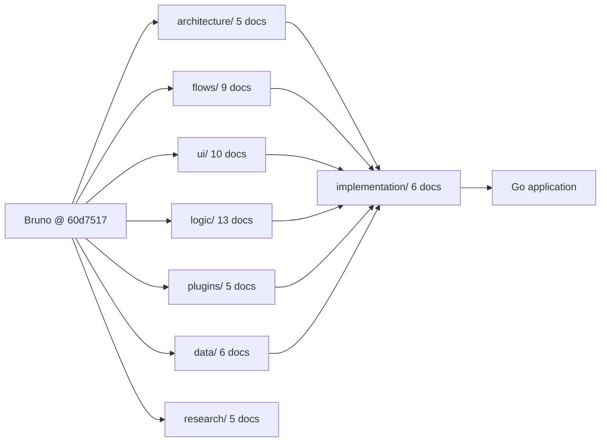

# fearless — Documentation

Technical blueprint for building an independent, **Go-native** HTTP API client inspired by [Bruno](https://github.com/usebruno/bruno).

This is a **research and design** package. No application code exists yet. The goal is that a Go engineer can implement the application from these documents without re-discovering Bruno's architecture.

---

## Ground rules

**Snapshot.** Everything under `architecture/`, `flows/`, `ui/`, `logic/`, `plugins/`, `data/` and `research/` describes Bruno at commit `60d7517d0545ef82c032c10dcbb6a3c815d246cf` (2026-11-09), cloned into `bruno/` at the repository root. Paths starting with `packages/` are relative to that clone.

**Evidence labels.** Every non-trivial claim is marked:

| Label        | Meaning                                                          |
| ------------ | ---------------------------------------------------------------- |
| **VERIFIED** | Directly observed in source code                                 |
| **INFERRED** | Derived from multiple source files, not stated anywhere          |
| **PROPOSED** | Recommendation for the Go implementation                         |
| **UNKNOWN**  | Could not be established; see `research/unresolved-questions.md` |

**Citations.** Significant claims carry:

```text
Source: path/to/file
Relevant symbols: FunctionName, TypeName
```

**Architecture constraint.** The target application is **entirely Go, including the GUI**. No React/Vue/Svelte, no HTML/CSS frontend, no Electron, no Wails. JavaScript appears only as an embedded script runtime for Bruno compatibility (`script:*`, `tests {}`, `assert {}`, PAC). GUI toolkit: **MyGo** (`github.com/egoist/mygo`); component library on top of it: **Lobe MyGo** (`github.com/lobehub/lobe-mygo`).

---

## Reading order

If you are new to this package, read in this order:

1. `architecture/system-overview.md` — the 10-minute picture.
2. `flows/request-lifecycle.md` — the single most important flow.
3. `data/bru-format.md` + `data/collection-format.md` — the on-disk contract.
4. `implementation/go-architecture.md` → `implementation/interface-design.md` → `implementation/package-structure.md`.
5. `implementation/feature-parity-matrix.md` + `implementation/implementation-roadmap.md` — what to build, in what order.
6. `research/limitations.md` — what **not** to copy.

---

## Index

### 1. Architecture — how Bruno is put together

| Document                                                                         | Covers                                                                                                                                                                |
| -------------------------------------------------------------------------------- | --------------------------------------------------------------------------------------------------------------------------------------------------------------------- |
| [`architecture/system-overview.md`](architecture/system-overview.md)             | Process model (Electron main / renderer / preload / CLI), package topology, IPC boundary, and §8 the **Go-only target architecture** including §8.5 the MyGo decision |
| [`architecture/module-breakdown.md`](architecture/module-breakdown.md)           | Responsibility of each of the 17 packages, with entry symbols                                                                                                         |
| [`architecture/dependency-map.md`](architecture/dependency-map.md)               | Which package imports what, external dependency weight, cycle-free layering                                                                                           |
| [`architecture/application-lifecycle.md`](architecture/application-lifecycle.md) | Boot sequence, window creation, IPC registration, collection mount, shutdown                                                                                          |
| [`architecture/design-decisions.md`](architecture/design-decisions.md)           | Observed design decisions and their consequences (verdicts, not guesses)                                                                                              |

### 2. Flows — what happens, step by step

| Document                                                             | Covers                                                                                                                                                             |
| -------------------------------------------------------------------- | ------------------------------------------------------------------------------------------------------------------------------------------------------------------ |
| [`flows/application-startup.md`](flows/application-startup.md)       | Cold start to interactive window                                                                                                                                   |
| [`flows/request-lifecycle.md`](flows/request-lifecycle.md)           | **Core flow.** User action → interpolate → auth → build → transport → redirects/cookies → response → render → timeline. Includes cancellation and failure branches |
| [`flows/response-lifecycle.md`](flows/response-lifecycle.md)         | Parsing, formatting, rendering, storage of the received response                                                                                                   |
| [`flows/collection-lifecycle.md`](flows/collection-lifecycle.md)     | Open, mount, watch, edit, save, reload, close                                                                                                                      |
| [`flows/environment-resolution.md`](flows/environment-resolution.md) | Variable scopes, precedence, inheritance, secrets, prompt variables                                                                                                |
| [`flows/authentication-flow.md`](flows/authentication-flow.md)       | Per-provider application order, OAuth2 interactive and cached paths                                                                                                |
| [`flows/scripting-flow.md`](flows/scripting-flow.md)                 | Pre-request, post-response, tests, assertions, `bru.sendRequest` chaining                                                                                          |
| [`flows/history-flow.md`](flows/history-flow.md)                     | What exists (in-memory timeline, saved examples) and what does not (persistent history)                                                                            |
| [`flows/error-handling.md`](flows/error-handling.md)                 | Error classes, propagation across IPC, user-visible surfaces                                                                                                       |

### 3. UI — what the interface does and why

| Document                                                   | Covers                                                                                                                                        |
| ---------------------------------------------------------- | --------------------------------------------------------------------------------------------------------------------------------------------- |
| [`ui/design-system.md`](ui/design-system.md)               | Tokens, typography, colour, spacing; §7 Go-native design system, §7.2 Lobe MyGo token API and widget mapping                                  |
| [`ui/application-layout.md`](ui/application-layout.md)     | Window regions, three-column body, layout modes, §8 native layout mapping with concrete MyGo constructs                                       |
| [`ui/navigation.md`](ui/navigation.md)                     | Sidebar → tabs → panes navigation model, tab identity and restoration                                                                         |
| [`ui/components.md`](ui/components.md)                     | Bruno component inventory with purpose, state, events, dependencies; §6 the Lobe MyGo component inventory, app mapping and custom-widget list |
| [`ui/request-editor.md`](ui/request-editor.md)             | Method/URL bar, params, headers, body editors, auth, scripts, assertions tabs                                                                 |
| [`ui/response-viewer.md`](ui/response-viewer.md)           | Response tabs, status strip, body viewer, size limits                                                                                         |
| [`ui/collections-sidebar.md`](ui/collections-sidebar.md)   | Tree, context menus, drag-and-drop, environment entries                                                                                       |
| [`ui/environment-selector.md`](ui/environment-selector.md) | Selector, edit/view modes, secret handling                                                                                                    |
| [`ui/settings.md`](ui/settings.md)                         | Preferences panes and the settings each one writes                                                                                            |
| [`ui/interaction-patterns.md`](ui/interaction-patterns.md) | Keyboard shortcuts, focus, drag, confirmation patterns; §12 which interactions Lobe supplies vs. which we build                               |

### 4. Logic — algorithms and edge cases

| Document                                                             | Covers                                                                                                             |
| -------------------------------------------------------------------- | ------------------------------------------------------------------------------------------------------------------ |
| [`logic/http-engine.md`](logic/http-engine.md)                       | Transport architecture, agent selection, proxy/PAC, timeouts, size caps                                            |
| [`logic/request-builder.md`](logic/request-builder.md)               | Merge of collection/folder/request state into a concrete outgoing request                                          |
| [`logic/response-parser.md`](logic/response-parser.md)               | Content-type detection, JSON/XML/text/binary handling, encoding                                                    |
| [`logic/variable-interpolation.md`](logic/variable-interpolation.md) | `{{var}}` resolution algorithm, precedence, dynamic variables, guards                                              |
| [`logic/authentication.md`](logic/authentication.md)                 | Per-provider algorithms (Digest, NTLM, OAuth1/2, SigV4, WSSE, EdgeGrid)                                            |
| [`logic/cookies.md`](logic/cookies.md)                               | Jar semantics, persistence, debounce, clearing                                                                     |
| [`logic/redirects.md`](logic/redirects.md)                           | Redirect following, method rewriting, hop recording                                                                |
| [`logic/tls-and-certificates.md`](logic/tls-and-certificates.md)     | CA override, client certs, precedence matrix, passphrases                                                          |
| [`logic/scripting.md`](logic/scripting.md)                           | Runtime selection, sandbox, `bru`/`req`/`res` API, limits                                                          |
| [`logic/assertions-and-tests.md`](logic/assertions-and-tests.md)     | `test`/`expect`, `assert` expressions, result shape                                                                |
| [`logic/import-export.md`](logic/import-export.md)                   | Postman / OpenAPI / Insomnia / OpenCollection conversion                                                           |
| [`logic/error-management.md`](logic/error-management.md)             | Error taxonomy and mapping to user messages                                                                        |
| [`logic/persistence.md`](logic/persistence.md)                       | Every store on disk, encryption scheme, write path, and the proposed Go persistence design with `BodyRef` spooling |

### 5. Plugins and extensibility

| Document                                                                     | Covers                                                                  |
| ---------------------------------------------------------------------------- | ----------------------------------------------------------------------- |
| [`plugins/extension-architecture.md`](plugins/extension-architecture.md)     | Extension points that actually exist (and the absence of a plugin API)  |
| [`plugins/plugin-system.md`](plugins/plugin-system.md)                       | Verdict: **there is no plugin system**; evidence                        |
| [`plugins/scripting-runtime.md`](plugins/scripting-runtime.md)               | Scripting as the de-facto extension mechanism                           |
| [`plugins/authentication-providers.md`](plugins/authentication-providers.md) | How auth providers are added in Bruno vs. a one-file registration in Go |
| [`plugins/extensibility-proposal.md`](plugins/extensibility-proposal.md)     | Proposed Go-native extensibility architecture                           |

### 6. Data formats — the on-disk contract

| Document                                                   | Covers                                                                                                    |
| ---------------------------------------------------------- | --------------------------------------------------------------------------------------------------------- |
| [`data/collection-format.md`](data/collection-format.md)   | Directory layout, `bruno.json` / `opencollection.yml`, folders, ordering, round-trip fidelity             |
| [`data/bru-format.md`](data/bru-format.md)                 | Full `.bru` grammar: sections, rules (`extends`, `color`), request/collection/folder/environment dialects |
| [`data/environment-format.md`](data/environment-format.md) | `.bru` and `.yml` environment files, secrets, inheritance                                                 |
| [`data/request-schema.md`](data/request-schema.md)         | Canonical request model with every field                                                                  |
| [`data/response-schema.md`](data/response-schema.md)       | Transport result, renderer response object, timeline entry, examples                                      |
| [`logic/persistence.md`](logic/persistence.md)             | App-level stores (preferences, cookies, tokens, secrets, history) — see §4                                |

### 7. Implementation — the Go plan

| Document                                                                                       | Covers                                                                                                                                       |
| ---------------------------------------------------------------------------------------------- | -------------------------------------------------------------------------------------------------------------------------------------------- |
| [`implementation/go-architecture.md`](implementation/go-architecture.md)                       | Layering, state model, typed events, commands, engine boundary, concurrency, persistence, testing, known conflicts                           |
| [`implementation/interface-design.md`](implementation/interface-design.md)                     | Concrete interfaces: commands, engine, sink, events, presenter seam, state actor, codec, extensibility; enforcement rules                    |
| [`implementation/package-structure.md`](implementation/package-structure.md)                   | Package tree, placement rules, interface ownership, naming, anti-patterns                                                                    |
| [`implementation/dependency-recommendations.md`](implementation/dependency-recommendations.md) | GUI framework evaluation and scoring (MyGo / Gio / Fyne / TUI), §1.1.1 the Lobe MyGo component layer, core libraries, exclusions, versioning |
| [`implementation/feature-parity-matrix.md`](implementation/feature-parity-matrix.md)           | Every feature: Bruno implementation, source, Go requirement, complexity, priority, compatibility                                             |
| [`implementation/implementation-roadmap.md`](implementation/implementation-roadmap.md)         | Seven phases with deliverables, acceptance criteria, and testing requirements                                                                |

### 8. Research — evidence and open questions

| Document                                                               | Covers                                                                                  |
| ---------------------------------------------------------------------- | --------------------------------------------------------------------------------------- |
| [`research/source-map.md`](research/source-map.md)                     | Repository map, source/test file counts, entry points                                   |
| [`research/dependencies.md`](research/dependencies.md)                 | External dependency inventory with purpose                                              |
| [`research/test-coverage.md`](research/test-coverage.md)               | Test harnesses, suites as reusable conformance corpora, gaps                            |
| [`research/limitations.md`](research/limitations.md)                   | Product, implementation and portability limitations; the list of deliberate divergences |
| [`research/unresolved-questions.md`](research/unresolved-questions.md) | UQ-B (unproven Bruno behaviour) and UQ-D (decisions needing owner input)                |

---

## Status at a glance



| Area           | Docs                  | State                                               |
| -------------- | --------------------- | --------------------------------------------------- |
| Architecture   | 5                     | complete                                            |
| Flows          | 9                     | complete                                            |
| UI             | 10                    | complete, MyGo mapping integrated                   |
| Logic          | 13                    | complete (incl. `persistence.md`)                   |
| Plugins        | 5                     | complete — documents the absence of a plugin system |
| Data           | 6 (incl. persistence) | complete                                            |
| Implementation | 6                     | complete, Go-only and MyGo-bound                    |
| Research       | 5                     | complete                                            |

### Decisions that need input

Recorded in `research/unresolved-questions.md` §UQ-D. The most consequential:

1. **MyGo binding depth** (UQ-D1) — version-pin and accept deliberate upgrades, vs. an abstraction seam.
2. **Script compatibility target** (UQ-D5) — Node-vm mode or QuickJS safe mode.
3. **`.bru` writer fidelity** (UQ-D4) — byte-exact round-trip vs. semantics-preserving rewrite.
4. **History retention** (UQ-D3) — what to keep and for how long.
5. **v1 scope** (UQ-D6) — confirm gRPC/WS/mock-server/AI/terminal/OpenAPI sync are deferred.

### Known open questions

`research/unresolved-questions.md` §UQ-B lists eight Bruno behaviours that source inspection did not settle — most importantly header merge case-sensitivity (UQ-B1) and the script module allow-list (UQ-B5). Each carries a PROPOSED interim decision so implementation is not blocked.
