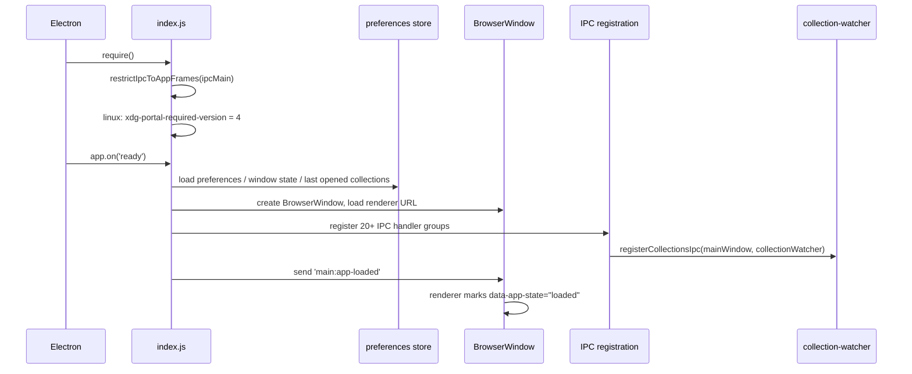
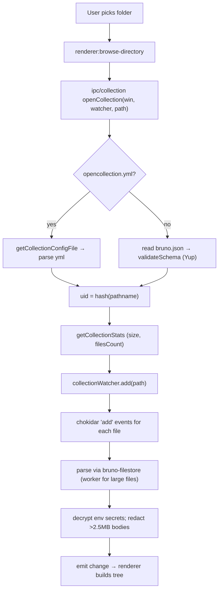

# Application Lifecycle

Status: VERIFIED unless marked. Snapshot `60d7517`.

---

## 1. Main-process boot



Evidence:

| Step | Source |
|---|---|
| `restrictIpcToAppFrames(ipcMain)` **before any registration** | `src/index.js` line ~27 (comment: "Must run before any ipcMain.handle/on registration") |
| `app.on('ready', …)` | `src/index.js` line 209 |
| IPC group registration | `src/index.js` lines 552–568 |
| `main:app-loaded` listener in renderer | `packages/bruno-app/src/pages/Bruno/index.js` |
| Single-instance / deeplink handling | `src/index.js` lines 183–198 (`open-url`, `second-instance`) |

Registered IPC groups (lines 552–568): network, global-environments, collections, yml-migration, preferences, snapshot, workspace, apiSpec, notifications, filesystem, system-monitor, git, openapi-sync, mock-server, AI, AI autocomplete, mount, sqlite, (plus wsdl, terminal, app-document, swagger-fetch).

### Startup ordering constraints

1. `restrictIpcToAppFrames` must run first (security).
2. In dev, the JS sandbox bundle must exist or the process throws (`sandbox/bundle-browser-rollup.js` check at `src/index.js` lines 11–16).
3. Preferences must load before request execution (timeout, cookie flags, proxy).
4. Collections are **not** loaded eagerly in main; the renderer holds the tree.

---

## 2. Renderer boot

```text
index.js
 └─ creates DOM root, mounts <App/>
     └─ providers: ReduxStore → Theme → Toaster → App → Hotkeys → PromptVariables → SetAsVariable
         └─ pages/Main (router: Bruno | ErrorBoundary)
             └─ pages/Bruno
                 ├─ <AppTitleBar/>
                 ├─ <Sidebar/>            (workspaces, collections)
                 ├─ <ManageWorkspace/>    (when workspace manager open)
                 ├─ <RequestTabs/>
                 ├─ <RequestTabPanel/>    (request + response)
                 ├─ <StatusBar/>
                 ├─ <AiChatSidebar/>      (optional)
                 └─ modals: SaveTransientRequest, GlobalSearch, Preferences
```

Source: `packages/bruno-app/src/pages/Bruno/index.js`
Relevant symbols: `Main`, `useGrpcEventListeners`, `useWsEventListeners`, `main:app-loaded` handler

On boot the renderer:

1. Registers gRPC and WS event listeners.
2. Reads preferences from Redux (`state.app.preferences`).
3. Renders a "loading" state (`data-app-state="loading"`) until `main:app-loaded` flips it to `"loaded"` — this avoids layout thrash while Electron sizes the window.
4. Opens previously open collections (rehydrated via IPC / snapshot — see `renderer:get-collection-drift`, `renderer:snapshot:get` calls in the renderer).

---

## 3. Opening a collection



Evidence:

| Step | Source |
|---|---|
| Config resolution | `packages/bruno-electron/src/app/collections.js` `getCollectionConfigFile` (lines 61–88) |
| Validation | `configSchema = Yup.object({...})` line 19, `validateSchema` line 53 |
| UID | `generateUidBasedOnHash(collectionPath)` |
| Watch | `app/collection-watcher.js` (`chokidar`, `MAX_FILE_SIZE = 2.5 * 1024 * 1024`) |
| Ignored paths | `defaultIgnores = ['node_modules', '.git']` (`app/collections.js` line 126) |
| Env secrets | `EnvironmentSecretsStore`, `decryptStringSafe` |
| Large files | `parseLargeRequestWithRedaction` |

---

## 4. Editing and saving

Bruno uses a **draft model**:

1. Any edit in the UI dispatches a reducer that writes `item.draft` (and sets a dirty flag).
2. A debounce autosave middleware (`providers/ReduxStore/middlewares/autosave`) can persist automatically if the preference is on.
3. Explicit save dispatches the `saveRequest` thunk → IPC `renderer:save-request` with the draft → main serializes with `stringifyRequest` → writes file → watcher sees change → emits updated parsed item → renderer reconciles (and clears the draft if identical).

`draftDetectMiddleware` compares draft vs saved to decide "modified" markers on tabs.

Source: `packages/bruno-app/src/providers/ReduxStore/index.js` (`draftDetectMiddleware`, `autosaveMiddleware`, `snapshotMiddleware`)

---

## 5. Shutdown

- Closing the window with unsaved changes triggers `ConfirmAppClose/SaveRequestsModal` (`providers/App/ConfirmAppClose`).
- `SaveRequestsModal` uses hotkey provider state (`showSaveRequestsModal`, `tabUidsToClose`) — see `providers/Hotkeys/index.js`.
- Cookie jar is flushed with a 5 s debounce (`CookiesStore.saveCookieJar`, `DEBOUNCE_MS = 5000` in `store/cookies.js`).
- Workspace/collection watchers are closed on `will-quit` (INFERRED from chokidar usage; no explicit shutdown file was inspected in depth).

---

## 6. Headless lifecycle (CLI)

`bruno-cli` skips the renderer entirely:

```text
bru run <dir> --env <name>
  → load collection (bruno-filestore)
  → resolve environment
  → for each request in order:
        prepareRequest → runPreRequest → execute → runPostScripts
  → reporters (json / junit / html / cli)
```

Confirmed by `packages/bruno-cli/src/runner/*` and the fact that `bruno-cli` depends on the same `bruno-js` and `bruno-requests`.

**Go implication:** the port should ship the same "engine usable without GUI" property as a hard requirement.
