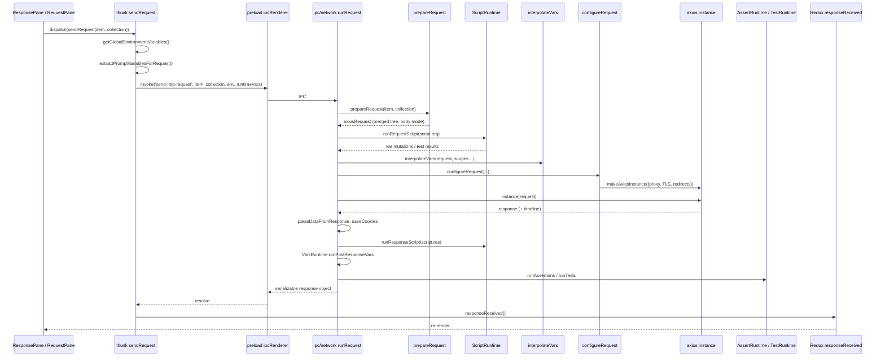
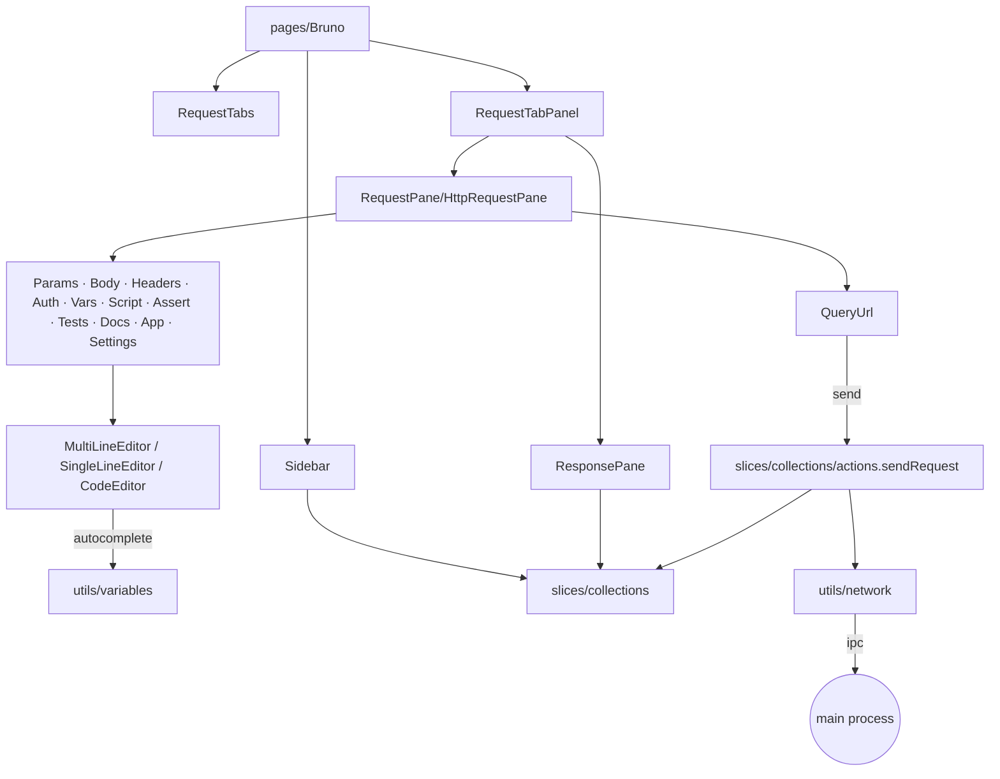

# Dependency Map

Status: VERIFIED unless marked. Snapshot `60d7517`.

This document maps **who depends on whom at runtime**, not just package manifests.

---

## 1. Compile-time package graph

See `research/dependencies.md §1` for the Mermaid graph. Strict ordering:

```text
bruno-lang          (leaf)
bruno-common        (leaf)
bruno-schema-types  (types only)
bruno-query         (leaf)
      │
bruno-requests ──→ bruno-common
bruno-js       ──→ bruno-common, bruno-requests, bruno-query
bruno-filestore ─→ bruno-lang, bruno-schema-types
bruno-converters ─→ bruno-lang, bruno-common, bruno-schema-types
      │
bruno-electron ──→ all of the above + bruno-sqlite + bruno-schema
bruno-app      ──→ bruno-common, bruno-schema (browser-safe only)
bruno-cli      ──→ common, requests, js, filestore, converters
```

**Rule enforced by the codebase:** `bruno-app` must only import packages that build for the browser. `bruno-requests` and `bruno-js` are Node-only in practice (they import `node:http`, `node:vm`, etc.) and are never imported by the renderer.

Verified by construction: `bruno-requests/src/utils/http-https-agents.ts` imports `node:https`; `bruno-app` never lists it in `package.json`.

---

## 2. Runtime call graph — sending a request



Each arrow corresponds to a concrete symbol; see `flows/request-lifecycle.md` for file/line references.

---

## 3. Coupling analysis

### 3.1 Tight couplings inside `bruno-electron`

| A | B | Nature |
|---|---|---|
| `ipc/network/index.js` | `utils/collection.js` | `prepareRequest` calls four `merge*` helpers to flatten the inheritance tree |
| `ipc/network/index.js` | `store/preferences.js` | Cookie toggles, TLS verification, request timeout |
| `ipc/network/index.js` | `utils/oauth2.js` + `store/oauth2.js` | Token acquisition and **token cache** keyed by `credentialsId` |
| `ipc/network/axios-instance.js` | `ui/../authorize-user-in-window.js` | Redirect handler can trigger OAuth2 login — network layer knows about OAuth UI |
| `app/collection-watcher.js` | `bruno-filestore`, `store/env-secrets.js`, `services/snapshot` | Watcher decrypts secrets and stages snapshots while parsing |

The OAuth2-in-redirect coupling is a **known architectural smell**: the HTTP agent code can open a window. A Go port should invert this with an `AuthProvider` that returns an *authorization callback* rather than importing UI.

### 3.2 Loose couplings (good)

| A | B | Mechanism |
|---|---|---|
| Renderer | Main | Solely IPC with serialisable payloads. The response is made JSON-safe in `sendNetworkRequest` (buffer → base64) before entering Redux. |
| `bruno-requests` | Everything else | Pure transport; no collection model |
| `bruno-js` | Collections | Receives a plain `request` object with scope bags (`envVariables`, `collectionVariables`, `folderVariables`, `requestVariables`, `globalEnvironmentVariables`, `oauth2CredentialVariables`, `promptVariables`, `runtimeVariables`) |
| Filestore | `bruno-lang`/`yaml` | Backend switched by `format` string |

Source: `packages/bruno-app/src/utils/network/index.js`
Relevant symbols: `sendNetworkRequest` (comment: "Buffer is encoded as a base64 string, because Buffers / TypedArrays are not allowed in the redux store")

### 3.3 Shared mutable request object

The most important coupling to understand: `runRequest` builds **one mutable `request` object** and passes it through:

```text
prepareRequest → merge* → setAuthHeaders → buildHeaderEntries
      ↓ (same object)
runRequestScript(request)   ← scripts mutate headers/url/vars
      ↓
interpolateVars(request)    ← rewrites url, headers, data, auth fields
      ↓
configureRequest(...)       ← adds cookies, API key, oauth token, interceptors
      ↓
refreshExplicitHeaderNames(request) → axios
      ↓
runPostScripts(request, response)
```

Every stage mutates in place. Consequences:

1. Ordering is load-bearing (e.g. Auth headers must exist before interpolation so `{{vars}}` in credentials resolve; `basic` auth is converted to an `Authorization` header inside `interpolateVars`).
2. `prepare-request.js` has a comment "todo: we have things happening in two places w.r.t basic auth — need to refactor".
3. The post-response stage reads `request.headers` — the response-cache middleware `applySentHeadersToRequest` copies the *actually sent* headers back onto `request`.

Source: `packages/bruno-electron/src/ipc/network/index.js` (line 696 area: `applySentHeadersToRequest(request, response)`)

---

## 4. Renderer internal dependency map



Notable renderer-only utilities:

| Utility | Role |
|---|---|
| `utils/variables` | Builds the variable autocomplete list (scopes, precedence labels) |
| `utils/environments.js` | `resolveEnvironmentInheritance`, `findEnvironmentInCollection` |
| `utils/collections/index.js` | `findCollectionByUid`, `findItemInCollection`, `flattenItems`, `isItemARequest` |
| `utils/responseBodyProcessor.js` | Large-body trimming / format detection for the viewer |
| `utils/codegenerator` + `utils/curl` | Request → code snippet, curl → request |
| `utils/sensitive-fields.js` | Masks fields in UI |
| `utils/importers`, `utils/exporters` | Thin wrappers over IPC to `bruno-converters` |

---

## 5. Dependency risk register

| Risk | Evidence | Impact on port |
|---|---|---|
| `maxRedirects: 0` + hand-rolled redirect loop | `axios-instance.js` line 127 and 260+ | Go `net/http` redirect handling must be **disabled** (`CheckRedirect` returning `ErrUseLastResponse`) and re-implemented to preserve Bruno semantics (301/302/303 → GET, 307/308 preserve, cross-origin auth stripping). |
| OAuth2 cached in main process | `store/oauth2.js`, `utils/oauth2.js` | Go core needs a pluggable credential cache. |
| QuickJS sandbox default | `VarsRuntime`/`ScriptRuntime` default `runtime: 'quickjs'` | Go needs a JS engine; goja is the closest pure-Go match. |
| Interpolation mutates in place | `interpolate-vars.js` | In Go, prefer pure functions returning a new `ResolvedRequest`; do not copy the mutation pattern. |
| FormData recreation on 307/308 | `axios-instance.js` lines ~460–500 | Go: re-open file readers / re-generate `multipart.Writer` on redirect. |
