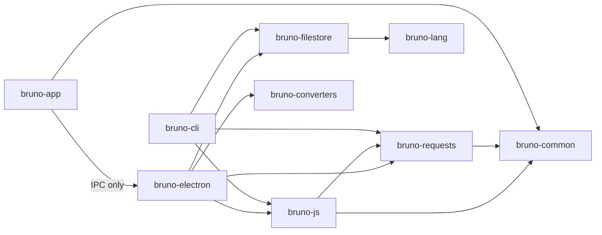

# Module Breakdown

Status: VERIFIED unless marked. Snapshot `60d7517`.

Each module is documented by **responsibility → public/internal API → data it owns → who calls it**.

---

## 1. `bruno-lang` (58 source files)

**Responsibility:** Parse and serialize the `.bru` DSL and `.env` variables.

| Entry | Symbol | Direction |
|---|---|---|
| `v2/src/bruToJson.js` | `bruToJson`, `ohm.grammar('Bru { … }')` | `.bru` → JS object |
| `v2/src/jsonToBru.js` | `jsonToBru` | JS object → `.bru` |
| `v2/src/collectionBruToJson.js` / `jsonToCollectionBru.js` | collection/folder root ↔ DSL | |
| `v2/src/envToJson.js` / `jsonToEnv.js` | `vars` file ↔ object | |
| `v2/src/dotenvToJson.js` | `.env` → variables | |
| `v2/src/example/*` | example request/response blocks | |
| `v1/` | legacy parser (arcsecond) kept for backwards compatibility | |

Grammar shape (representative, VERIFIED from source):

```text
BruFile = (meta | http | grpc | ws | query | params | headers | metadata
          | auths | bodies | varsandassert | script | tests | app
          | settings | docs | example)*
```

- **Dictionary blocks**: `headers { key: value }`, `query { … }`, `auth:basic { … }`
- **Text blocks**: `body:json { … }`, `script:pre-request { … }`, `tests { … }`, `docs { … }`
- **List blocks**: `tags [ smoke, regression ]`
- **Multiline strings**: `'''…'''` inside dictionaries (values) and as annotation args
- **Disabled keys**: a key prefixed `~` (`~content-type: …`) deserializes with `enabled: false`
- **Annotations**: `@description('…')`, `@number`, `@boolean`, `@object` on dictionary entries
- **Quoted keys**: `"key:with:colon": value`

Notes (VERIFIED):
- `meta.seq` defaults to `1`; `meta.type` defaults to `'http'`.
- Tags and list items are restricted to `[alnum _ -]`.
- Value escaping: single-line values run to end of line; `'''` multiline blocks strip 4 spaces of indentation per line.

Who calls it: `bruno-filestore` (its `bru` backend) and `bruno-converters`.

---

## 2. `bruno-filestore` (80 source files)

**Responsibility:** The single façade for reading/writing collection artifacts, independent of format.

Public functions (`src/index.ts`):

```text
parseRequest / stringifyRequest
parseRequestAndRedactBody
parseFolder  / stringifyFolder
parseCollection / stringifyCollection
parseEnvironment / stringifyEnvironment
parseEnvironmentViaWorker / parseRequestViaWorker / stringifyRequestViaWorker
parseFolderViaWorker / parseCollectionViaWorker
```

- Backends under `src/formats/bru` (delegates to `bruno-lang`) and `src/formats/yml` (uses `yaml`).
- `src/workers/WorkerQueue` + `workers/index.ts`: parser runs in **web workers** in the renderer so large collections do not block the UI. There is also a main-process worker pool (`bruno-electron/src/services/pool`).
- `bruRequestParseAndRedactBodyData` + `redactLargeTextBlocks/restoreRedactedBlocks`: requests over ~2.5 MB have body text blocks redacted with placeholders in memory, restored when stringified.
- `parseMockServer.ts`, `mockServerTypes.ts`: mock-server definitions stored alongside collections.
- `maxRedirects.spec.ts` reveals parsing of `settings { maxRedirects: … }`.

Source: `packages/bruno-filestore/src/index.ts`
Relevant symbols: `parseRequest`, `stringifyRequest`, `getWorkerInstance`

---

## 3. `bruno-requests` (63 source files)

**Responsibility:** Everything about *talking to servers*, with no knowledge of collections.

| Area | File | Key symbols |
|---|---|---|
| Axios factory | `src/network/axios-instance.ts` | `makeAxiosInstance` |
| Timeline | `src/utils/timeline-agent.ts` | `TimelineAgent`, `TimelineEntry` |
| Agent cache | `src/utils/agent-cache.ts` | `getOrCreateHttpsAgent`, `getOrCreateHttpAgent` |
| Agents/proxy/TLS | `src/utils/http-https-agents.ts` (642 L) | `getHttpHttpsAgents`, `setupProxyAgents`, `DEFAULT_PORTS` |
| Proxy normalisation | `src/utils/proxy-util.ts` | `transformProxyConfig` (old→new shape) |
| PAC | `src/utils/pac-resolver.ts` | `getPacResolver` |
| CA certificates | `src/utils/ca-cert.ts` | `getCACertificates` |
| URL validation | `src/utils/url-validation.ts` | `isAllowedUrl` (SSRF guard for scripts) |
| Shell env | `src/utils/shell-env.ts` | `getShellEnv` |
| Sent headers | `src/network/sent-headers.ts` | — |
| Response timing | `src/network/response-time.ts` | — |
| Omit Connection | `src/network/omit-connection.ts` | — |
| Cookies | `src/cookies/index.ts` (550 L) | `jar`, `getCookiesForUrl`, `createCookieString` |
| OAuth1 | `src/auth/oauth1-request-authorization.ts` | `applyOAuth1ToRequest` |
| Digest | `src/auth/digestauth-helper.js` | `addDigestInterceptor` |
| NTLM | `src/auth/ntlm.ts` | `NtlmClient` wrapper |
| EdgeGrid | `src/auth/edgegrid-helper.js` | `addEdgeGridInterceptor` |
| Vault | `src/utils/node-vault.ts` | HashiCorp Vault secret reads |
| Scripting bridge | `src/scripting/send-request.ts` (259 L) | `bru.sendRequest` implementation |
| WebSocket | `src/ws/` | `ws-url.ts` etc. |
| gRPC | `src/grpc/` | re-exports `@grpc/grpc-js` glue |

Note: there are **two** `axios-instance` modules — the generic one in `bruno-requests` (`makeAxiosInstance`) and a richer Electron-specific one in `bruno-electron/src/ipc/network/axios-instance.js` that adds timeline recording, localhost/IPv4-IPv6 resolution, proxy agent setup and **manual redirect following**. The Electron one is what the desktop app actually uses for user requests.

Source: `packages/bruno-electron/src/ipc/network/axios-instance.js` (603 L)
Relevant symbols: `makeAxiosInstance`, `completeOpenHop`, `setupProxyAgents`, `redirectCount`, `handleNtlmRedirect`, `isSameOrigin`

---

## 4. `bruno-js` (106 source files)

**Responsibility:** Execute user JavaScript in a sandbox and expose the `bru` API.

| File | Contents |
|---|---|
| `src/bru.js` | `class Bru` — variable scopes, cookies, runner controls, `sendRequest`, `runRequest`, `interpolate`, `utils` |
| `src/bruno-request.js` / `bruno-response.js` | `req` and `res` objects given to scripts |
| `src/header-list.js`, `cookie-list.js`, `readonly-property-list.js` | Array-like helpers |
| `src/runtime/script-runtime.js` | `ScriptRuntime.runRequestScript`, `runResponseScript` |
| `src/runtime/test-runtime.js` | `TestRuntime.runTests` (the `tests {}` block) |
| `src/runtime/assert-runtime.js` (589 L) | `AssertRuntime.runAssertions` (`assert {}` block) |
| `src/runtime/vars-runtime.js` | `VarsRuntime.runPostResponseVars` (`vars:post-response`) |
| `src/sandbox/quickjs/index.js` (240 L) | `executeQuickJsVm`, `executeQuickJsVmAsync` — **default runtime** |
| `src/sandbox/node-vm/index.js` (192 L) + `cjs-loader.js` (734 L) | Alternative sandbox with a CommonJS loader and module whitelist |
| `src/sandbox/bundle-libraries.js` | Bundles lodash/moment/etc. into the QuickJS context |
| `src/unresolved-variables.js` | `trackUnresolvedVariables`, `getUnresolvedVariableCollector` |
| `src/utils/error-formatter.js` | `formatErrorWithContextV2`, source-line mapping for the UI |

Runtime selection (VERIFIED): `collection.brunoConfig.scripts.runtime` → `getJsSandboxRuntime(collection)`; default `'quickjs'` when unset (`VarsRuntime` constructor `props?.runtime || 'quickjs'`).

---

## 5. `bruno-common` (62 source files)

**Responsibility:** Pure helpers shared by main and renderer.

| File | Symbols |
|---|---|
| `src/interpolate/index.ts` (170 L) | `interpolate(str, obj, { escapeJSONStrings, onUnresolved })`, mock `{{$faker}}` handling |
| `src/utils/index.ts` | `encodeUrl`, `hasExplicitScheme`, `DEFAULT_MAX_REDIRECTS`, `buildFormUrlEncodedPayload`, `isFormData`, `getMediaType`, `extractBoundaryFromContentType`, `parseValueByDataType` |
| `src/utils/faker-functions.ts` | `mockDataFunctions` |
| `src/tags/*` | `getEffectiveTags`, `getOwnTags`, `getInheritedTagsFromTreePath`, `isRequestTagsIncluded` |
| `src/runner/*` | collection runner primitives (shared with CLI) |
| `src/generate-code/*` | code snippet generators (curl, js, python…) |
| `src/openapi-sync/*` | OpenAPI drift detection helpers |
| `src/collection/*` | shared collection helpers |
| `src/headers/*` | `refreshExplicitHeaderNames` |

---

## 6. `bruno-electron` (218 source files)

**Responsibility:** The main process: orchestration + privileged I/O.

### 6.1 `ipc/network/index.js` (2320 L) — the heart

| Symbol | Line | Role |
|---|---|---|
| `saveCookies` | 53 | Persist `Set-Cookie` into jar |
| `getJsSandboxRuntime` | 70 | Read `scripts.runtime` from collection config |
| `hasStreamHeaders` | 81 | Detect SSE/stream responses |
| `promisifyStream` | 92 | Buffer a Node stream into a Buffer |
| `configureRequest` | 118 | Agents, OAuth2, AWS/Digest/NTLM/EdgeGrid, cookies, API-key-in-query, timeout |
| `fetchGqlSchemaHandler` | 391 | GraphQL introspection |
| `registerNetworkIpc` | 473 | Handler registration closure |
| `runPreRequest` | 591 | Run pre-request script → interpolate → normalize URL/form bodies |
| `runPostResponse` | 696 | Post-response vars → script |
| `runRequest` | 762 | Full orchestration (see flows) |
| `extractPromptVariablesForRequest` | 1349 | Pre-flight `{{prompt.*}}` detection |
| `ipcMain.handle('send-http-request')` | 1386 | Entry point |
| `ipcMain.handle('cancel-http-request')` | 1440 | Abort via `cancelTokens` |
| `registerAllNetworkIpc` | 2307 | Also registers gRPC/WS |

### 6.2 Supporting modules

| File | Responsibility |
|---|---|
| `ipc/network/prepare-request.js` (558 L) | Merge headers/scripts/vars/auth from tree path; set Content-Type per body mode; read file bodies (stream if >20 MB); produce the `axiosRequest` object |
| `ipc/network/interpolate-vars.js` (427 L) | Resolve `{{…}}` everywhere (URL, headers, body by media type, path params incl. OData, auth fields) |
| `ipc/network/apply-collection-vars.js` | Inject collection-level vars into root context |
| `ipc/network/cert-utils.js` (250 L) | Build `certsAndProxyConfig` from preferences/collection/request |
| `ipc/network/authorize-user-in-window.js` / `…-in-system-browser.js` | OAuth2 authorization-code UI |
| `ipc/network/grpc-*`, `ws-*` | gRPC and WebSocket channels |
| `ipc/collection.js` | Collection CRUD IPC |
| `ipc/filesystem.js` | File/dir dialogs and ops |
| `app/collection-watcher.js` | chokidar watcher → parse via filestore → emit changes; handles env secrets decryption and size redaction |
| `utils/collection.js` | Tree utils: `getTreePathFromCollectionToItem`, `mergeHeaders`, `mergeVars`, `mergeAuth`, `mergeScripts`, `resolveInheritedSettings`, `findItemInCollectionByPathname` |
| `utils/oauth2.js` | Token acquisition for all four grant types, credentials cache, refresh |
| `utils/cookies.js` | Bridge to `tough-cookie` jar |
| `utils/form-data.js` | Build multipart bodies from the UI's entries |
| `utils/parse.js` | Parse/hydrate requests from disk, UID assignment |
| `store/*` | `preferences`, `cookies`, `oauth2`, `env-secrets`, `bruno-config`, `process-env`, `global-environments` |
| `services/pool` | Worker pool for heavy parsing |
| `services/mount` | Filesystem "mount" for non-local collections |
| `services/snapshot` | Git-lite snapshots for diffs / UI state |
| `services/transient` | Unsaved "transient" requests |
| `services/runner-exchange` | Stream runner results (JSON-lines) |

---

## 7. `bruno-cli` (77 source files)

**Responsibility:** Headless test runner.

- `src/runner/run-single-request.js` mirrors `runRequest` without Electron events, writing results with a reporter.
- Shares `bruno-js`, `bruno-requests`, `bruno-filestore`, `bruno-common`.
- Commands: `run`, `import`, `export`, `publish` (per `src/commands/` and `src/index.js`).

This is the best evidence that the request engine is **GUI-independent** — same libraries, different driver.

---

## 8. `bruno-converters` (159 source files)

**Responsibility:** Import/export other API clients.

| Directory | Direction |
|---|---|
| `src/postman` | Postman v2/v2.1 → Bruno; Bruno → Postman |
| `src/insomnia` | Insomnia v4/v5 |
| `src/openapi` | OpenAPI 3 → requests |
| `src/wsdl` | WSDL → requests |
| `src/opencollection` | OpenCollection ⇄ Bruno internal model |

---

## 9. `bruno-schema` / `bruno-schema-types`

- `bruno-schema` — runtime validators (ajv + yup) for `bruno.json` (`configSchema` in `app/collections.js`) and environments.
- `bruno-schema-types` — the **canonical TypeScript model** of an item (`collection/item.ts`), HTTP request (`requests/http.ts`), auth (`common/auth.ts`). This is the most direct reference for the Go structs.

Source: `packages/bruno-schema-types/src/collection/item.ts`, `src/requests/http.ts`, `src/common/auth.ts`

---

## 10. `bruno-app` (1544 source files) — the renderer

Grouped by concern:

| Group | Directory | Notes |
|---|---|---|
| Pages | `src/pages` | `Bruno` is the main shell |
| Feature components | `src/components` | ~110 top-level folders |
| Design primitives | `src/ui` | `Button`, `Select`, `MenuDropdown`, `ContextMenu`, `Tabs`(`ResponsiveTabs`), `Modal`, `MethodBadge`, `StatusBadge` |
| State | `src/providers/ReduxStore` | 13 slices + 5 middleware |
| Cross-cutting providers | `src/providers/{App,Hotkeys,PromptVariables,Theme,Toaster,SetAsVariable}` | |
| Hooks | `src/hooks` | ~35 hooks |
| Non-UI logic | `src/utils` | `network`, `collections`, `environments`, `variables`, `curl`, `codegenerator`, `importers`, `exporters`, `responseBodyProcessor`, `sensitive-fields` |
| Styling | `src/styles`, `src/themes`, Tailwind (`globalStyles.js`) | |

---

## 11. Cross-module dependency direction (summary)



No library imports `bruno-electron` or `bruno-app`; the dependency graph is strictly downward. A Go port should preserve the same shape: `httpengine` must not import GUI packages.
