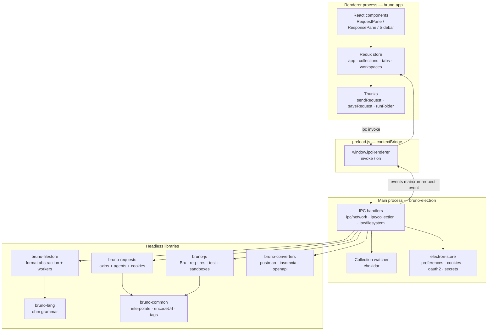
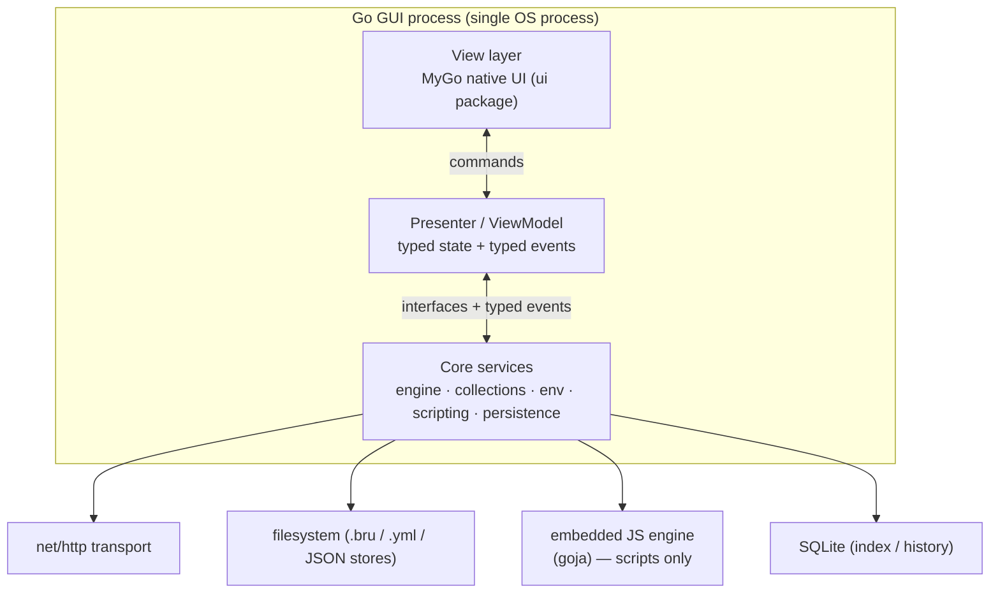

# System Overview

Snapshot: `usebruno/bruno` @ `60d7517` (2026-11-09).

Status: **VERIFIED** unless marked otherwise.

---

## 1. What Bruno is, architecturally

Bruno is a **two-process Electron application** plus a set of **headless packages** reused by a CLI:

1. **Renderer process** (`bruno-app`) — a React 18 single-page app. Owns _all_ UI state and the draft editing experience. Runs with `nodeIntegration` disabled; talks to the main process exclusively through `window.ipcRenderer` exposed by `preload.js` (`contextBridge`).
2. **Main process** (`bruno-electron`) — Node.js. Owns every privileged capability: filesystem access, collection parsing/watching, HTTP execution, cookies, OAuth token exchange, mock servers, git, terminals, AI proxies. All network traffic for HTTP requests happens here.
3. **Headless libraries** — `bruno-lang`, `bruno-filestore`, `bruno-requests`, `bruno-js`, `bruno-common`, `bruno-converters`, `bruno-schema*`. These are format/runtime packages with no Electron dependency and are what a Go port should mirror.

The renderer is **not** where a request is built. The renderer only hands the _collection snapshot + item + resolved environment + runtime variables_ to the main process; the main process resolves inheritance, interpolates variables, applies auth, executes, and returns a serializable response.

Source: `packages/bruno-electron/src/preload.js`
Relevant symbols: `contextBridge.exposeInMainWorld('ipcRenderer', { invoke, send, on })`

Source: `packages/bruno-app/src/utils/network/index.js`
Relevant symbols: `sendHttpRequest`, `sendNetworkRequest`

Source: `packages/bruno-electron/src/ipc/network/index.js`
Relevant symbols: `ipcMain.handle('send-http-request', …)` (line 1386), `runRequest` (line 762)

---

## 2. Layer diagram



---

## 3. The three state worlds

Bruno has **three distinct stores of truth**, and much of the architecture is about keeping them consistent:

| Store                   | Where                                                     | Lifetime                             | Holds                                                                                                                                   |
| ----------------------- | --------------------------------------------------------- | ------------------------------------ | --------------------------------------------------------------------------------------------------------------------------------------- |
| **Disk**                | `.bru` / `.yml` files + `bruno.json`/`opencollection.yml` | Durable, user-owned, git-friendly    | Persisted requests, folders, environments, collection config                                                                            |
| **Redux**               | Renderer memory                                           | Session                              | Loaded collection trees, open tabs, **drafts** (unsaved edits), responses, per-item request state, timeline                             |
| **Main-process caches** | `bruno-electron/src/store`, `cache`, `services`           | Session (+ persisted files for some) | Preferences, cookie jar, OAuth2 credentials, environment secrets (encrypted), collection config cache, request UID cache, file index DB |

Key mechanic: the renderer keeps `item.draft` next to `item` (the saved value). Every save IPC sends the _draft_, and the main process stringifies it to disk and the watcher re-emits the parsed result. This is why `prepareRequest` reads `item.draft ? item.draft.request : item.request` — a request is always executed from the _current visible state_, even if unsaved.

Source: `packages/bruno-electron/src/ipc/network/prepare-request.js` (lines 380–383)
Source: `packages/bruno-app/src/providers/ReduxStore/slices/collections/index.js`
Relevant symbols: `requestReceived`, `draftReceived`, `responseReceived`

---

## 4. Architectural boundaries

| Boundary                 | Rule observed in code                                                                                                                         |
| ------------------------ | --------------------------------------------------------------------------------------------------------------------------------------------- |
| **Renderer → FS**        | Never. All file access through IPC handlers.                                                                                                  |
| **Renderer → network**   | Never for user requests. Only the mock-server preview and AI chat use renderer HTTP; user requests always go through `send-http-request` IPC. |
| **Renderer → Node APIs** | No `require` in the renderer bundle for privileged modules; preload exposes a narrow surface.                                                 |
| **bruno-lang**           | Leaf module (no internal deps).                                                                                                               |
| **bruno-requests**       | Depends on `bruno-common` only; knows nothing about collections or UI.                                                                        |
| **bruno-js**             | Knows the `Bru` API and `request`/`response` shapes; not collections-on-disk.                                                                 |
| **bruno-filestore**      | Format-neutral. `bru` and `yml` are sibling implementations behind the same functions.                                                        |

Source: `packages/bruno-lang/v2/src/bruToJson.js` (comment: "unimportable: bruno-lang is a leaf")

---

## 5. Process/IPC surface (VERIFIED, sampled)

Invocation channels (`ipcRenderer.invoke`) registered in main, grouped:

| Group              | Examples                                                                                                                                       |
| ------------------ | ---------------------------------------------------------------------------------------------------------------------------------------------- |
| Request execution  | `send-http-request`, `cancel-http-request`, `fetch-gql-schema`, `grpc:*`, `renderer:ws:*`                                                      |
| Collections        | `renderer:save-request`, `renderer:new-request`, `renderer:clone-folder`, `renderer:rename-collection`, `renderer:resequence-items`            |
| Environment        | `renderer:save-environment`, `renderer:create-global-environment`, `renderer:get-global-environments`, `renderer:update-workspace-environment` |
| Preferences        | `renderer:save-preferences`, `renderer:set-zoom-level`, `renderer:refresh-system-proxy`, `renderer:refresh-pac-cache`                          |
| Files              | `renderer:browse-directory`, `renderer:resolve-path`, `renderer:show-in-folder`, `renderer:save-file`                                          |
| Workspace/snapshot | `renderer:snapshot:*`, `renderer:update-ui-state-snapshot`, `renderer:start-workspace-watcher`                                                 |
| Import/export      | `renderer:import-collection`, `renderer:swagger-fetch`, `renderer:read-openapi-spec`                                                           |
| Mock server        | `renderer:mock-server-build-spec-responses`                                                                                                    |
| Terminal           | `terminal:create`, `terminal:list-sessions`                                                                                                    |

Main → renderer event channels (`main:*`):

| Channel                                    | Payload                                                                                                                                                                     |
| ------------------------------------------ | --------------------------------------------------------------------------------------------------------------------------------------------------------------------------- |
| `main:run-request-event`                   | `request-queued`, `request-sent`, `test-results-pre-request`, `test-results-post-response`, `test-results`, `assertion-results`, `unresolved-variables`, `scripted-request` |
| `main:cookies-update`                      | Domain cookie jar snapshot                                                                                                                                                  |
| `main:credentials-update`                  | OAuth2 credentials for UI caching                                                                                                                                           |
| `main:display-error`                       | Script/variable errors                                                                                                                                                      |
| `main:run-folder-event`                    | Runner progress                                                                                                                                                             |
| `main:app-loaded`                          | Window boot signal                                                                                                                                                          |
| `main:collection-changed` / watcher events | FS changes from `collection-watcher`                                                                                                                                        |

Source: `packages/bruno-electron/src/ipc/network/index.js` (event sends throughout `runRequest`, lines 762–1347)
Source: `packages/bruno-app/src/pages/Bruno/index.js` (`main:app-loaded`)

---

## 6. The two formats

Bruno is mid-migration from `.bru` (its own DSL) to **`opencollection` YAML**. Both are supported simultaneously, chosen per collection:

```text
FORMAT_CONFIG = {
  yml: { ext: '.yml', collectionFile: 'opencollection.yml', folderFile: 'folder.yml' },
  bru: { ext: '.bru', collectionFile: 'collection.bru', folderFile: 'folder.bru' }
}
```

Source: `packages/bruno-electron/src/utils/collection.js` (lines 20–23)

`bruno-filestore` dispatches to either backend transparently:

```ts
parseRequest(content, { format })  → parseBruRequest | parseYmlItem
stringifyRequest(obj, { format })  → stringifyBruRequest | stringifyYmlItem
```

Source: `packages/bruno-filestore/src/index.ts`

A Go port must decide whether to support both (`data/collection-format.md`).

---

## 7. Summary of the request path (one paragraph)

`ResponsePane`/`RequestPane` → thunk `sendRequest` → resolves global env vars → `extractPromptVariablesForRequest` → `initRunRequestEvent` → `sendNetworkRequest` → IPC `send-http-request` → `runRequest` in main → `prepareRequest` (merge collection/folder/request headers, vars, auth, scripts) → `runPreRequest` (script, then interpolate) → `configureRequest` (OAuth2 token, AWS/Digest/NTLM/EdgeGrid interceptors, cookies, API key) → `axiosInstance(refreshExplicitHeaderNames(request))` → streamed response → `parseDataFromResponse` → cookie save → `runPostScripts` (post-response vars, script, assertions, tests) → return serializable object → thunk `responseReceived` → Redux → `ResponsePane`.

Each step is documented in `flows/request-lifecycle.md`.

---

## 8. Target architecture constraint: Go-only application (PROPOSED)

Sections 1–7 above describe **Bruno as it exists** (Electron + React + Node) and remain the reference for behaviour. The application to be built is **Go-only end to end**, which changes the _process/deployment_ topology and the GUI technology — not the domain model, file formats, request pipeline, or semantics.

### 8.1 Constraint statement

| Requirement                                                                           | Consequence for this document                                                                                                                              |
| ------------------------------------------------------------------------------------- | ---------------------------------------------------------------------------------------------------------------------------------------------------------- |
| Entire application, GUI included, written in Go                                       | Single Go binary per platform; no Node/Chromium runtime shipped                                                                                            |
| No React/Vue/Svelte/HTML-CSS frontend, no Electron, no Wails, no separate JS frontend | The three-tier "renderer ↔ preload ↔ main" split in §2 collapses into **in-process layers behind interfaces**                                              |
| JavaScript permitted **only** for embedded scripting compatibility with Bruno         | A JS engine is embedded solely for `script:*`, `tests {}`, `vars:post-response {}`, `assert {}` expressions and PAC evaluation — never for UI or app logic |
| HTTP engine, services, state, collections, persistence GUI-independent                | `core/*` packages must not import any GUI package (enforced by a build check; see `implementation/go-architecture.md`)                                     |

### 8.2 Mapping Bruno's topology onto one Go process



| Bruno concept                   | Go equivalent                                                                         |
| ------------------------------- | ------------------------------------------------------------------------------------- |
| Renderer (React)                | Go view layer (widgets)                                                               |
| `preload.js` + `contextBridge`  | Presenter interfaces (compile-time, no serialization boundary)                        |
| IPC `invoke`/`on` channels      | Method calls + typed event channel                                                    |
| Redux store                     | `core/state` store with immutable snapshots (see `implementation/go-architecture.md`) |
| Main-process services           | `core/*` packages                                                                     |
| `main:run-request-event` stream | `events.Event` values on a buffered channel                                           |
| Base64-over-IPC bodies          | Body references (id + temp file / spool)                                              |

### 8.3 What must **not** change

1. The request pipeline order in `flows/request-lifecycle.md` (merge → script → interpolate → configure → send → post-scripts).
2. On-disk formats (`.bru`, `opencollection.yml`, `bruno.json`, env files).
3. Scripting API surface (`bru`, `req`, `res`, `test`, `expect`) — JavaScript remains the _only_ supported scripting language for compatibility.
4. Cookie, redirect, TLS, and proxy semantics.

### 8.4 Out-of-scope simplifications

Because there is no Chromium, these Bruno features have **no direct equivalent** and must be redesigned or dropped: embedded web previews for HTML/PDF responses, the tiptap docs editor (replace with a Markdown editor), the in-app xterm terminal (optionally reopen in an OS terminal), and the AI chat sidebar if it depends on a web renderer.

### 8.5 GUI toolkit decision

The GUI toolkit is **MyGo** (`github.com/egoist/mygo`), used in its **native-UI** mode only (`ui.View`, no webview). Rationale, alternatives (Gio, Fyne) and the exclusion of MyGo's webview mode are evaluated in `implementation/dependency-recommendations.md §1`.

See `implementation/go-architecture.md` for the layering rules, `implementation/package-structure.md` for the tree, and `implementation/dependency-recommendations.md` for the GUI framework evaluation.
