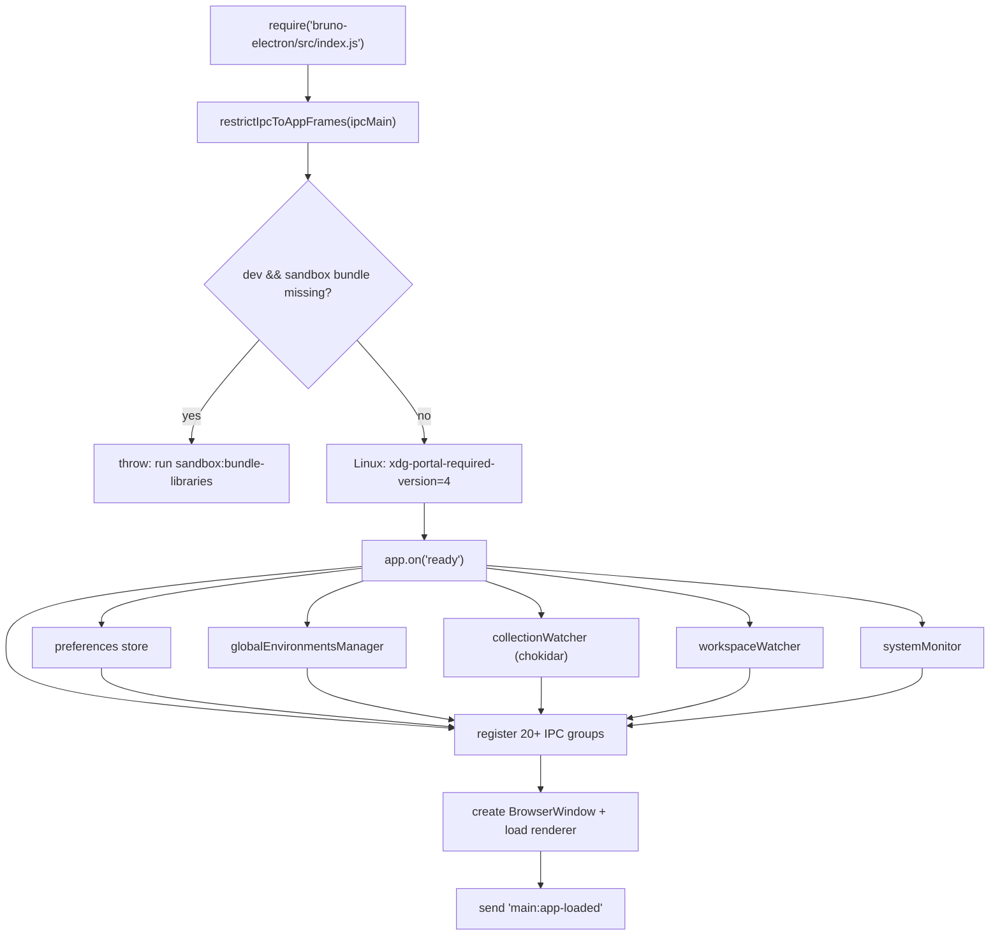
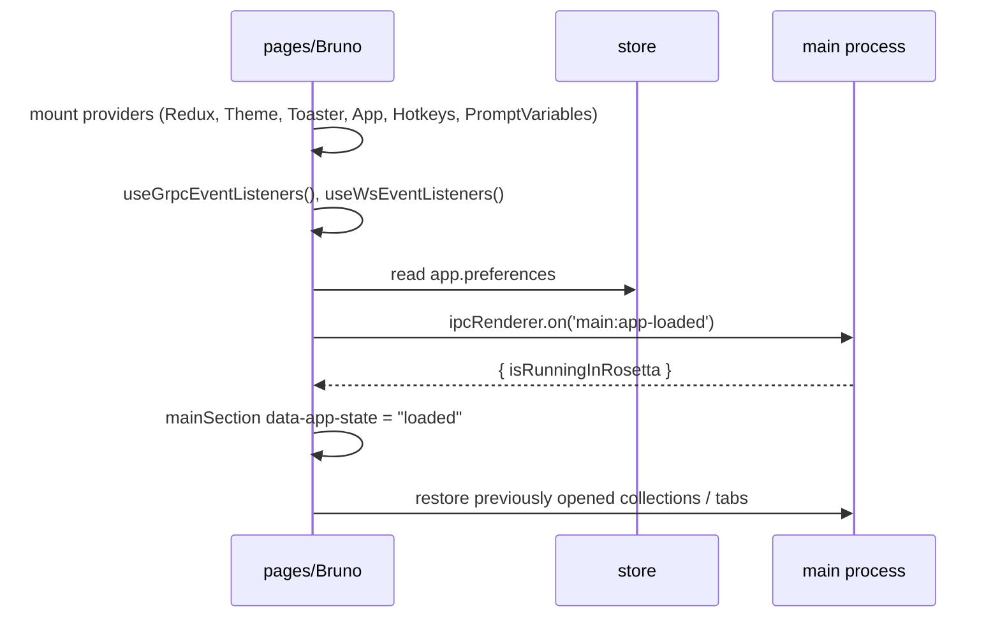

# Application Startup Flow

Status: VERIFIED unless marked.

---

## 1. Main process

| Step | Source |
|---|---|
| Security wrapper | `packages/bruno-electron/src/index.js` (`restrictIpcToAppFrames`) |
| Sandbox bundle check | same file, lines ~11–16 |
| Ready hook | line 209 |
| IPC registration block | lines 552–568 |
| Watchers and managers | lines ~209–552 |

### Startup edge cases

| Condition | Result | Evidence |
|---|---|---|
| Dev, sandbox not bundled | Throws with actionable message | index.js lines 11–16 |
| Dev, `ELECTRON_USER_DATA_PATH` set | `app.setPath('userData', …)` | index.js lines ~30–36 |
| Second instance launched | Existing window focused; deeplink forwarded | `app.on('second-instance')` line 198 |
| Deeplink URL | `app.on('open-url')` line 183 | OAuth2 protocol handler |
| Benchmark mode | `enable-precise-memory-info` switch | `utils/benchmark.js` |
| Linux | Portal v4 forced for `current_folder` | comment references issue #5471 |

---

## 2. Renderer

Observable boot states in the DOM: `data-app-state="loading"` → `"loaded"`. This gating exists because layout measurement (resizable panes, CodeMirror) is unreliable before Electron reports the window is sized.

Optional banner: Rosetta detection on Apple Silicon (`isRunningInRosetta`).

---

## 3. Cold-start collection restore

INFERRED ordering, based on IPC channels present in the renderer:

1. Renderer asks `renderer:get-last-opened-collections` (or equivalent) and `renderer:snapshot:get-tabs` / `renderer:snapshot:get-sidebar`.
2. For each collection path, `openCollection` in main statistics and registers a chokidar watcher (`app/collections.js`).
3. Watcher emits parsed items; renderer builds tree.
4. Tabs are restored from the snapshot and matched to item UIDs.

`services/mount/manager.js` contains the comment "cold start only — collection-watcher handles live changes and writes through to the cache", confirming the two-phase design: **bulk index on cold start**, **incremental updates afterwards**.

---

## 4. Failure handling at startup

| Failure | Behavior |
|---|---|
| Invalid `bruno.json` | `validateSchema` throws; collection fails to open and the error surfaces to the renderer (Yup error string). |
| Request file > 2.5 MB | Body text blocks redacted (placeholders) rather than failing parse. |
| Corrupt `.bru` | `bruToJson` throws; watcher records an error for that file; other files continue (INFERRED from per-file try/catch in watcher). |
| Secret env value cannot be decrypted | `decryptStringSafe` returns a safe placeholder rather than crashing. |
| Chokidar sees a write during save | Debounce/ignore mechanisms limit echo loops (INFERRED). |
