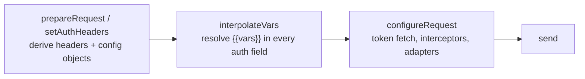

# Authentication Flow

Status: VERIFIED unless marked.

Bruno supports **11** auth modes: `inherit`, `none`, `basic`, `bearer`, `apikey`, `digest`, `ntlm`, `oauth1`, `oauth2`, `awsv4`, `wsse`, `akamai-edgegrid`.

Model: `packages/bruno-schema-types/src/common/auth.ts`
Grammar: `auth:*` blocks in `bruno-lang/v2/src/bruToJson.js`
Implementation: `prepare-request.js` `setAuthHeaders` + `configureRequest` in `ipc/network/index.js`

---

## 1. Two-phase design

Authentication is deliberately split:



Reason: credentials frequently contain `{{variables}}`, so auth *structure* must exist before interpolation, while network-dependent operations (token exchange, signing with a clock, digest challenge round-trip) must happen after.

---

## 2. Inheritance (`inherit`)

`mergeAuth` (`utils/collection.js` line 882):

- Base = collection root auth.
- Walk the tree path; each folder with a concrete mode (`mode && mode !== 'inherit'`) becomes the new effective auth.
- If the request's mode is `inherit`, it takes the effective auth.
- For OAuth2, records whether credentials belong to a folder (`folderUid`) or the request (`itemUid`) so the token cache is shared at the right scope.

```bru
# collection.bru
auth {
  mode: bearer
}
auth:bearer {
  token: {{bearer_auth_token}}
}
```

---

## 3. Per-provider mechanics

### 3.1 Basic

`setAuthHeaders` → `axiosRequest.basicAuth = { username, password }`.
`interpolateVars` then resolves values and **converts to a header**:

```js
request.headers['Authorization'] = `Basic ${Buffer.from(`${username}:${password}`).toString('base64')}`;
delete request.basicAuth;
```

> Comment in source: "todo: we have things happening in two places w.r.t basic auth — need to refactor".

### 3.2 Bearer

Immediate: `Authorization: Bearer <token>` (built from the raw, still-uninterpolated token; interpolation resolves it later).

### 3.3 API Key

- `placement: 'header'` → header `key: value`, remembered as `apiKeyHeaderName`.
- `placement: 'queryparams'` → stored as `apiKeyAuthValueForQueryParams` and appended **after interpolation** in `configureRequest` via `URL.searchParams.set`.

### 3.4 WSSE

Computed **at prepare time** (a notable asymmetry — the nonce/timestamp are generated before variable interpolation):

```js
ts    = new Date().toISOString()
nonce = crypto.randomBytes(16).toString('hex')
digest = base64( hex( sha1( nonce + ts + password ) ) )
header: X-WSSE: UsernameToken Username="…", PasswordDigest="…", Nonce="…", Created="…"
```

Go: `crypto/rand`, `crypto/sha1`, `encoding/base64` — trivial to match exactly.

### 3.5 Digest

`digestConfig` → `addDigestInterceptor` (`bruno-requests/src/auth/digestauth-helper.js`): performs the initial request, parses `WWW-Authenticate: Digest …` (supports `qop=auth`, MD5/SHA-256), recomputes `Authorization` and retries.

### 3.6 NTLM

`NtlmClient` from `axios-ntlm` replaces the axios adapter. A 401 `WWW-Authenticate: NTLM` triggers the three-leg handshake. Redirect handling calls `handleNtlmRedirect` to reset the connection state.

### 3.7 OAuth 1.0a

`applyOAuth1ToRequest(request, collectionPath)` in `bruno-requests/src/auth/oauth1-request-authorization.ts`:

- Signature methods: `HMAC-SHA1`, `HMAC-SHA256`, `HMAC-SHA512`, `RSA-SHA1/256/512`, `PLAINTEXT`.
- Parameters: `consumerKey`, `consumerSecret`, `accessToken`, `accessTokenSecret`, `callbackUrl`, `verifier`, `privateKey` (+ `privateKeyType: file|text`), `timestamp`, `nonce`, `version`, `realm`, `placement` (`header|query|body`), `includeBodyHash`.
- Errors surface as `OAuth1 signing failed: …`.

### 3.8 OAuth 2.0

Four grant types, each with its own helper in `utils/oauth2.js`:

| Grant | Helper | Interactive? |
|---|---|---|
| `authorization_code` | `getOAuth2TokenUsingAuthorizationCode` | **Yes** — opens window/system browser, handles redirect |
| `implicit` | `getOAuth2TokenUsingImplicitGrant` | **Yes** |
| `client_credentials` | `getOAuth2TokenUsingClientCredentials` | No |
| `password` | `getOAuth2TokenUsingPasswordCredentials` | No |

Configuration fields (`AuthOauth2` in `common/auth.ts`):

```text
grantType, username, password, callbackUrl, authorizationUrl, accessTokenUrl,
clientId, clientSecret, scope, state, pkce, credentialsPlacement ('body' | 'basic_auth_header'),
credentialsId, tokenPlacement ('header' | 'queryparams'), tokenHeaderPrefix, tokenQueryKey,
refreshTokenUrl, autoRefreshToken, autoFetchToken, tokenSource ('access_token' | 'id_token'),
additionalParameters { authorization[], token[], refresh[] }   // each { name, value, sendIn, enabled }
```

Token injection (`configureRequest`):

```js
tokenValue = tokenSource === 'id_token' ? credentials.id_token : credentials.access_token;
if (tokenPlacement === 'header') request.headers['Authorization'] = `${tokenHeaderPrefix} ${tokenValue}`.trim();
else url.searchParams.set(tokenQueryKey, tokenValue);
```

Caching and refresh:

- Stored by `credentialsId` in `store/oauth2.js`.
- `main:credentials-update` pushes tokens to the renderer for display in the Auth tab.
- `autoRefreshToken` triggers refresh before use; `autoFetchToken` fetches on first use.
- Scripts may invalidate: `bru.deleteOauth2Credential()` sets `oauth2CredentialsToReset`, consumed by `resetOauth2Credentials` in `runRequest`.
- `oauth2CredentialVariables` (`$oauth2.<credentialsId>.<field>`) become part of the interpolation scope.

Authorization-code UX:

```mermaid
sequenceDiagram
    participant U as User
    participant M as main process
    participant B as Auth server
    participant CB as localhost callback / deeplink
    U->>M: Send request (auth: oauth2, authorization_code)
    M->>M: build authorize URL (state, PKCE if enabled)
    M->>B: open window or system browser (authorize-user-in-window / -in-system-browser)
    B->>CB: redirect ?code=…&state=…
    CB->>M: code captured (protocol handler / loopback server)
    M->>B: POST accessTokenUrl (client creds in body or basic header) + additional params
    B-->>M: { access_token, refresh_token, expires_in, id_token? }
    M->>M: cache credentials by credentialsId; push main:credentials-update
    M->>M: inject token; send real request
```

Token and refresh URLs each get their **own** `getCertsAndProxyConfig` because they may live on a different host requiring different TLS/proxy settings.

### 3.9 AWS SigV4

- `resolveAwsV4Credentials(request)` uses `@aws-sdk/credential-providers` (env, shared config, profile name).
- `addAwsV4Interceptor(axiosInstance, request)` from `awsv4-axios`.
- On cross-origin redirect: `requestConfig.__skipAwsV4Sign = true` and all existing `x-amz-*` headers are deleted — a signature is host-bound, so re-signing for another host must never happen.

### 3.10 Akamai EdgeGrid

`edgegrid-helper.js` implements the EG1-HMAC-SHA256 Authorization header builder; `headersToSign`, `maxBodySize`, `nonce`, `timestamp` are configurable.

---

## 4. Header ordering effects

Because auth is applied in `prepareRequest` and interpolation rebuilds the header map (`interpolate-vars.js` iterates `forOwn(request.headers)` and rebuilds), a **user-defined `Authorization` header will be overwritten** by any active auth mode at the same level, depending on which comes later. For mixed use (e.g. custom `Authorization` plus API key), pick modes that set distinct headers.

---

## 5. `forwardAuthorizationHeader` on redirects

Default `true`. On cross-origin redirect with `false`, the redirect handler strips `authorization` and `proxy-authorization` and logs a timeline message. Proxy credentials from proxy settings are still sent.

---

## 6. Go implementation notes (PROPOSED)

```go
type Provider interface {
    Name() string
    // Prepare runs before interpolation: may set headers/params.
    Prepare(ctx context.Context, req *RequestBuilder, cfg AuthConfig) error
    // Sign runs after interpolation, immediately before send.
    Sign(ctx context.Context, req *http.Request, cfg AuthConfig) error
    // NeedsInteractive explains why a UI is required (oauth2 auth code).
    NeedsInteractive() bool
}
```

- Digest and NTLM require **retry loops**; model them as `Transport` wrappers, not request mutators.
- OAuth2 should be a service with a `TokenCache` interface; the *authorization window* must be injected as a callback interface (this is where Bruno's coupling to Electron must be broken).
- Keep a `credentialsId` concept for cache sharing across requests/folders.
