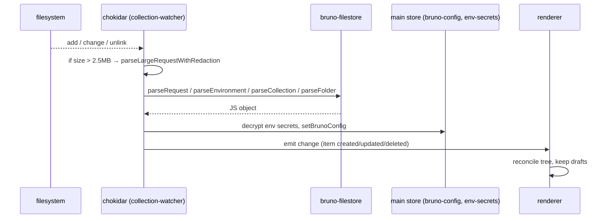
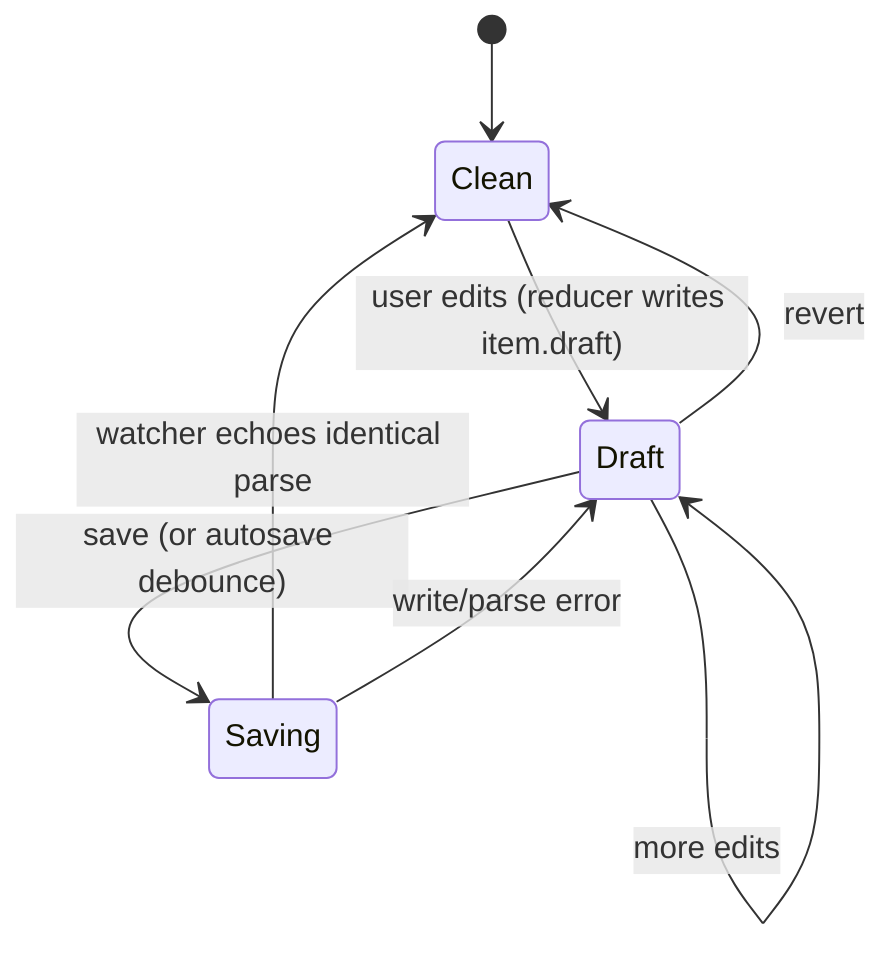

# Collection Lifecycle

Status: VERIFIED unless marked.

---

## 1. On-disk model

```text
my-collection/
├── bruno.json               (bru format)   OR  opencollection.yml   (yml format)
├── collection.bru           (bru)          OR  collection.yml       (yml)
├── environments/
│   ├── Local.bru
│   └── Prod.bru
├── folder-a/
│   ├── folder.bru           (bru)          OR  folder.yml
│   ├── request-one.bru      (bru)          OR  request-one.yml
│   └── nested/
│       └── …
└── folder-b/
    └── …
```

Source: `packages/bruno-electron/src/utils/collection.js` `FORMAT_CONFIG`; fixture `packages/bruno-tests/collection/`

---

## 2. Create

| Action | Path |
|---|---|
| New collection | `Sidebar/CreateCollection` → IPC → main writes `bruno.json` (or `opencollection.yml`) → watcher parses |
| New request | `Sidebar/NewRequest` modal → choose method/name/URL → IPC writes file with a `meta` block and method block |
| New folder | `Sidebar/NewFolder` → writes `folder.bru` / `folder.yml` |
| New environment | `Environments` UI → writes `environments/<Name>.bru` |

A minimal created request (VERIFIED shape from fixtures and serializer):

```bru
meta {
  name: Get Users
  type: http
  seq: 1
}

get {
  url: {{host}}/users
  body: none
  auth: inherit
}
```

`seq` orders items within a folder; `type` is `http` (default), `graphql`, `grpc`, `ws`.

---

## 3. Open

`openCollection(win, watcher, collectionPath)` in `packages/bruno-electron/src/app/collections.js`:

1. `getCollectionConfigFile(pathname)` — prefers `opencollection.yml`, falls back to `bruno.json`.
2. Validate with Yup `configSchema`.
3. `uid = generateUidBasedOnHash(pathname)`.
4. `getCollectionStats(pathname)` (size, file count) — used to warn on large collections.
5. Register with `collectionWatcher` (chokidar) ignoring `node_modules`, `.git`.
6. Parse each file via `bruno-filestore`.

### Config schema (VERIFIED keys)

From `configSchema` in `app/collections.js` and real `bruno.json` files:

```jsonc
{
  "version": "1",
  "name": "my-collection",
  "type": "collection",
  "proxy": { "inherit": true, "config": { "protocol": "http", "hostname": "", "port": 4000,
              "auth": { "username": "", "password": "", "disabled": true }, "bypassProxy": "" } },
  "scripts": { "moduleWhitelist": ["crypto"], "additionalContextRoots": ["../lib"], "flow": "sandwich" },
  "clientCertificates": { "enabled": true, "certs": [] },
  "presets": { "requestType": "http", "requestUrl": "http://localhost:6000" }
}
```

---

## 4. Watch and reload



Details (VERIFIED):

- `MAX_FILE_SIZE = 2.5 * 1024 * 1024` — above this, text blocks are replaced with placeholders on read (`redactLargeTextBlocks`) and restored on write.
- Env secrets: variable entries with `secret: true` have their values replaced by decrypted values from `EnvironmentSecretsStore` before reaching the UI.
- `.env` files are handled by a dedicated `dotenv-watcher.js`.
- Snapshotting: parsed data is staged into a git-lite snapshot (`stageToCache`) unless disabled.
- UID stability: `getRequestUid` maps a pathname to a stable UID across reloads, so open tabs survive file edits.

Source: `packages/bruno-electron/src/app/collection-watcher.js`, `packages/bruno-electron/src/cache/requestUids.js`

---

## 5. Edit (draft cycle)



- `draftDetectMiddleware` marks tabs dirty when `draft !== saved`.
- `autosaveMiddleware` optionally persists without an explicit save.
- Save path: `saveRequest` thunk → IPC `renderer:save-request` → `stringifyRequest(draft, { format })` → write → watcher → renderer replaces item and clears draft.

---

## 6. Move / rename / clone / delete

| Operation | Channel |
|---|---|
| Rename | `renderer:rename-item-name`, `renderer:rename-collection`, `renderer:rename-environment` |
| Clone item or folder | `renderer:clone-folder` |
| Reorder (`seq`) | `renderer:resequence-items` |
| Delete | via filesystem handler; watcher emits `unlink` |
| Drag & drop | `Sidebar` uses a drag layer (`useMouseRowDrag`, `DndTargetErrorGuard`) with a blocked cursor when moving across collections |

Reordering writes new `seq` values across the affected folder (`sortByNameThenSequence` then renumber).

Source: `packages/bruno-electron/src/utils/collection.js` `sortByNameThenSequence`

---

## 7. Import / export

- **Import**: Postman v2/v2.1, Insomnia, OpenAPI 3, WSDL, Bruno collection bundle (`adm-zip`). Components: `Sidebar/ImportCollection`, `ImportCollectionLocation`, `BulkImportCollectionLocation`, `PostmanPackageReport`.
- **Export**: collection → zip/bundle (`renderer:export-collection` handlers, `bruno-app/src/utils/exporters`), Postman export via converters.
- **OpenAPI sync**: `ipc/openapi-sync.js` + `OpenAPISyncTab` computes drift between a spec and a collection using `bruno-common/src/openapi-sync`.

---

## 8. Workspaces (multi-collection)

A workspace groups multiple collections plus shared environments and API specs. Stored in `workspaces.json` + per-workspace config. Watcher: `app/workspace-watcher.js`; storage: `store/last-opened-workspaces.js`, `store/workspace-environments.js`.

`services/mount` provides a unified read view so mounted/non-local collections behave like local ones for the sidebar.

---

## 9. Sharing / git

- Git integration (`ipc/git.js`, `utils/git.js`, `simple-git`) exposes status, diff, commit, push through the UI (`components/Git`).
- `ShareCollection` produces a shareable bundle.
- Because collections are plain files, git is the primary collaboration mechanism.

---

## 10. Deletion and safety

| Risk | Mitigation in code |
|---|---|
| Accidental mass delete | Empty-state / confirm dialogs (`Modal`, `ConfirmCloseEnvironment`) |
| External edits while unsaved (draft) | Watcher updates land on `item`, draft retained; UI shows modified state (INFERRED) |
| Concurrent writers | `workspace-lock.js` prevents two app instances editing the same workspace |
| `.git`/`node_modules` churn | Ignored by watcher |
