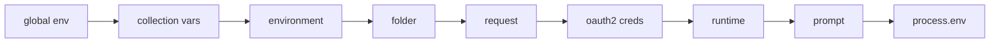
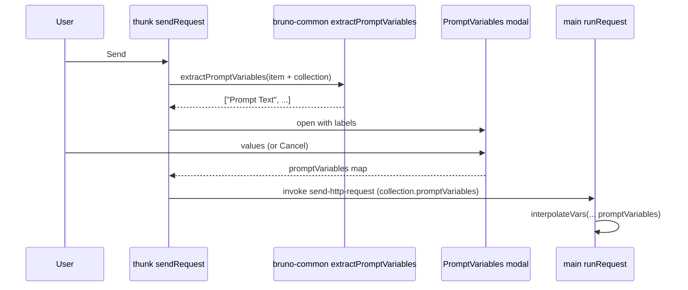

# Environment & Variable Resolution

Status: VERIFIED unless marked.

Bruno has **seven** variable scopes, plus faker-generated "mock" values and interactive prompt variables. Getting precedence right is the single most error-prone part of a reimplementation.

---

## 1. Scope model

| Scope | Persisted where | Set by | Notes |
|---|---|---|---|
| **Global environment** | `electron-store` `global-environments` (app-level, shared by all collections) | Preferences → Global environments | Secret values encrypted |
| **Collection variables** | `collection.bru` `vars:pre-request` / `vars:post-response` | Scripts (`bru.setCollectionVar`) or UI | |
| **Environment** | `environments/<Name>.bru` `vars { … }` | UI or file edit | Supports `extends` inheritance |
| **Environment secrets** | Encrypted store keyed by (collection, env, key) | UI | Names listed in `vars:secret [ … ]` |
| **Folder variables** | `folder.bru` `vars:pre-request` | Scripts / UI | Merged along the tree path |
| **Request variables** | The request file `vars:pre-request` / `vars:post-response` | Scripts / UI | |
| **Runtime variables** | Redux `collection.runtimeVariables` | Scripts (`bru.setVar`) | Live for the session only |
| **Prompt variables** | Nothing (ephemeral) | User via modal at send time | `{{?Label}}` syntax |
| **OAuth2 credential variables** | Derived from token response | Auth layer | Namespaced `$oauth2.<credentialsId>.<key>` |
| **process.env** | `.env` files + OS env | | Nested under `process.env.*` |

---

## 2. Interpolation precedence (execution order)

From `packages/bruno-electron/src/ipc/network/interpolate-vars.js` `interpolateVars` — later entries override earlier ones:

```js
const combinedVars = {
  ...globalEnvironmentVariables,
  ...collectionVariables,
  ...envVariables,
  ...folderVariables,
  ...requestVariables,
  ...oauth2CredentialVariables,
  ...runtimeVariables,
  ...promptVariables,
  process: { env: { ...processEnvVars } }
};
```



Pre-step: environment values themselves are interpolated once against `process.env` only, so an env value can be `{{process.env.API_HOST}}`.

---

## 3. Environment file format (`.bru`)

```bru
vars {
  host: http://localhost:8080
  bearer_auth_token: your_secret_token
  @number
  typed_env_num: 300
  @boolean
  typed_env_bool: true
  @object
  typed_env_obj: '''
    {"scope":"env"}
  '''
}

vars:secret [
  github_client_secret,
  google_client_secret
]

vars:externalsecrets:vault {
  path: secret/data/bruno
}
```

Verified against `packages/bruno-tests/collection/environments/*.bru`. Grammar: `bruno-lang/v2/src/envToJson.js`.

| Feature | Detail |
|---|---|
| `@number`, `@boolean`, `@object` | Type annotations; parsed into JS types via `parseValueByDataType` |
| `'''…'''` | Multiline value; 4 spaces of indentation removed |
| `vars:secret` | List of names only; values are not on disk |
| `vars:externalsecrets:<provider>` | Declares external secret resolver config |
| `extends` | Environment inheritance (below) |
| `color` | UI color tag |

### YAML equivalent (`environments/Test.yml`)

```yaml
name: Test
variables:
  - name: envVar
    value: original
    enabled: true
    secret: false
```

---

## 4. Environment inheritance (`extends`)

Environments may extend others. Resolution (`bruno-common/src/utils/environment-inheritance.ts`):

1. Build the chain of inherited environments; detect cycles (`cyclicInheritancePath`) and missing parents (`missingInheritedEnvironmentName`).
2. Collect enabled variables from parents (nearest parent last → wins).
3. Apply the child's own enabled variables; a child variable **deletes** the parent's entry of the same name.
4. Non-secret and secret variables are tracked in separate maps (`nonSecrets`, `secrets`); returned as `inheritedVariables` with `inheritedFrom: { name, uid }`.

The renderer calls `resolveEnvironmentInheritance({ environments, targetEnvironment })` before sending and passes the flattened environment to main.

### Environment selection

- Stored per collection (`collection.activeEnvironmentUid`).
- Workspaces can also have a workspace-level environment (`store/workspace-environments.js`).
- A global environment is selected app-wide (`globalEnvironments.activeGlobalEnvironmentUid`).

---

## 5. Prompt variables

Syntax: `{{?Prompt Text}}` (regex in `bruno-common/src/utils/prompt-variables.ts`).

Flow:



Extraction only produces prompts that are reachable after earlier scopes are applied (comment: "Tries to respect the hierarchy of the variables and avoid unnecessary prompts as much as possible"), see `extractPromptVariablesForRequest` in `index.js` line 1349.

Cancelling the modal resolves the thunk without sending.

---

## 6. Mock / dynamic variables

`{{$randomFirstName}}`-style placeholders are replaced by `@faker-js/faker` functions before variable interpolation:

- `MOCK_PATTERN = /\{\{\$(\w+)\}\}/g` in `bruno-common/src/interpolate/index.ts`
- `mockDataFunctions` in `bruno-common/src/utils/faker-functions.ts`
- JSON-escaping applies to generated values when `escapeJSONStrings` is set.

---

## 7. The interpolation algorithm

`bruno-common/src/interpolate/index.ts`:

```ts
interpolate(str, obj, { escapeJSONStrings, onUnresolved })
  → prepareMock(str)            // {{$faker}} expansion
  → prepareMockObj(obj)
  → replace(str, obj, onUnresolved, visited = new Set(), results = new Map())
```

`replace` behavior:

1. Regex `/\{\{([^}]+)\}\}/g`.
2. Lookup via lodash `get` → supports dot paths (`user.name`).
3. Non-string values are `JSON.stringify`-ed when substituted.
4. **Recursive resolution**: if the replacement itself contains `{{…}}` and the placeholder has not been visited, recurse (handles variable-of-a-variable chains).
5. Cycle protection via `visited`.
6. Unresolved placeholders are left **verbatim** (`{{missing}}` stays) and reported via `onUnresolved`.

### JSON escaping

When `escapeJSONStrings` is true, replacements escape `\`, `\n`, `\r`, `\t`, `"`. This is how a token with quotes can be safely inserted into a JSON body. Note that it does **not** handle all JSON escapes (control characters).

---

## 8. Typed values

`parseValueByDataType(value, dataType)` (`bruno-common/src/utils`) coerces `string`/`number`/`boolean`/`object`. Used both at parse time (env files) and at request time (`resolveTypedValue` in `utils/collection.js`), so a `@number` change in a draft takes effect without saving.

---

## 9. Unresolved variable reporting

- Collector created per request: `getUnresolvedVariableCollector(request)`.
- After send, `trackUnresolvedVariables(request, parentUnresolvedVariables)` (parent chaining for nested `bru.runRequest`).
- Emitted as `main:run-request-event { type: 'unresolved-variables' }` only when the count changes.
- UI: `ResponsePane/UnresolvedVariablesInfo`.

---

## 10. Go implementation notes (PROPOSED)

1. Model scopes as an ordered slice of `map[string]any`, not one merged map — the UI needs to know *where* a value came from (`VariableScopeList`, `VariableScopeIcon` components show provenance).
2. Interpolate with a recursive resolver and a visited set; return `(string, unresolved []string)`.
3. Implement `escapeJSONStrings` identically, including the known gaps, to stay compatible.
4. Keep prompt-variable extraction a pure function in a `variables` package, callable by GUI before dispatch.
5. Environment `extends` resolution belongs in the core (not GUI) so the CLI shares it.
