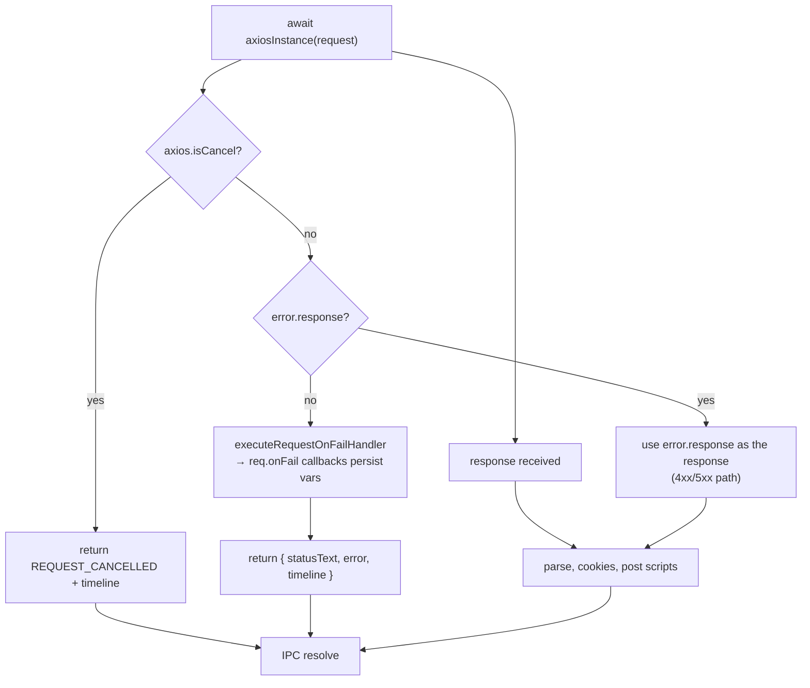

# Error Handling Flow

Status: VERIFIED unless marked.

Bruno's error philosophy: **never lose the request's diagnostics**. Failures are converted into result objects carrying `error`, `statusText` and `timeline`, never thrown across IPC (except for script errors, which are re-thrown with attached partial results).

---

## 1. Error taxonomy

| Class | Where raised | Surfaced as | UI |
|---|---|---|---|
| **Transport error** (DNS, connect, TLS, socket reset, timeout) | axios, no `error.response` | `{ statusText, error, timeline }` | `NetworkError` card in response pane |
| **Cancellation** | `AbortController.abort()` | `{ statusText: 'REQUEST_CANCELLED', isCancel: true }` | Response cleared |
| **HTTP error status** (4xx/5xx) | Received normally | Normal response | Colored status badge; post scripts still run |
| **Pre-request script error** | `ScriptRuntime` | Promise rejected (or partial results) | Script error card with source line |
| **Post-response script error** | `ScriptRuntime` | Partial results + `test-results` entry | Same |
| **Variable evaluation error** | `VarsRuntime` | Aggregated string, `main:display-error` | Toast |
| **Assertion failure** | `AssertRuntime` | `assertion-results` event | Tests tab, red |
| **Test failure** | `TestRuntime` | `test-results` event | Tests tab |
| **Invalid URL** | `interpolate-vars.js` path-param resolution | Thrown `{ message: 'Invalid URL format' }` | Error toast |
| **GraphQL variables parse** | `runPreRequest` | Thrown `Failed to parse GraphQL variables: …` | Error card |
| **OAuth errors** | `utils/oauth2.js` | Thrown, surfaced in Auth tab + `main:display-error` | Auth tab banner |
| **Parse errors on disk** | `bruno-lang` | Watcher error event | File marked broken in sidebar |
| **IPC-level errors** | Renderer invoke rejection | Caught in thunk | `responseReceived({ response: { status: 'Error', isError: true, error } })` |

---

## 2. Control flow at the transport boundary



Outer `try/catch` wraps everything, so even an exception inside post scripts produces `{ status, error, timeline, requestSent }` rather than a rejected IPC call.

Source: `packages/bruno-electron/src/ipc/network/index.js` `runRequest` (lines 1000–1347)

---

## 3. Renderer-side handling

```js
.catch((err) => {
  if (err.message === "Error invoking remote method 'send-http-request': Error: Request cancelled") {
    dispatch(responseReceived({ response: null }));
    return;
  }
  dispatch(responseReceived({ response: { status: 'Error', isError: true, error: err.message, size: 0, duration: 0 } }));
});
```

Source: `packages/bruno-app/src/providers/ReduxStore/slices/collections/actions.js`

**Known fragility (VERIFIED):** cancellation is detected by string matching an Electron-generated message. A refactor of the error text silently breaks cancellation UX.

**PROPOSED for Go:** return a typed result:

```go
type Result struct {
    Err      error      // transport error, nil for HTTP responses
    Canceled bool
    Resp     *Response
    Timeline []TimelineEntry
}
```

---

## 4. Script error formatting

`bruno-js/src/utils/error-formatter.js` exposes `formatErrorWithContextV2`, `parseErrorLocation`, `adjustLineNumber`, `findScriptBlockStartLine`, `findScriptBlockEndLine`, YAML equivalents, `getErrorTypeName`, `adjustStackTrace`.

Because the script is wrapped in a closure before execution (`wrapScriptInClosure`), stack line numbers must be shifted back to the `.bru` file. The UI then:

1. Shows the error type, message, and 2–3 lines of context.
2. Highlights the failing line in the editor via `useFocusErrorLine`.
3. Keeps previously-passing `test()` results as partial results.

---

## 5. Error aggregation for variables

`VarsRuntime.runPostResponseVars` catches per-variable errors and aggregates:

```text
<N> error(s) in post response variables:
  varName: message
  …
```

Sent as `main:display-error`, shown as a toast.

---

## 6. Redirect-related errors

| Case | Handling |
|---|---|
| `followRedirects: false` | First 3xx is returned as the response; cookies still saved |
| `redirectCount >= maxRedirects` | Rejects with the last 3xx response; timeline error entry contains the body |
| Missing `Location` | Rejects with the 3xx response |
| FormData consumed and not reconstructible | Timeline note; request proceeds with consumed body (potential bug) |
| Cross-origin with `forwardAuthorizationHeader: false` | Auth headers stripped + timeline note |
| AWS SigV4 redirect | `x-amz-*` stripped and signing skipped |

---

## 7. TLS / proxy errors

Surfaced by Node agents as `error` without `response` → transport-error path. The timeline captures a `setupProxyAgents` failure explicitly:

```js
timeline.push({ type: 'error', message: `Error setting up proxy agents: ${err?.message}` });
```

---

## 8. Error UI surface map

| Component | Shows |
|---|---|
| `ResponsePane/NetworkError` | Transport errors with retry |
| `ResponsePane/ResponseErrorsCard` | Script/assertion/test failures |
| `ResponsePane/ResponseAlertsSection` | Warnings (unresolved vars, etc.) |
| `ResponsePane/ResponseErrorsIcon` | Counts in the tab |
| `Errors/` | Legacy error boundary screens |
| `pages/ErrorBoundary` | React render errors |
| Toaster | Aggregated errors (variables, OAuth) |
| `components/Devtools` | Console output incl. script errors |

---

## 9. Testing implications (PROPOSED)

For the Go port, add a table-driven matrix mirroring Bruno's own tests:

- network error (connection refused, DNS failure, TLS mismatch)
- timeout
- cancellation at every phase (pre-script, during send, during post-script)
- 4xx/5xx with post scripts
- redirect loop, missing Location, cross-origin auth stripping
- script throw with partial results
- invalid URL and invalid GraphQL variables
- proxy setup failure
