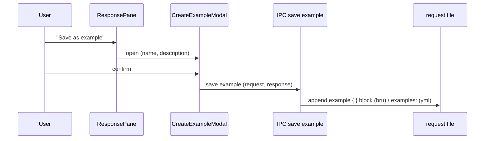

# History Flow

Status: **VERIFIED findings — the headline finding is that Bruno has no persistent request/response history feature.**

This document describes what *does* serve history-like purposes, so the Go port can decide deliberately whether to add one.

---

## 1. Finding

| Expected feature (typical API client) | Present in Bruno? | Evidence |
|---|---|---|
| Persistent list of every sent request with its response | **No** | No `history` slice in Redux; no store; grep for `requestHistory`/`historyStore` finds only the AI chat sidebar |
| Per-collection request log | **No** (only an in-memory timeline) | `collection.timeline` array in `slices/collections/index.js` (line ~700) |
| Saved responses ("examples") | **Yes** | `ResponseExample/*` components, `example` blocks in `.bru`, `exampleReducers.js` |
| Execution timeline per request | **Yes** (per response, not persisted across restarts except snapshots) | `response.timeline`, `ResponsePane/Timeline` |
| Runner results archive | Partial (runner exchange files) | `services/runner-exchange`, `useStoredRunnerExchange` |

Source: `packages/bruno-app/src/providers/ReduxStore/slices/collections/index.js` (lines 688–705)
Relevant symbols: `collection.timeline.push({…})`, `timelineRequest`, `timestamp`

---

## 2. What "timeline" actually is

```js
if (!collection.timeline) collection.timeline = [];
const timelineRequest = action.payload.requestSent || item.requestSent || item.request;
const timestamp = timelineRequest?.timestamp instanceof Date ? …getTime() : timelineRequest?.timestamp || Date.now();
collection.timeline.push({ … });
```

Two distinct "timelines" exist and must not be confused:

1. **Collection timeline** — a flat log of requests *sent in this session*, used to render the "Timeline" tab when viewing a collection; filter by `itemUid`.
2. **Response timeline** — a detailed hop-by-hop network trace produced by `axios-instance.js`, attached to each response.

The response timeline entries (VERIFIED types):

| Type | Meaning |
|---|---|
| `separator` | Starts a request section |
| `info` | Human-readable notes (URL, current time, redirect resolution, method changes) |
| `request` | `METHOD url` |
| `requestData` | Serialized body |
| `requestHeader` | `key: value` actually sent |
| `response` | `HTTP/1.1 <status> <text>` |
| `responseHeader` | `key: value` received |
| `timing` | Durations (prepared in X ms) |
| `error` | Error text |

`utils/timeline/index.js` provides helpers such as `sentHeadersFromTimeline`.

---

## 3. Response examples (the documented "save response" feature)



- UI: `ResponseExample/ResponseExampleTopBar` (name, re-run), `ResponseExampleRequestPane` / `ResponseExampleResponsePane` (split view).
- Try/execute: `tryResponseExample({ itemUid, collectionUid, exampleUid })` dispatched from the sidebar.
- Persistence: `example` blocks in `.bru`, handled by `bruno-lang/v2/src/example/*`; YAML has an `examples` key.
- UIDs: `getExampleUid` in `cache/requestUids.js`.
- Reducers: `slices/collections/exampleReducers.js` (1210 lines) — create/update/delete/reorder, with draft handling.

---

## 4. Runner history

The collection runner streams progress to disk through `services/runner-exchange`, and the renderer rehydrates the most recent run (`useStoredRunnerExchange`, `useClearStoredRunnerExchanges`). This is the only durable execution record.

---

## 5. Snapshots

`services/snapshot` plus `renderer:snapshot:*` IPC persist UI state (open tabs, sidebar expansion) and a git-lite content snapshot for drift detection — but **not** request/response payloads.

---

## 6. Recommendations for the Go port (PROPOSED)

History is a table-stakes feature in competing clients, and Bruno's absence of it is a gap rather than a design choice (no ADR found). A Go port can add it cheaply because the engine already produces a complete, typed `Result`:

1. Append every completed execution to an append-only store (SQLite via `modernc.org/sqlite`).
2. Store `request_hash`, `collection`, `env`, `status`, `duration`, `size`, truncated bodies (configurable limit), and the full timeline as JSON.
3. Keep the response *body* off-row in a blob table or temp-file store; you already need one for large bodies.
4. Make retention configurable (N days / N MB) with a background vacuum.
5. Preserve Bruno semantics: examples remain the "blessed" snapshots committed to git; history stays in an app-local DB and is never written into the collection directory.

Marking: history is **not** required for Bruno compatibility; it is an additive improvement.
