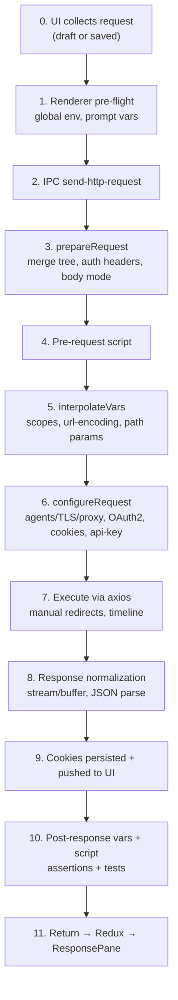
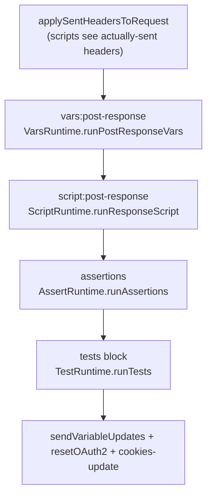

# Request Lifecycle

Status: VERIFIED unless marked. Primary source: `packages/bruno-electron/src/ipc/network/index.js`.

This is the most important document in the set. It documents the exact ordering of the 11 phases the plan asked about, with file/symbol anchors.

---

## 0. Phase map



---

## 1. Phase 0 — Request configuration collected (UI)

The request executed is the **draft if present**, else the saved item:

```js
const request = item.draft ? item.draft.request : item.request;
const settings = item.draft?.settings ?? item.settings;
```

Source: `packages/bruno-electron/src/ipc/network/prepare-request.js` lines 380–383

The request model (TypeScript, authoritative): `packages/bruno-schema-types/src/requests/http.ts`

```ts
interface HttpRequest {
  url: string;
  method: string;
  headers: KeyValue[];
  params: HttpRequestParam[];     // type: 'query' | 'path'
  auth?: Auth | null;
  body?: HttpRequestBody | null;  // mode: none|json|text|xml|formUrlEncoded|multipartForm|graphql|sparql|file
  script?: { req?: string; res?: string } | null;
  vars?: { req: Variables; res: Variables } | null;
  assertions?: KeyValue[] | null;
  tests?: string | null;
  docs?: string | null;
}
```

`KeyValue` carries `uid, name, value, description, enabled, annotations`.

### Renderer-side pre-flight (thunk `sendRequest`)

Source: `packages/bruno-app/src/providers/ReduxStore/slices/collections/actions.js` (~line 600 onwards)

1. If a request is already in-flight for this item, cancel it (`dispatch(cancelRequest(item.cancelTokenUid, …))`).
2. Deep-clone collection and item (they cross the IPC boundary).
3. Attach `globalEnvironmentVariables` computed from `activeGlobalEnvironmentUid`.
4. Generate `requestUid = uuid()`.
5. `extractPromptVariablesForRequest(itemCopy, collectionCopy)` — **may open a modal**; user can cancel → the thunk resolves without sending.
6. `dispatch(initRunRequestEvent({...}))` — sets item state `queued`.
7. Resolve the environment, flattening inheritance: `resolveEnvironmentInheritance({ environments, targetEnvironment })`.
8. Branch: gRPC (`sendGrpcRequest`), WebSocket (`sendWsRequest`), else `sendNetworkRequest`.

---

## 2. Phase 1–2 — IPC boundary

```js
ipcRenderer.invoke('send-http-request', item, collection, environment, runtimeVariables)
```

Source: `packages/bruno-app/src/utils/network/index.js` `sendHttpRequest`

Handler: `packages/bruno-electron/src/ipc/network/index.js` line 1386.

The response is normalized into a Redux-safe shape (`sendNetworkRequest`): `dataBuffer` base64, `timeline` timestamps converted from `Date` to epoch ms.

---

## 3. Phase 3 — `prepareRequest`

Source: `packages/bruno-electron/src/ipc/network/prepare-request.js` `prepareRequest` (line 380)

### 3.1 Inheritance merge

```text
requestTreePath = getTreePathFromCollectionToItem(collection, item)
mergeHeaders(collection, request, path, { includeDisabledHeaders: true })
mergeScripts(collection, request, path, scriptFlow /* collection.brunoConfig.scripts.flow ?? 'sandwich' */)
mergeVars(collection, request, path)
mergeAuth(collection, request, path)
request.globalEnvironmentVariables = collection.globalEnvironmentVariables
request.oauth2CredentialVariables = getFormattedCollectionOauth2Credentials(...)
request.promptVariables = collection.promptVariables
```

`mergeHeaders` precedence: collection root → each folder in path order → request. Later entries win; disabled entries are tracked separately (`disabledHeaders`) so the UI can keep names visible.

Source: `packages/bruno-electron/src/utils/collection.js` `mergeHeaders` line 26, `mergeVars` line 81, `mergeScripts` line 296, `mergeAuth` line 882, `getTreePathFromCollectionToItem` line 503.

**`mergeAuth` semantics (VERIFIED):** collection auth is the base; each folder with `auth.mode !== 'inherit'` overrides it; if the request's mode is `inherit`, the nearest effective auth wins. OAuth2 specially records `folderUid` vs `itemUid` so credentials can be cached at the right scope.

### 3.2 Header normalization

`buildHeaderEntries(headers)` from `@usebruno/js` returns `{ headers, headerEntries }` — a plain object plus ordered entries (important: HTTP allows repeated header names; the ordered list preserves both).

### 3.3 Base request object

```js
let axiosRequest = {
  mode: request.body.mode,
  method: request.method,
  url,
  headers, headerEntries,
  name: item.name, pathname: item.pathname,
  tags: getEffectiveTags(getOwnTags(item), getInheritedTagsFromTreePath(requestTreePath)),
  pathParams: request.params?.filter(p => p.type === 'path'),
  settings,
  responseType: 'arraybuffer'
};
```

### 3.4 Auth headers (`setAuthHeaders`)

Order: (a) if the request inherits, apply collection auth; (b) apply the request's own auth. Each provider either sets headers directly or attaches a config object consumed later by `configureRequest`:

| Provider | Immediate effect | Deferred config |
|---|---|---|
| `basic` | — | `basicAuth { username, password }` (encoded later in `interpolateVars`) |
| `bearer` | `Authorization: Bearer <token>` | — |
| `apikey` | header placement → header + `apiKeyHeaderName`; queryplacement → `apiKeyAuthValueForQueryParams` | applied in `configureRequest` |
| `wsse` | `X-WSSE: UsernameToken …` with `Base64(hex(SHA1(nonce + ts + password)))` | — |
| `awsv4` | — | `awsv4config` → `aws4-axios` interceptor |
| `digest` | — | `digestConfig` → `addDigestInterceptor` |
| `ntlm` | — | `ntlmConfig` → `NtlmClient` adapter |
| `oauth1` | — | `oauth1config` → `applyOAuth1ToRequest` in `configureRequest` |
| `oauth2` | — | `oauth2 {…}` → token fetch in `configureRequest` |
| `akamai-edgegrid` | — | `edgeGridConfig` → `addEdgeGridInterceptor` |

Source: `prepare-request.js` `setAuthHeaders` (line 13) — a ~370-line function with a switch per mode, duplicated for collection vs request.

### 3.5 Body and Content-Type (VERIFIED table)

| `body.mode` | Default `content-type` (if user didn't define one) | `data` |
|---|---|---|
| `json` | `application/json` | **decomment**-stripped JSON string |
| `text` | `text/plain` | string |
| `xml` | `application/xml` | string |
| `sparql` | `application/sparql-query` | string |
| `file` | `application/octet-stream`, then **overridden** by the file's `contentType` | `Buffer` or `fs.createReadStream` if > 20 MB |
| `formUrlEncoded` | `application/x-www-form-urlencoded` | array of enabled `{name,value}` |
| `multipartForm` | `multipart/form-data` | array of enabled entries (converted to real `FormData` later in `runPreRequest`) |
| `graphql` | `application/json` | `{ query, variables }` (variables decommented) |
| `none` | `content-type = false` (unless awsv4) | — |

`false` is a deliberate sentinel to stop axios adding a Content-Type; it is stripped from `requestSent.headers` before the UI shows "sent" headers.

> **Go note:** use `req.Header` omission instead of the `false` sentinel. If no body is present, do not set Content-Type at all. AWS SigV4 requires a hash of an empty body — replicate that case explicitly.

### 3.6 File body (VERIFIED)

```js
const STREAMING_FILE_SIZE_THRESHOLD = 20 * 1024 * 1024;
if (isLargeFile(filePath, THRESHOLD)) data = fs.createReadStream(filePath);
else data = fs.readFileSync(filePath);
```

Relative `filePath` is resolved against the collection directory. **The user's chosen `contentType` always wins**, even for `mode: file`.

---

## 4. Phase 4 — Pre-request script

Source: `packages/bruno-electron/src/ipc/network/index.js` `runPreRequest` line 591.

```mermaid
sequenceDiagram
    participant N as runPreRequest
    participant S as ScriptRuntime
    participant IV as interpolateVars
    N->>S: runRequestScript(request.script.req)
    S-->>N: { envVariables, runtimeVariables, collectionVariables,
             globalEnvironmentVariables, oauth2CredentialsToReset,
             results, nextRequestName, skipRequest, stopExecution,
             scriptedRequestEntries }
    N->>N: sendVariableUpdates(result)  → IPC to renderer + disk via thunk
    N->>N: resetOauth2Credentials(...)
    N->>N: push main:cookies-update
    N->>IV: interpolateVars(request, scopes)
    N->>N: normalize scheme, encodeUrl, parse GraphQL vars, stringify form bodies, build multipart FormData
```

Script errors: collected as `preRequestError`; if `partialResults` exist, variable mutations are still forwarded. If a real error exists after emitting results, the request **rejects without sending**.

---

## 5. Phase 5 — Variable interpolation

Source: `packages/bruno-electron/src/ipc/network/interpolate-vars.js` `interpolateVars` (line 45)

### Scope precedence (lowest → highest)

```text
globalEnvironmentVariables
collectionVariables
envVariables (active environment)
folderVariables
requestVariables
oauth2CredentialVariables
runtimeVariables
promptVariables
process.env  (nested object: process.env.KEY)
```

Note: an env value may itself contain `{{process.env.X}}`; env vars are pre-interpolated with a masked `process.env` first.

### What is interpolated

1. `request.url`
2. header **names and values** (rebuilds the header map)
3. body — behavior depends on media type:
   - JSON (`mediaType.includes('json')`) and **not** binary: string bodies interpolated with `escapeJSONStrings: true`; object bodies are `JSON.stringify` → interpolate → `JSON.parse`.
   - `application/x-www-form-urlencoded`: array values interpolated per entry.
   - `multipart/*`: array entry values (and arrays of values) interpolated; `FormData` instances skipped.
   - GraphQL: `data.query` and `data.variables` interpolated separately (avoids double-escaping).
   - gRPC / WS bodies: `JSON.stringify` → interpolate with JSON escaping.
   - everything else: plain interpolation.
4. path params (path-style `:name` **and** OData-style `EntitySet(:key)` / `Func(x=:y)`)
5. proxy fields, basic auth → `Authorization: Basic base64(user:pass)` (auth object deleted)
6. every OAuth2 field per grant type + additional parameters
7. awsv4 / digest / wsse / ntlm / edgegrid / oauth1 credential fields

### Unresolved variables

`onUnresolved(placeholder)` is wired to `getUnresolvedVariableCollector(request)`. Unresolved references stay literal (`{{name}}` stays as-is) and are reported to the UI via `unresolved-variables` events, throttled by count.

Source: `packages/bruno-electron/src/ipc/network/interpolate-vars.js`; UI consumer: `components/ResponsePane/UnresolvedVariablesInfo`.

### Post-interpolation normalization (in `runPreRequest`)

| Step | Detail |
|---|---|
| Scheme | If no explicit scheme, prefix `http://` (must happen **before** `encodeUrl`, else `host:port` colon is percent-encoded) |
| `encodeUrl` | Only when `settings.encodeUrl` |
| GraphQL | `JSON.parse(data.variables)` after interpolation (issue #884) |
| form-urlencoded | `buildFormUrlEncodedPayload` from `bruno-common` |
| multipart | `createFormData(entries, collectionPath, existingBoundary)`; `getHeaders()` monkey-patched so the user's `content-type` (with or without boundary) survives; `extend(request.headers, form.getHeaders())` |

---

## 6. Phase 6 — `configureRequest`

Source: `index.js` line 118.

1. **Scheme defaulting** if url still lacks a scheme.
2. **`getCertsAndProxyConfig`** → `{ proxyMode, proxyModeReason, proxyConfig, httpsAgentRequestFields, interpolationOptions }` (see `logic/tls-and-certificates.md`).
3. **Settings**:
   - `followRedirects = settings.followRedirects ?? true`
   - `forwardAuthorizationHeader = settings.forwardAuthorizationHeader ?? true`
   - `maxRedirects = settings.maxRedirects ?? request.maxRedirects ?? DEFAULT_MAX_REDIRECTS`
   - `!followRedirects → maxRedirects = 0`
   - `request.maxRedirects = 0` (unused by axios; Bruno follows manually)
4. **Axios instance** with protocol-specific agents.
5. **NTLM**: replaces the adapter.
6. **OAuth1**: `applyOAuth1ToRequest` (throws `OAuth1 signing failed: …`).
7. **OAuth2**: per grant type → token → inject as `Authorization` header or query param, using `tokenHeaderPrefix` / `tokenQueryKey` / `tokenSource` (`access_token` | `id_token`). Token/refresh URLs get their **own** cert/proxy config.
8. **AWS SigV4**: `resolveAwsV4Credentials` (env/`~/.aws`/profile) → `addAwsV4Interceptor`.
9. **Digest**, **EdgeGrid**: interceptors.
10. **Timeout**: `resolveInheritedSettings(request.settings).timeout` — `'inherit'` falls back to the global preference.
11. **Cookies**: if `preferences.shouldSendCookies()` → merge jar cookies with an explicit `Cookie` header (user values win).
12. **API key in query params**: interpolated key/value `searchParams.set`.

---

## 7. Phase 7 — Execution

```js
request.__bruno__executionMode = 'standalone';
request.responseType = 'stream';
const response = await axiosInstance(refreshExplicitHeaderNames(request));
```

- `saveCancelToken(cancelTokenUid, abortController)` before send; `request.signal` set.
- `requestSent` snapshot is emitted (`main:run-request-event type=request-sent`) **before** the request leaves, so the UI can show it during a long request.
- Redirects handled in the response interceptor (see `logic/redirects.md`).

### Success path

| Step | Detail |
|---|---|
| Response | `response.data` is a stream. |
| `isResponseStream = hasStreamHeaders(response.headers)` | True for `text/event-stream` etc. |
| Non-stream | `response.data = await promisifyStream(response.data)` |
| Timing | `responseTime = measureResponseTime(response.config.metadata)` (excludes queueing before preparation) |
| Timeline | `response.timeline` from the interceptor |

### Error paths (all handled, none thrown to UI as exceptions)

| Condition | Returned object |
|---|---|
| `axios.isCancel(error)` | `{ statusText: 'REQUEST_CANCELLED', isCancel: true, error: 'REQUEST_CANCELLED', timeline }` |
| `error.response` exists (4xx/5xx) | Response is used as if successful; `responseTime` measured; post scripts still run |
| Network error, no response | `executeRequestOnFailHandler` runs `req.onFail()` callbacks; returns `{ statusText, error: message, timeline }` |
| Anything else | Outer `catch` → `{ status, error, timeline, requestSent }` |

Crucial: **4xx/5xx responses are successful executions**, running post-response scripts, assertions and tests. Only transport failures are errors.

---

## 8. Phase 8 — Response processing

Source: `parseDataFromResponse(response, request.__brunoDisableParsingResponseJson)` in `utils/common.js`.

- Text bodies are decoded as UTF-8; JSON is parsed only when the parse mode allows it.
- `dataBuffer` is retained for the viewer and for size.
- Binary detection drives base64 transport to the renderer.

---

## 9. Phase 9 — Cookies

```js
if (preferencesUtil.shouldStoreCookies()) saveCookies(request.url, response.headers);
const domainsWithCookies = await getDomainsWithCookies();
mainWindow.webContents.send('main:cookies-update', …);
cookiesStore.saveCookieJar();
```

---

## 10. Phase 10 — Post-response pipeline

Source: `runPostResponse` (line 696) and `runPostScripts` (line 1146).

Strict order:



- Each step emits its own `main:run-request-event` (`test-results-post-response`, `assertion-results`, `test-results`).
- `scriptedRequestEntries` from `bru.runRequest()` inside any script are emitted as `scripted-request` events.
- Partial results survive exceptions (`error.partialResults`).

---

## 11. Phase 11 — Return and render

Returned object:

```js
{
  status, statusText, headers, data,
  stream, sseChunks, cancelTokenUid,
  dataBuffer,            // base64
  size: Buffer.byteLength(dataBuffer),
  duration: responseTime,
  url, timeline, requestSent
}
```

Renderer: `sendNetworkRequest` → `responseReceived({ itemUid, collectionUid, response, requestSent })` → `item.response` populated → `ResponsePane` renders with `useInitialResponseFormat` (content-type sniffing).

The renderer maps cancellation to `responseReceived({ response: null })` by matching the error message string. **Fragile** — a Go port should use a typed error code.

---

## 12. Concurrency and cancellation

| Concern | Implementation |
|---|---|
| Parallel requests | Each `send-http-request` invocation is independent; renderer allows one in-flight per item (`cancelRequest` before re-send). |
| Cancellation | `AbortController` stored in `cancelTokens` map under `cancelTokenUid`; `cancel-http-request` calls `abort()`. |
| Runner cancellation | Runner's outer abort controller listens and aborts the current inner controller. |
| Nested `bru.runRequest` | Runs `runRequest` with `runInBackground: true` so no UI events fire; inherits `parentRequestUid`. |
| Streaming (SSE) | `runPostScripts` deferred to the stream `close` event. |

---

## 13. Edge cases catalogue

| Case | Behavior | Source |
|---|---|---|
| URL starts with `{{` | No `http://` prefix is added before interpolation (variables may contain a scheme) | `configureRequest` line ~130 |
| `localhost` hostname | Custom DNS lookup probes IPv6 then falls back to IPv4 | `axios-instance.js` lines 188–204 |
| Multi-hop redirect with FormData | FormData recreated from `_originalMultipartData` | `axios-instance.js` ~lines 470–505 |
| GraphQL variables invalid after interpolation | Throws `Failed to parse GraphQL variables: …` | `runPreRequest` |
| Large response | UI warning + lazy body fetch (see `ui/response-viewer.md`) | `LargeResponseWarning` component |
| `WOOF` method | Easter egg response | `utils/woof.js` |
| gRPC/WS request via `bru.runRequest` | `status: 'skipped'` with explanatory text | `runRequestByItemPathname` |
