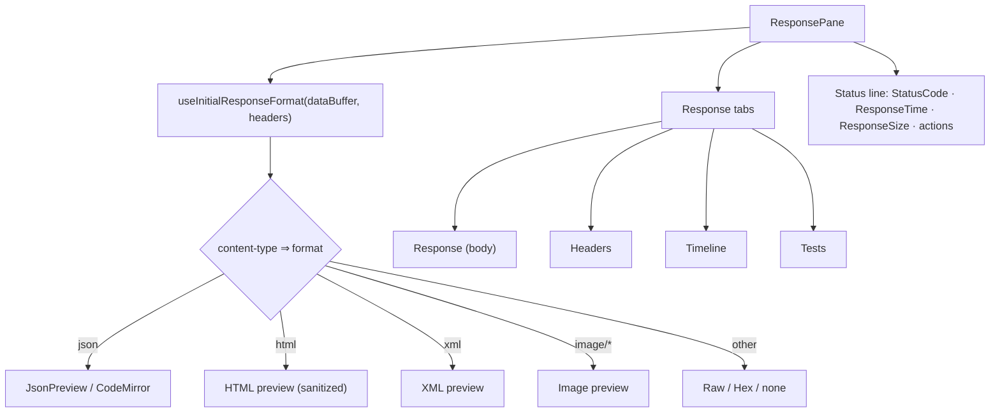

# Response Lifecycle

Status: VERIFIED unless marked.

Covers what happens from the moment bytes arrive to the moment pixels are drawn.

---

## 1. Bytes → transport objects

| Stage | Code | Notes |
|---|---|---|
| Request issued | `axiosInstance(refreshExplicitHeaderNames(request))` | `bruno-electron/src/ipc/network/index.js` |
| Response headers | axios response interceptor | Timeline entries pushed for status line and each header |
| Body | `responseType: 'stream'` | Set in `runRequest` (`request.responseType = 'stream'`) |
| Stream detection | `hasStreamHeaders(response.headers)` | SSE / chunked event streams |
| Buffering (non-stream) | `promisifyStream(response.data)` | Collects chunks into a Buffer |
| Timing | `measureResponseTime(response.config.metadata)` | ms |

Source: `packages/bruno-electron/src/ipc/network/axios-instance.js` (interceptors), `index.js` `runRequest`

### What counts as a "stream"

`hasStreamHeaders` inspects response headers for stream signals (SSE `text/event-stream`, long-lived chunked). When true:

- `axiosDataStream = response.data` is kept open.
- `sseChunks` accumulate.
- `runPostScripts()` is deferred to `axiosDataStream.on('close')`, at which point `buildResponseBodyFromStreamChunks` reconstructs `data`/`dataBuffer` from the captured chunks.

This means **post-response scripts see the assembled body, not the partial stream** — an important semantic.

---

## 2. Parsing and normalization

```js
const { data, dataBuffer } = parseDataFromResponse(response, request.__brunoDisableParsingResponseJson);
response.data = data;
response.dataBuffer = dataBuffer;
```

Source: `packages/bruno-electron/src/utils/common.js` (`parseDataFromResponse`)

Rules (VERIFIED by usage):

1. If JSON parsing is not disabled and the body parses as JSON, `data` is the parsed value; otherwise `data` is a UTF-8 string.
2. `dataBuffer` is always the raw bytes (Buffer), used for size, base64 transport, and binary previews.
3. `request.__brunoDisableParsingResponseJson` lets a caller (Runner, large bodies) skip parsing.

### Size computation

```js
size: Buffer.byteLength(response.dataBuffer)
```

Not `Content-Length` — accurate even after decompression.

---

## 3. Serialization across IPC

Buffers cannot cross the context bridge into Redux. `sendNetworkRequest` normalizes:

```js
{
  state: 'success',
  data, dataBuffer /* base64 */, headers, size, status, statusText,
  duration, timeline /* timestamps → epoch ms */, stream, requestSent
}
```

Source: `packages/bruno-app/src/utils/network/index.js` `sendNetworkRequest`

Consequences:

- `stream` (a Node Readable) is sent but effectively unusable in the renderer; the UI relies on the reconstructed body and on `main:run-request-event` events.
- Timelines must be JSON-safe — one reason they are flattened to `{ timestamp, type, message }`.

---

## 4. Redux landing

`responseReceived` writes into `collections[].items[].response` (and `requestSent`). Reducer also updates `requestState` to `received` / `error`.

Source: `packages/bruno-app/src/providers/ReduxStore/slices/collections/index.js`
Relevant symbols: `responseReceived`, `requestCancelled`, `initRunRequestEvent`

---

## 5. Rendering pipeline



| Piece | Component | Notes |
|---|---|---|
| Format detection | `ResponsePane/index.js` `useInitialResponseFormat` | Also produces `initialTab` (`editor`/`preview`) |
| Format/view persisted per tab | `updateResponseFormat`, `updateResponseViewTab` in `slices/tabs` | Stored on the focused tab so it survives switching |
| Body rendering | `ResponsePane/QueryResult` | Handles JSON/XML/HTML/image/raw; line-virtualized for big bodies |
| Action bar | `ResponsePane/ResponsePaneActions` | Copy, download, save-to-file, clear |
| Errors | `ResponseErrorsCard`, `ResponseAlertsSection` | Script/assertion failures and warnings |
| Timeline | `ResponsePane/Timeline` | Renders `response.timeline` |
| Test results | `ResponsePane/TestResults` | Pass/fail per `test()` and assertions |
| Bookmarks | `ResponsePane/ResponseBookmark` | Save response as an example |

### Auto-format on content-type change

`ResponsePane` watches `contentType`; when it changes it re-derives `initialFormat`/`initialTab` and dispatches updates — but only if the user has not chosen a format (`persistedFormat === null`). This "user choice wins" rule is explicit in the effect dependencies.

---

## 6. Response examples (saved responses)

Bruno can persist a response as an **example** stored next to the request. `exampleReducers.js` (1210 lines) manages these; `ResponseExample/*` components render them; `.bru` examples live in `example { … }` blocks (handled by `bruno-lang/v2/src/example/*`).

---

## 7. Error and edge states

| State | UX |
|---|---|
| `queued` | Spinner in the request tab; response pane shows placeholder |
| `sending` | Send button becomes Cancel |
| Cancelled | `response: null`; pane shows a cancelled placeholder |
| Network error | `response.isError`, `status: 'Error'`, message shown in `NetworkError` |
| Non-2xx | Rendered normally, status badge colored |
| Huge body (> threshold) | `LargeResponseWarning` with option to download |
| Binary | Hex/raw view; size shown; download available |
| Unresolved variables | Badge + list in `UnresolvedVariablesInfo` |
