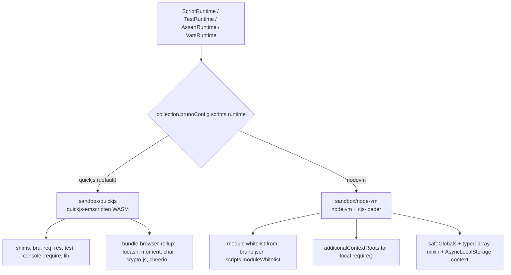
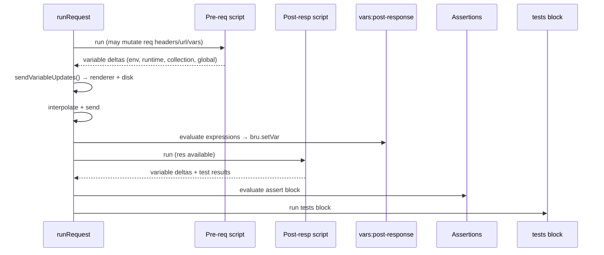

# Scripting Flow

Status: VERIFIED unless marked.

Bruno runs user JavaScript at four points. Everything else (`tests`, `vars:post-response`) is also JavaScript.

---

## 1. Execution points

| Hook | File block | Runtime class | Sync/async |
|---|---|---|---|
| Pre-request | `script:pre-request { }` | `ScriptRuntime.runRequestScript` | async |
| Post-response | `script:post-response { }` | `ScriptRuntime.runResponseScript` | async |
| Tests | `tests { }` | `TestRuntime.runTests` | async |
| Post-response variables | `vars:post-response { }` | `VarsRuntime.runPostResponseVars` | sync (expressions) |
| Assertions | `assert { }` | `AssertRuntime.runAssertions` | sync (expressions) |
| gRPC hooks | `script:grpc:before-call-start` etc. | `GrpcScriptRuntime` | async |

Source: `packages/bruno-js/src/runtime/*`, grammar rules in `bruno-lang/v2/src/bruToJson.js`.

---

## 2. The script context

Every script receives the same global context:

```js
{
  bru,                 // scripting API (class Bru)
  req,                 // BrunoRequest (pre-request only)
  res,                 // BrunoResponse (post-response / tests)
  test,                // test(name, fn) — registers a test result
  expect, assert,      // chai
  __brunoTestResults,  // collector
  __bruSetScope,       // internal: tracks which scope a var belongs to
  console,             // mirrored to the Devtools console and runner output
  require,             // quickjs: whitelisted shims; nodevm: real module loader
  axios, uuid, nanoid, jwt, path, crypto-utils,   // quickjs library shims
  Buffer, process, setTimeout, …          // provided by the sandbox
}
```

`context` is built in each runtime, then passed to the sandbox:

```js
executeQuickJsVmAsync({ script, context, scriptType, scriptingConfig })
runScriptInNodeVm({ script, context, scriptingConfig })
```

Source: `packages/bruno-js/src/runtime/script-runtime.js` (lines 15–120)

---

## 3. Sandbox architecture



### QuickJS

- `newQuickJSWASMModuleFromVariant` (memoized module for sync + async; reload on WASM trap).
- `marshallToVm(value, vm)` converts JS objects into the VM; host objects (`bru`, `req`) are exposed as shims implemented in QuickJS-host code.
- Shims live at `sandbox/quickjs/shims/`: `bru.js`, `bruno-request.js`, `bruno-response.js`, `test.js`, `console.js`, `require.js`, `lib/{axios,nanoid,path,uuid,jwt,crypto-utils}.js`.
- `bundle-libraries.js` produces the rollup bundle of allowed libraries available as `require('lodash')` etc.

### Node VM

- `node:vm` contexts with a restricted global (`safeGlobals` in `sandbox/node-vm/constants.js`).
- Custom `cjs-loader.js` (734 lines) implements a `require` that:
  - allows Node builtins only if in `moduleWhitelist`,
  - allows local files only inside `additionalContextRoots`,
  - caches per script context, with a shared npm module cache across scripts,
  - tracks a require graph for eviction.
- `AsyncLocalStorage` keeps the active script context for async callbacks.

### Security model (VERIFIED)

- `nodevm` module access is gated by an explicit whitelist per collection (`bruno.json → scripts.moduleWhitelist`), e.g. `["crypto", "buffer", "form-data"]`.
- `bru.sendRequest` validates URLs (`bruno-requests/src/utils/url-validation.ts`, SSRF guard) before dispatching.
- QuickJS has no filesystem/network access except through shims.

---

## 4. The `bru` API

Source: `packages/bruno-js/src/bru.js` (`class Bru`, ~900 lines with JSDoc).

### Variables

| Group | Methods |
|---|---|
| Runtime (`bru.setVar`) | `getVar`, `setVar`, `hasVar`, `deleteVar`, `deleteAllVars`, `getAllVars` |
| Environment | `getEnvVar`, `setEnvVar`, `hasEnvVar`, `deleteEnvVar`, `getAllEnvVars`, `deleteAllEnvVars`, `getEnvName` |
| Collection | `getCollectionVar`, `setCollectionVar`, `hasCollectionVar`, `deleteCollectionVar`, `getAllCollectionVars`, `deleteAllCollectionVars`, `getCollectionName` |
| Folder | `getFolderVar` |
| Request | `getRequestVar` |
| Global env | `getGlobalEnvVar`, `setGlobalEnvVar`, `hasGlobalEnvVar`, `deleteGlobalEnvVar`, `getAllGlobalEnvVars`, `deleteAllGlobalEnvVars` |
| process.env | `getProcessEnv` |
| Scope-aware | generic `setVar` routes by `__bruSetScope` when invoked from a scoped helper |

Variable names are validated: `/^[\w-.]*$/` (letters, digits, `-`, `_`, `.`) — otherwise throws `Variable name: "<name>" contains invalid characters!`.

### Request/response

| Method | Notes |
|---|---|
| `bru.sendRequest(options)` | Fire a raw HTTP request from a script (see §6) |
| `bru.runRequest(pathname)` | Execute another request **in this collection** as if the user sent it, returning `{ status, statusText, headers, data, duration, size }` |
| `bru.sleep(ms)` | Async delay |
| `bru.interpolate(str)` | Run the same interpolation engine on a string |
| `bru.getRequestVar` / `req.*` | Request introspection |
| `bru.deleteOauth2Credential()` | Invalidate cached tokens |
| `bru.setNextRequest(name)` | Runner control (`null` ends the run) |
| `bru.runner.skipRequest()` / `stopExecution()` | Runner control |
| `bru.isSafeMode()` | Sandbox capability probe |
| `bru.cwd()` | Collection path |

### `req` object (`BrunoRequest`)

`getUrl`, `setUrl`, `getHost`, `getPath`, `getQueryString`, `getMethod`, `setMethod`, `getAuthMode`, `getHeaders`, `setHeaders`, `deleteHeaders`, `getHeader`, `setHeader`, `deleteHeader`, `hasJSONContentType`, `getBody({raw})`, `setBody`, `setMaxRedirects`, `getTimeout`, `setTimeout`, `onFail(callback)`, `disableParsingResponseJson`, `getExecutionMode`, `getName`, `getPathParams`, `getTags`.

`req.onFail(cb)` registers a callback invoked when the request fails at transport level; its variable mutations are persisted (`executeRequestOnFailHandler` in `ipc/network/index.js` line 2289).

### `res` object (`BrunoResponse`)

`getStatus`, `getStatusText`, `getHeader`, `getHeaders`, `getBody`, `getResponseTime`, `getUrl`, `setBody`, `getSize`, `getDataBuffer`.

---

## 5. Execution order and variable propagation



`sendVariableUpdates(result, { collectionUid, requestUid, collection })` forwards only *dirty* scopes (`bru._envDirty`, `_runtimeVarsDirty`, `_collVarsDirty`, `_globalEnvDirty`) — a small but important optimization that avoids rewriting files on every script.

Partial results on error: `error.partialResults` carries test results and variable deltas collected before the throw.

---

## 6. `bru.sendRequest` vs `bru.runRequest`

| | `sendRequest` | `runRequest` |
|---|---|---|
| Input | `{ url, method, headers, data, params, timeout }` | Collection-relative path to a request file |
| Inherits collection auth/cookies? | No — raw (cookies come from the shared jar) | Yes — full pipeline incl. scripts |
| Runs scripts of the target? | No | Yes |
| Emits UI events? | Recorded as `scripted-request` entry | Same (or suppressed in background) |
| UI | Listed in the Timeline as a nested entry | Listed as a nested entry |
| gRPC/WS | Not supported | Returns `status: 'skipped'` |

Implementation: `bruno-requests/src/scripting/send-request.ts` (259 lines) and `ipc/network/index.js` `runRequestByItemPathname`.

`buildScriptedEntry({request, response, error, startedAt, completedAt})` normalizes both into timeline entries (`bruno-requests/src/scripting/scripted-entry.spec.ts`).

---

## 7. Console and errors

- `console.log/debug/info/warn/error` are wrapped to `onConsoleLog(type, cleanJson(args))`; output appears in the Devtools console pane and CLI reporters.
- Errors are formatted with source context: `formatErrorWithContextV2` maps the sandbox stack (which wraps the script) back to the `.bru` file line using `findScriptBlockStartLine`/`findScriptBlockEndLine` (and YML variants). The UI shows a clickable error that focuses the offending line (`hooks/useFocusErrorLine`).
- Timed-out or runaway scripts: QuickJS/WASM traps are caught; module is recycled (comment: "On dispose WASM trap, recycle the module").

---

## 8. Collection runner interplay

The runner (`bruno-common/src/runner`, `bruno-cli/src/runner`) drives requests sequentially and interprets:

- `bru.setNextRequest(name)` → jump to that request (data-driven loops).
- `bru.runner.skipRequest()` → skip this request.
- `bru.runner.stopExecution()` → end run after current request.
- `nextRequestName`, `skipRequest`, `stopExecution` are returned with every script result.

---

## 9. Go implementation notes (PROPOSED)

1. Use `goja` (pure Go) as the default engine; expose the same globals. Implement shims natively rather than bundling JS.
2. `ScriptEngine` interface:

```go
type ScriptEngine interface {
    Run(ctx context.Context, script string, globals Globals) (*Result, error)
}
type Result struct {
    VarDeltas  VarDeltas
    Tests      []TestResult
    NextRequest string
    Skip, Stop bool
}
```
3. Run scripts in a goroutine with a deadline; `goja` supports interruption via `vm.Interrupt`.
4. Keep chai-like `expect` semantics — parity matters for existing test suites. Prefer porting the assertion operator table (see `logic/assertions-and-tests.md`) natively for `assert {}` blocks, and use JS for `tests {}`.
5. `req`/`res` must be host objects proxied into the VM, not snapshots, because scripts mutate `req` headers before send.
