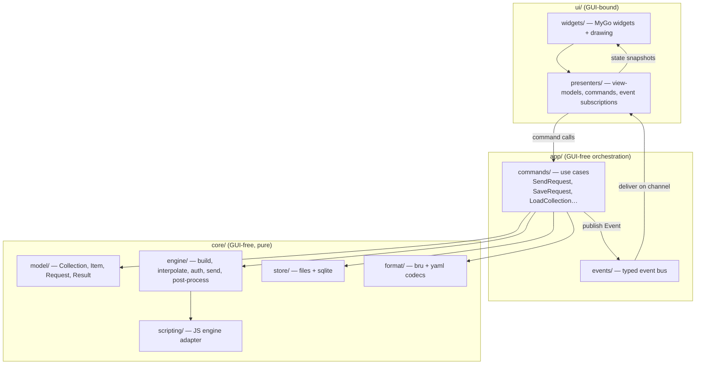

# Go Architecture

Status: **PROPOSED** — target architecture for the Go-only reimplementation. The Bruno behaviour it must reproduce is documented in `architecture/*`, `flows/*`, `logic/*`, `data/*`.

Hard constraint set by `plan_update.md`:

1. The entire application, **including the GUI**, is written in Go.
2. No React/Vue/Svelte, no HTML/CSS frontend, no Electron, no Wails, no separate JavaScript frontend.
3. JavaScript is embedded **only** for Bruno scripting compatibility (`script:*`, `tests {}`, `vars:post-response {}`, `assert {}` expressions, PAC scripts).
4. HTTP engine, application services, state, collections and persistence are **GUI-independent**.

---

## 1. Layering



**Dependency rule (enforced):** `core/**` and `app/**` must not import `ui/**` or any GUI framework module. Add a CI check:

```sh
# MyGo is the only UI toolkit allowed to appear in the dependency graph of ui/.
go list -deps ./core/... ./app/... | grep -E 'github.com/egoist/mygo|gioui.org|fyne.io' && exit 1 || true
```

This is the Go analogue of Bruno's renderer/main boundary, without the IPC cost.

---

## 2. Package skeleton

```text
cmd/fearless/main.go                 # wiring only: build presenter, run GUI loop
internal/
  core/
    model/          # Collection, Item, Folder, Request, Body, Auth, Result, Timeline
    format/
      bru/          # .bru lexer/parser/writer (recursive descent, per data/bru-format.md)
      yaml/         # opencollection.yml codec
      codec.go      # Codec interface + registry
    vars/           # scopes, precedence, interpolate, faker, prompt extraction
    engine/
      build/        # merge tree, headers, body, path params
      auth/         # providers + registry
      transport/    # http.Client, RoundTripper stack, proxy, TLS, redirects
      postscript/   # vars:post-response, scripts, assertions, tests
      result/       # typed Result, body store
    scripting/      # JS engine adapter (goja), sandbox, bru/req/res shims
    cookies/        # jar + persistence
    oauth2/         # token service + cache
    persistence/    # settings, secrets (keyring), history (sqlite), body spool
    collection/     # load/save/watch tree, merge helpers
    events/         # typed event definitions
  app/
    commands/       # use-case functions with explicit dependencies
    bus/            # event bus implementation
  ui/
    presenters/     # pure Go view-models; no MyGo imports
    widgets/        # MyGo-bound widgets (github.com/egoist/mygo/ui)
    theme/          # token loading into ui.Theme (see ui/design-system.md §7)
    layout/         # Split/SplitPercent composition, region budget
  platform/         # MyGo app services: mygo.Dialog, mygo.Secrets, mygo.WatchFiles, mygo/netproxy
```

---

## 3. State management

Bruno uses Redux with drafts. The Go equivalent keeps the same **semantics** with less machinery:

```go
// internal/core/model/state.go
type WorkspaceState struct {
    Collections []*Collection   // loaded trees
    Tabs        []Tab           // open tabs (per collection)
    ActiveTab   string
    Settings    Settings
}

type Item struct {
    Saved *Request     // as on disk
    Draft *Request     // nil when unmodified
}
```

Rules carried over from Bruno (must preserve):

1. **Draft model:** edits mutate `Draft`; a save writes `Draft` and swaps it to `Saved`.
2. **UID-from-path:** request identity survives reloads; renaming remaps tabs.
3. **Per-tab UI sub-state** (active sub-tab, response format, orientation) lives in the **presenter**, not the domain model.

Implementation approach:

- The store is a small actor: a single goroutine owns the state, commands send closures/messages, and readers receive immutable snapshots (`*WorkspaceState` copies or copy-on-write slices).
- No global mutable singleton; `State` is injected into commands.
- Responses and bodies are **never** stored in state — only a `BodyRef{ID, Size, ContentType}` pointing into the body store (`persistence/body`).

---

## 4. Typed events

Replaces `main:*` IPC channels (`architecture/system-overview.md §5`).

```go
// internal/core/events/events.go
type Event interface{ isEvent() }

type RequestQueued struct{ CollectionUID, ItemUID, RequestUID string }
type RequestSent struct{ RequestUID string; Sent model.SentRequest }
type ResponseChunk struct{ RequestUID string; Data []byte }        // streaming/SSE
type ResponseReceived struct{ RequestUID string; Result *model.Result }
type TestResults struct{ RequestUID, Phase string; Results []model.TestResult }
type AssertionResults struct{ RequestUID string; Results []model.AssertionResult }
type UnresolvedVariables struct{ RequestUID string; Names []string }
type ScriptedRequest struct{ RequestUID string; Entry model.ScriptedEntry }
type CookiesUpdated struct{ Domains []model.DomainCookies }
type CredentialsUpdated struct{ CredentialsID string; Token model.OAuthToken }
type CollectionChanged struct{ CollectionUID string; Change model.TreeChange }
type ScriptOutput struct{ RequestUID, Level, Text string }
type ErrorOccurred struct{ Scope string; Err error }
```

Delivery contract:

| Property        | Rule                                                                                                                              |
| --------------- | --------------------------------------------------------------------------------------------------------------------------------- |
| Ordering        | Per-request FIFO; global ordering not guaranteed                                                                                  |
| Back-pressure   | Buffered channel (e.g. 256); on overflow, drop `ResponseChunk` first and coalesce, **never drop** `ResponseReceived`/error events |
| Thread-safety   | Events are values; no pointers into core-owned structures                                                                         |
| Subscription    | `bus.Subscribe(topic) <-chan Event`; presenters filter by `RequestUID`                                                            |
| Terminal events | Every request publishes exactly one terminal event (`ResponseReceived` or `ErrorOccurred`)                                        |

---

## 5. Commands (application layer)

```go
type SendRequest struct {
    CollectionUID string
    ItemUID       string
    Env           string
    RuntimeVars   map[string]any
    PromptVars    map[string]string
}

type Sender interface {
    Execute(ctx context.Context, cmd SendRequest) (requestUID string, err error)
}
```

- `Execute` validates, resolves scopes, publishes `RequestQueued`, and launches the pipeline in a goroutine tracked by the command's `context`.
- Cancellation is a `context.CancelFunc` stored by `requestUID` (replaces `cancelTokens` map).
- Long-running commands (runner) run in the app layer and publish runner events.

Command inventory (from observed UI actions): `LoadCollection`, `SaveItem`, `DeleteItem`, `MoveItem`, `NewItem`, `SendRequest`, `CancelRequest`, `RunFolder`, `SaveEnvironment`, `SelectEnvironment`, `ImportCollection`, `ExportCollection`, `SavePreferences`, `ClearOAuth2Cache`, `ReloadCollection`.

---

## 6. HTTP engine boundary

The engine takes a plain, serializable input and returns a typed result:

```go
type Engine interface {
    Do(ctx context.Context, in EngineInput) (*model.Result, error)
}

type EngineInput struct {
    Item        *model.Item
    Collection  *model.Collection
    Scopes      vars.Scopes
    Settings    model.RequestSettings
    Hooks       HookSet     // scripting + auth + transport wrappers
    Sink        EventSink   // where timeline/chunks/console go
}
```

No GUI types, no `image`, no toolkit imports. The CLI and the GUI both call this interface — this is the property that keeps the project testable and is the direct successor of Bruno's CLI-reuses-main-process design.

---

## 7. Concurrency model

| Concern          | Design                                                                                                                  |
| ---------------- | ----------------------------------------------------------------------------------------------------------------------- |
| GUI thread       | MyGo main loop (`mygo.App.Run`); must never block (see `implementation/dependency-recommendations.md` §threading rules) |
| Commands         | Goroutine per command; results via the bus                                                                              |
| Request lifetime | `context.Context` per request; cancel propagates to transport and scripts                                               |
| State            | Single-owner actor goroutine; snapshots published to presenters                                                         |
| FS watching      | `fsnotify` goroutine debouncing into `CollectionChanged` events                                                         |
| SQLite           | Single writer goroutine; `modernc.org/sqlite` with `WAL`; readers use separate connections                              |
| JS engine        | One engine instance per script execution (no sharing); deadline via `vm.Interrupt`                                      |

---

## 8. Scripting boundary (JS allowed, nothing else)

```go
type ScriptRuntime interface {
    Run(ctx context.Context, src string, sc ScriptContext) (*ScriptOutcome, error)
}

type ScriptContext struct {
    Bru  BruAPI          // host functions
    Req  *RequestProxy   // mutable during pre-request
    Res  *ResponseProxy  // read-only + setBody
    Out  OutputSink
}
```

- One implementation in v1 (`goja`); interface kept so a second engine could be added.
- JavaScript **must not** be used for the application logic, theming, or rendering — this is a hard rule (see `research/unresolved-questions.md`).
- PAC resolution uses the same engine but a restricted globals set.

---

## 9. Persistence

| Data                                          | Storage                                                                      |
| --------------------------------------------- | ---------------------------------------------------------------------------- |
| Collections                                   | Files (`.bru` / `opencollection.yml`) — single source of truth               |
| Settings/theme/layout                         | JSON file in config dir                                                      |
| Secrets (env secrets, proxy/cert passphrases) | OS keyring (`zalando/go-keyring`), fallback AES-GCM with machine-derived key |
| Cookies                                       | Encrypted JSON file, debounced writes                                        |
| OAuth2 tokens                                 | Encrypted JSON file keyed by `credentialsId`                                 |
| History (new)                                 | SQLite (`modernc.org/sqlite`), plus body spool files                         |
| Body spool                                    | Temp files with TTL                                                          |

Core never touches the GUI config dir path directly; a `Paths` struct is injected (mirrors Bruno's `electron-store` name-per-file layout).

---

## 10. Testing strategy per layer

| Layer            | Tests                                                                                  |
| ---------------- | -------------------------------------------------------------------------------------- |
| `core/format`    | Golden files from Bruno fixtures (`bruno-tests/collection`), round-trip property tests |
| `core/vars`      | Port of Bruno's `interpolate.spec.ts` cases (883 lines)                                |
| `core/engine`    | `httptest.Server` matrix: redirects, auth, multipart, TLS, proxy                       |
| `core/scripting` | Replay Bruno script fixtures; assert `bru.*` semantics                                 |
| `app/commands`   | Fake engine + fake bus; assert emitted event sequences                                 |
| `ui/presenters`  | Headless unit tests (no toolkit)                                                       |
| `ui/widgets`     | `ui.Tester` from MyGo for headless widget tests; golden screenshots where supported    |

---

## 11. Migration/parity protocol

1. Start from the CLI (`cmd/fearless run`) — it exercises the whole core without a GUI.
2. Add presenters and the GUI once the core passes the Bruno fixture suites.
3. Keep an `engine-conformance` test package that runs a Bruno collection through both the Go engine (offline, recorded expectations) and compares results.

---

## 12. Known architectural conflicts (recorded, not hidden)

| Conflict                                                       | Impact                       | Resolution                                                                                       |
| -------------------------------------------------------------- | ---------------------------- | ------------------------------------------------------------------------------------------------ |
| Bruno's OAuth2 authorization UI lives inside the network layer | Engine would need a browser  | Inject `AuthBrowser` interface; GUI opens the system browser + loopback callback; CLI prints URL |
| Bruno renders HTML/PDF response previews in Chromium           | No renderer in Go-only stack | Open in OS default app; show source in-editor                                                    |
| tiptap docs editor                                             | DOM-based                    | Markdown editor widget                                                                           |
| `xml-formatter`/`JSONPath` display features                    | JS libs                      | Pure-Go equivalents or minimal reimplementation                                                  |
| Scripts may use bundled JS libs (lodash etc.)                  | Large JS surface to bundle   | Bundle a curated set; document what is unavailable                                               |
