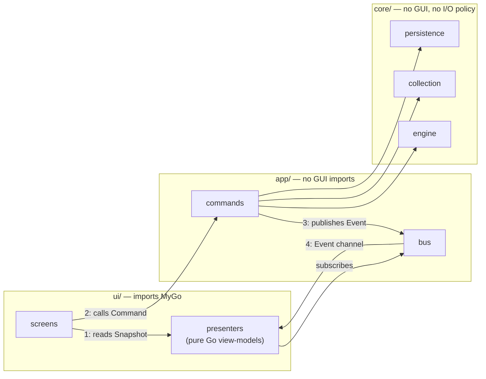
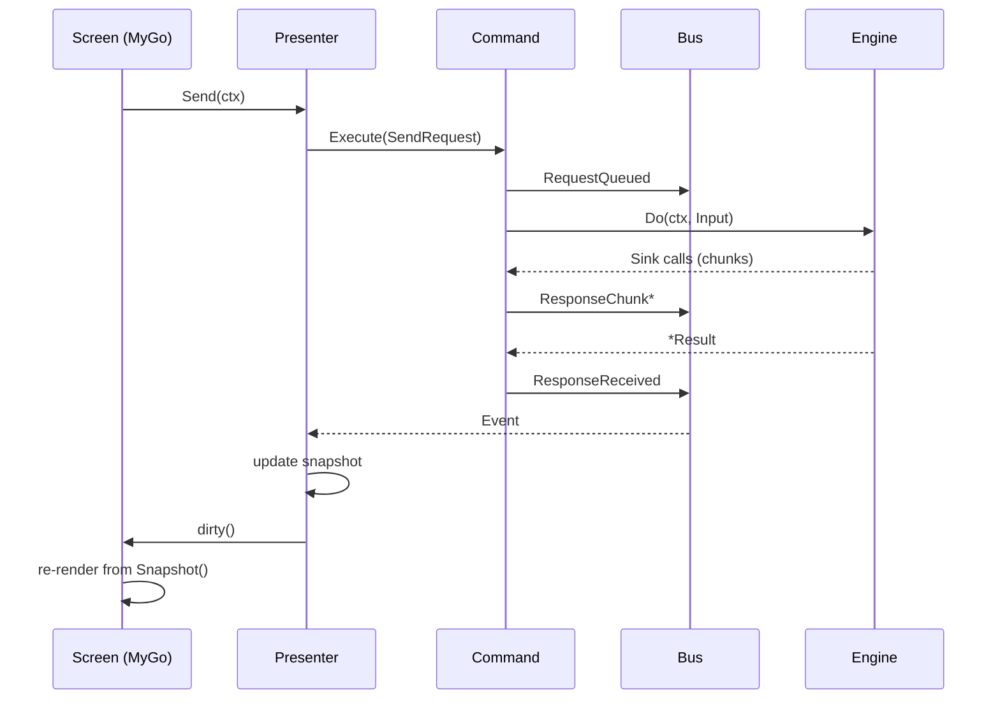

# Interface Design

Status: **PROPOSED**. This document specifies the Go interfaces, the typed event contract, and the GUI-boundary seam. `implementation/go-architecture.md` gives the layering picture and package skeleton; this file is the contract detail a Go engineer codes against. Where a design choice follows from Bruno's observed behaviour, the Bruno counterpart is cited.

Hard rule from `plan_update.md`: the HTTP engine, application services, state management, collections and persistence **must not depend on the GUI framework**. Everything below is arranged so that this rule is mechanically checkable.

---

## 1. The three seams



| Seam | Direction | Contract | Rule |
| --- | --- | --- | --- |
| 1. Snapshot | app → ui | `Snapshot() *model.WorkspaceState` | Immutable, copy-on-write |
| 2. Command | ui → app | `Command` interfaces | Fire-and-forget or `(value, error)` |
| 3. Event | app → ui | `<-chan events.Event` | Values only, never pointers into core |
| 4. Transport | core ↔ network | `RoundTripper` chain | Pure `net/http` |

---

## 2. Command interfaces

Small, single-method interfaces defined at the **consumer** (`ui/presenters` declares what it needs; `app/commands` implements). This keeps the presenter testable with hand-written fakes and no mocking library.

```go
// internal/ui/presenters/ports.go  (declared by the consumer)
type RequestSender interface {
    Execute(ctx context.Context, cmd commands.SendRequest) (requestUID string, err error)
}

type ItemSaver interface {
    Execute(ctx context.Context, cmd commands.SaveItem) error
}

type CollectionLoader interface {
    Execute(ctx context.Context, path string) (collectionUID string, err error)
}

type EnvSelector interface {
    Execute(ctx context.Context, cmd commands.SelectEnvironment) error
}
```

Command payloads are plain structs (serializable, loggable, replayable in tests):

```go
// internal/app/commands/types.go
type SendRequest struct {
    CollectionUID string
    ItemUID       string
    Env           string
    RuntimeVars   map[string]any
    PromptVars    map[string]string
}

type SaveItem struct {
    CollectionUID string
    ItemUID       string
    Format        model.CollectionFormat // bru | yml — explicit, never inferred at the edge
}
```

**Why explicit format.** Bruno infers the active dialect from collection state and carries it through every write call; making it an explicit field removes a class of "saved the wrong dialect" bugs. See `data/collection-format.md` §9.

---

## 3. Engine interface

The engine is the only entry point to the network and must be usable by the CLI with zero UI packages on the import graph.

```go
// internal/core/engine/engine.go
type Engine interface {
    Do(ctx context.Context, in Input) (*model.Result, error)
}

type Input struct {
    Item       *model.Item
    Collection *model.Collection
    Scopes     vars.Scopes        // resolved variable scopes
    Settings   model.RequestSettings
    Hooks      HookSet
    Sink       EventSink
}

type HookSet struct {
    PreRequest  []ScriptHook      // collection → folder → request, ordered
    PostResponse []ScriptHook
    Tests       []ScriptHook
    Assertions  []AssertHook
}
```

`Result` is fully materialised and serializable (see `data/response-schema.md` §8); streaming is delivered through `Sink`, not through the return value, so `Do` has exactly one success shape.

```go
// internal/core/engine/sink.go
type EventSink interface {
    Queued(sent model.SentRequest)
    Chunk(data []byte)
    ScriptOutput(level, text string)
    Unresolved(names []string)
}
```

**Why `Sink` rather than returning a channel.** It keeps the engine synchronous and trivially testable (`Do` returns when the response is complete); the app layer decides whether to publish each sink call as an event. In tests, `Sink` is a recording struct.

---

## 4. Event contract

```go
// internal/core/events/events.go
type Event interface{ Kind() Kind }

type Kind uint8
const (
    KindRequestQueued Kind = iota + 1
    KindRequestSent
    KindResponseChunk
    KindResponseReceived
    KindTestResults
    KindAssertionResults
    KindUnresolvedVariables
    KindScriptedRequest
    KindCookiesUpdated
    KindCredentialsUpdated
    KindCollectionChanged
    KindScriptOutput
    KindErrorOccurred
)
```

`Kind()` rather than a marker method `isEvent()`: a `switch` on an integer is cheaper than a type switch in the presenter's hot loop, and it makes "did I handle every event" auditable as a table.

| Event | Producer | Payload invariant |
| --- | --- | --- |
| `RequestQueued` | command | Published **before** any network I/O; reserves the `requestUID` |
| `RequestSent` | engine→sink→command | Contains the exact bytes-to-be-sent model, post-interpolation |
| `ResponseChunk` | engine→sink | May be dropped under back-pressure; never terminal |
| `ResponseReceived` | command | Exactly one per `requestUID`; carries `BodyRef`, not bytes |
| `TestResults` | command | `Phase` ∈ {`pre-request`, `post-response`, `tests`} |
| `AssertionResults` | command | One per request |
| `UnresolvedVariables` | command | Published **before** send; may abort |
| `ScriptedRequest` | command | Emitted for `bru.sendRequest` children |
| `CookiesUpdated` | command | Full domain set, not a delta |
| `CredentialsUpdated` | command | Never carries a refresh token in logs |
| `CollectionChanged` | watcher | Distinguishes `Self` vs `External` origin |
| `ScriptOutput` | engine→sink | `Level` ∈ {`log`, `warn`, `error`} |
| `ErrorOccurred` | any | `Scope` identifies the failing command |

Terminal-event rule: **every** `RequestQueued` must be followed by exactly one of `ResponseReceived` or `ErrorOccurred`, including on cancellation. Cancellation surfaces as `ErrorOccurred{Err: context.Canceled}` with a distinct scope so the UI can render "cancelled" rather than "failed".

**Why this replaces IPC.** Bruno's renderer receives `main:*` channel messages (`architecture/system-overview.md` §5) with untyped payloads. The typed enum above is the in-process equivalent, with the compiler doing what no amount of `if (event.type === …)` discipline achieved.

---

## 5. Presentation seam

The presenter is a plain Go struct with no MyGo import. The screen calls it from inside a `ui.View` function.

```go
// internal/ui/presenters/request_pane.go
type RequestPane struct {
    snapshot atomic.Pointer[model.WorkspaceState]
    sender   RequestSender
    events   <-chan events.Event
    dirty    func() // invalidate hook, injected by the screen
}

func (p *RequestPane) Snapshot() *model.WorkspaceState { return p.snapshot.Load() }
func (p *RequestPane) Send(ctx context.Context)        { /* calls sender, records pending uid */ }
func (p *RequestPane) Handle(ev events.Event)          { /* mutate only presentation state */ }
```

And in the MyGo layer:

```go
// internal/ui/screens/request_pane.go
func RequestPaneScreen(p *presenters.RequestPane) ui.View {
    return func(c *ui.Context) {
        s := p.Snapshot()
        ui.Column(
            urlBar(c, s, p),
            ui.SplitVertical(
                editorFor(c, s, p),
                responseFor(c, s, p),
            ),
        )(c)
    }
}
```

Rules:

1. `ui.View` functions are **pure renderers** of `Snapshot()` plus presentation-only state.
2. No domain mutation happens inside a `View` closure. Mutations go through a presenter method that calls a command.
3. The presenter receives events on a goroutine and calls the injected `dirty()` (which forwards to `Context.Invalidate`) **after** storing the new snapshot. Never call `Context` from a non-main goroutine — MyGo forwards such calls, but relying on that hides ordering bugs.
4. Per-tab presentation state (active sub-tab, response format, orientation, `changeLayout`) lives here, matching Bruno's Redux tab slice placement (`docs/ui/navigation.md`).



---

## 6. State interface

The state actor exposes exactly three operations:

```go
// internal/app/bus/state.go  (app layer)
type StateActor interface {
    Snapshot() *model.WorkspaceState
    Apply(mutator func(*model.Draft))   // runs on the actor goroutine
    Subscribe() <-chan events.Event
}
```

`Apply` takes a closure that receives a **draft** — the same mental model as Bruno's draft slice, but with a compile-time guarantee that the closure runs serialized on one goroutine.

Verified counterpart: `packages/bruno-app/src/providers/ReduxStore/slices/collections/index.js` (draft/reducer pattern, 4549 lines). The Go equivalent is a single actor rather than a store plus middleware; `draftDetectMiddleware` becomes explicit `Saved`/`Draft` fields on `model.Item` (`implementation/go-architecture.md` §3).

---

## 7. Codec interface

```go
// internal/core/format/codec.go
type Codec interface {
    Name() model.CollectionFormat
    Detect(dir string) (bool, error)
    ParseRequest(data []byte) (*model.Request, error)
    WriteRequest(req *model.Request) ([]byte, error)
    ParseCollection(data []byte) (*model.CollectionConfig, error)
    WriteCollection(cfg *model.CollectionConfig) ([]byte, error)
    ParseEnvironment(data []byte) (*model.Environment, error)
    WriteEnvironment(env *model.Environment) ([]byte, error)
}
```

Registered in a `map[model.CollectionFormat]Codec` at startup — two implementations (`bru`, `yml`) that Bruno ships as parallel directories (`bruno-filestore/src/formats/bru`, `.../yml`).

---

## 8. Extensibility interfaces

```go
// internal/core/engine/auth/registry.go
type AuthProvider interface {
    Mode() model.AuthMode
    Apply(ctx context.Context, req *http.Request, cfg model.AuthConfig, deps Deps) error
}

// internal/core/scripting/runtime.go
type ScriptRuntime interface {
    Run(ctx context.Context, src string, sc ScriptContext) (*ScriptOutcome, error)
}

// injected by the GUI; absent in CLI
type AuthBrowser interface {
    Authorize(ctx context.Context, url string, loopback net.Listener) (code string, err error)
}
```

`AuthProvider` is the Go analogue of Bruno's five-place auth registration; adding a provider here is one file plus one `Register` call (`plugins/authentication-providers.md`).

---

## 9. Enforcement

| Rule | Mechanism |
| --- | --- |
| Core/app are GUI-free | `go list -deps ./core/... ./app/... \| grep -E 'mygo\|gioui\|fyne'` must be empty (CI) |
| Events are values | `go vet` custom check or review: no pointer fields into core-owned structs |
| Terminal event per request | Asserted in `app/commands` tests: for every `RequestQueued`, exactly one terminal |
| Presenter has no MyGo import | Same dependency check, scoped to `./ui/presenters` |
| No secrets in events | Redaction test: `UnresolvedVariables` and `CredentialsUpdated` payloads scanned against known secret values |

Source (Bruno counterparts): `packages/bruno-electron/src/ipc/network/index.js` (the pipeline this contract replaces), `packages/bruno-app/src/providers/ReduxStore/index.js` (state), `packages/bruno-electron/src/utils/collection.js` (auth/header merge ordering).
