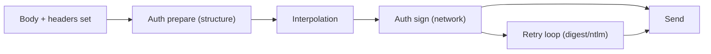

# Authentication (Logic)

Status: VERIFIED unless marked.

Companion to `flows/authentication-flow.md` (user journey). This document is the implementation-level reference: for each provider, the **exact transformation** applied to the request.

---

## 1. Pipeline position



| Provider | Prepare | Sign | Transport wrap |
|---|---|---|---|
| Basic | config | header (`interpolate-vars`) | — |
| Bearer | header | — | — |
| API Key | header or deferred | query param (`configureRequest`) | — |
| WSSE | header (digest computed immediately) | — | — |
| Digest | config | header after challenge | yes (retry) |
| NTLM | config | handshake | yes (adapter) |
| OAuth1 | config | per-request signature | — |
| OAuth2 | config | token fetch + inject | — |
| AWS v4 | config | authorizer interceptor | — |
| EdgeGrid | config | signer interceptor | — |

---

## 2. Basic

```js
// interpolate-vars.js
request.headers['Authorization'] = `Basic ${Buffer.from(`${username}:${password}`).toString('base64')}`;
delete request.basicAuth;
```

- Empty username/password are coerced to `''` (`|| ''`).
- RFC 7617 uses ISO-8859-1 by default; Bruno uses UTF-8 (Node `Buffer.from`). Servers expecting Latin-1 may reject non-ASCII credentials — a documented difference if you switch.

---

## 3. Bearer

```js
axiosRequest.headers['Authorization'] = `Bearer ${token}`;
```

If `token` is empty, the header becomes `Bearer ` (trailing space) — a real behavior worth preserving or fixing deliberately.

---

## 4. API Key

| Placement | Effect |
|---|---|
| `header` | `headers[key] = value`; `apiKeyHeaderName = key` (used so redirect handling/`omitHeaders` can reason about it) |
| `queryparams` | Deferred; appended in `configureRequest` after interpolation |

Empty key → no-op (`if (apiKeyAuth.key.length === 0) break;`).

---

## 5. WSSE

```text
nonce  = 16 random bytes as hex
ts     = new Date().toISOString()
digest = base64( hex( sha1( nonce + ts + password ) ) )
X-WSSE: UsernameToken Username="U", PasswordDigest="D", Nonce="N", Created="T"
```

The digest is computed **before** interpolation, so a password containing `{{var}}` is hashed literally. This is arguably a bug; a Go port should decide explicitly (PROPOSED: interpolate first, document the divergence).

---

## 6. Digest

`addDigestInterceptor(axiosInstance, request)` (`digestauth-helper.js`):

1. Send the request unauthenticated.
2. On `401` with `WWW-Authenticate: Digest`, parse `realm`, `nonce`, `qop`, `opaque`, `algorithm`, `stale`.
3. Compute `HA1 = H(user:realm:pass)`, `HA2 = H(method:uri)`, `response = H(HA1:nonce:nc:cnonce:qop:HA2)`.
4. Retry with `Authorization: Digest …`.
5. If `stale=true`, redo.

---

## 7. NTLM

```js
const ntlmInstance = NtlmClient(request.ntlmConfig, {});
axiosInstance.defaults.adapter = (config) => ntlmInstance.request({ ...config, adapter: axios.getAdapter('http') });
delete request.ntlmConfig;
```

- NTLM is connection-oriented: the handshake must reuse the same TCP connection.
- Redirect handling must not carry NTLM state across hosts (`handleNtlmRedirect`).

---

## 8. OAuth 1.0a

`applyOAuth1ToRequest(request, collectionPath)`:

- Builds the signature base string from method, base URI (no port if default), sorted normalized parameters.
- `oauth_*` params added to the chosen `placement` (header/query/body).
- RSA private keys may come from a file (relative to the collection) or inline text.
- `includeBodyHash` adds `oauth_body_hash` (RFC 5849 extension).

---

## 9. OAuth 2.0

### Token request construction

| Field | Placement |
|---|---|
| `client_id`, `client_secret` | body (default) or HTTP Basic (`credentialsPlacement: 'basic_auth_header'`) |
| `grant_type` | body |
| `code`, `redirect_uri`, `code_verifier` | body (auth code) |
| `username`, `password` | body (password grant) |
| `scope` | body |
| `refresh_token` | body (refresh) |
| additional params | headers / query / body per config |

### PKCE

`pkce: true` → generate `code_verifier` + `code_challenge` (S256), store the verifier with the pending authorization.

### Token storage

```text
key = credentialsId (interpolated) or derived default
value = { access_token, refresh_token, expires_in, id_token, token_type, scope, … }
```

- Persisted in `store/oauth2.js` (electron-store).
- Folder-scoped credentials share with all requests inheriting that folder's auth.
- `bru.deleteOauth2Credential()` invalidates.
- `clear-oauth2-cache` IPC removes by `credentialsId`.

### Token injection

```js
tokenValue = tokenSource === 'id_token' ? credentials.id_token : credentials.access_token;
if (tokenPlacement === 'header') headers['Authorization'] = `${tokenHeaderPrefix} ${tokenValue}`.trim();
else url.searchParams.set(tokenQueryKey, tokenValue);
```

Default `tokenHeaderPrefix` is `Bearer` in the UI model.

### Refresh

- `autoRefreshToken` → refresh before the request when the token is expired (or within a skew window; exact skew is UNKNOWN).
- Refresh uses `refreshTokenUrl` (falls back to `accessTokenUrl`).

### Credential variables

Every credential field is exposed as `$oauth2.<credentialsId>.<field>` and injected into the interpolation scope, so scripts and headers can reference `{{$oauth2.myApi.access_token}}`.

---

## 10. AWS Signature v4

1. `resolveAwsV4Credentials(request)` resolves credentials in order: explicit fields → environment variables → shared credentials file → profile (`profileName`).
2. `addAwsV4Interceptor(instance, request)` signs each request with `aws4-axios`.
3. Region/service may be inferred from the URL (`*.amazonaws.com`) when not set.
4. On redirect: `__skipAwsV4Sign` and `x-amz-*` removal for cross-origin hops.

---

## 11. Akamai EdgeGrid

Signature inputs: `accessToken`, `clientToken`, `clientSecret`, request method, scheme, host, path+query, canonicalized `headersToSign`, body hash (bounded by `maxBodySize`). Result: `Authorization: EG1-HMAC-SHA256 client_token=…;access_token=…;timestamp=…;nonce=…;signature=…`.

---

## 12. Interaction with user-set headers

| Scenario | Result |
|---|---|
| User `Authorization` + no auth mode | Sent as-is |
| User `Authorization` + Basic/Bearer | Overwritten by auth (interpolation rebuilds the map) |
| API key in header | Merged, may coexist with authorization |
| `omitHeaders` includes `authorization` | Not applied to auth-generated headers (auth sets them after omission logic) |

---

## 13. Error surfaces

| Failure | Message |
|---|---|
| OAuth1 signing | `OAuth1 signing failed: <detail>` |
| OAuth2 token | Provider error details shown in Auth tab (`main:credentials-update` debugInfo) |
| AWS credential resolution | Interceptor error → transport error path |
| Cert/key read | `Error reading cert/key file` |

---

## 14. Go interface design (PROPOSED)

```go
type Credentials map[string]string

type AuthProvider interface {
    Name() string
    // Prepare mutates the built request using still-unresolved values.
    Prepare(req *BuiltRequest, cfg Config) (Signer, error)
}

type Signer interface {
    // Sign is called after interpolation with a fresh *http.Request; it may
    // replace the transport (digest/ntlm) or return a modified request.
    Sign(ctx context.Context, req *http.Request) (RoundTripper, error)
}

type TokenCache interface {
    Get(ctx context.Context, key string) (*Token, bool)
    Put(ctx context.Context, key string, t *Token) error
    Delete(ctx context.Context, key string) error
}
```

Digest/NTLM become `RoundTripper` wrappers (`RoundTrip` = send unauthenticated → on 401 → retry authenticated). This is the idiomatic Go shape and avoids mutating requests on 401, which `http.Client` otherwise makes awkward.
