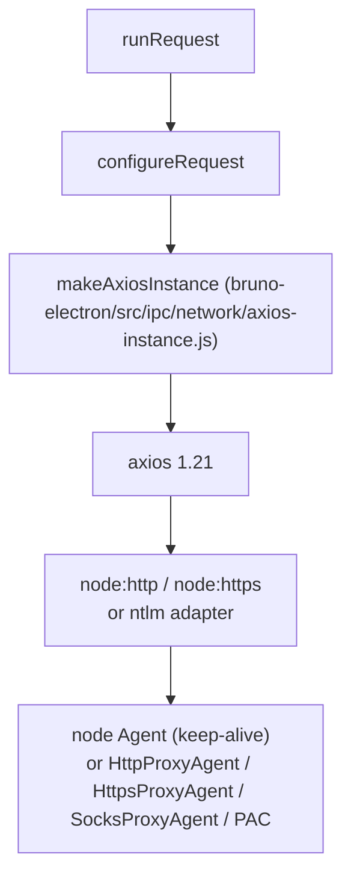
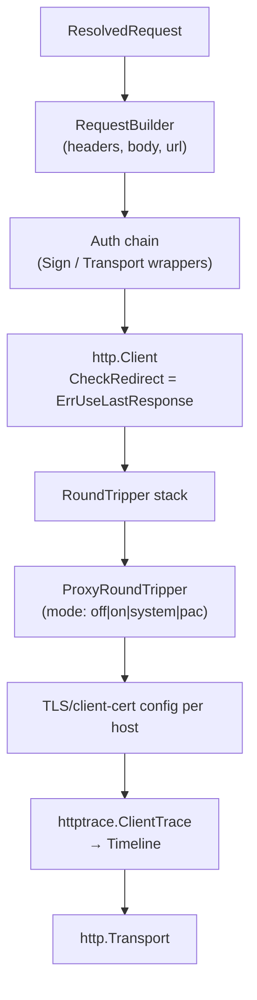

# HTTP Engine

Status: VERIFIED unless marked.

This document describes the transport layer as actually implemented: axios in `bruno-electron`, the Electron axios wrapper, and the agent stack in `bruno-requests`.

---

## 1. Layers



Two axios factories exist:

| Factory | Used by | Features |
|---|---|---|
| `bruno-requests/src/network/axios-instance.ts` | `bru.sendRequest`, generic reuse | Pure transport, timing interceptor |
| `bruno-electron/src/ipc/network/axios-instance.js` | All user requests | Adds timeline recording, localhost IP family resolution, omit-headers/connection, proxy agent setup per hop, **manual redirects**, OAuth2-on-401 |

The second is the one that matters for parity.

---

## 2. Instance configuration (VERIFIED)

```js
axios.create({
  transformRequest: (data, headers) => {
    const ct = headers?.['Content-Type'] || headers?.['content-type'] || '';
    if (typeof data === 'string' && ct.includes('json')) return data;   // don't double-encode
    return axios default transforms…
  },
  proxy: false,        // proxy handled via agents
  maxRedirects: 0,     // redirects handled manually
  headers: {}
});
instance.defaults.headers.common['User-Agent'] = `bruno-runtime/${version}`;
```

Rationale comment (verbatim, paraphrased): assigning a new headers object would nuke axios's default `Accept: application/json, text/plain, */*`.

**Go note:** `net/http` does not add an `Accept` header. If parity with servers that content-negotiate matters, set `Accept: application/json, text/plain, */*` and `User-Agent: <app>/<version>` explicitly, allowing the user to override both.

---

## 3. Request interceptor responsibilities

Ordered steps inside `instance.interceptors.request.use`:

1. `config.metadata` init; `completeOpenHop(config)` (closes the previous hop's timing); push `separator`, `info` (URL, current time), `request` (`METHOD url`), `requestData` timeline entries.
2. **Localhost DNS override** (issue #124, RFC 6761 §6.3):
   - `url.hostname === '127.0.0.1'` → force IPv4.
   - `url.hostname === '::1'` → force IPv6.
   - otherwise if the TLD is `localhost` (e.g. `api.localhost`) → probe IPv6 on the target port; use IPv6 if reachable, else IPv4.
   - any other host → delete `config.lookup` (use system resolver).
3. **Omit headers**: `applyOmitHeaders(config.headers, { omitHeaders, headersToDelete, explicitHeaderNames })`.
4. **Proxy agents**: `await setupProxyAgents({ requestConfig, proxyMode, proxyModeReason, proxyConfig, httpsAgentRequestFields, interpolationOptions, timeline })`; failures are recorded in the timeline, not thrown.
5. If `connection` was omitted, strip it from the final request.
6. Record preparation timing; `startHop(config.metadata)`.

`refreshExplicitHeaderNames(request)` is called immediately before send to recompute which headers the user actually set (used to suppress defaults).

---

## 4. Response interceptor

- Push `response` and `responseHeader` entries.
- Attach the timeline to the response object.
- `completeOpenHop` when the body is not streamed.

## 5. Error interceptor (redirect engine — summary)

Detailed in `logic/redirects.md`. Key facts:

- `redirectResponseCodes` are treated as "not an error" for the user.
- Redirects are re-issued by calling `instance(requestConfig)` recursively.
- `redirectCount` and `requestMaxRedirects` bound the loop.
- Cookies are saved per hop; the new hop receives the jar's cookies for the new URL.
- Proxy agents are rebuilt for the new host.

---

## 6. Agent construction

`bruno-requests/src/utils/http-https-agents.ts` (642 lines).

```ts
type ProxyMode = 'on' | 'off' | 'system' | 'pac';

type HttpsAgentRequestFields = {
  keepAlive?: boolean;
  rejectUnauthorized?: boolean;
  caCertificatesCount?: { system, root, custom, extra };
  ca?: string | string[];
};
```

| Mode | Agent |
|---|---|
| `off` | `new https.Agent(opts)` / `new http.Agent(opts)` |
| `on` (http/https proxy) | `HttpsProxyAgent(proxyUrl, opts)` / `HttpProxyAgent(proxyUrl, opts)` |
| `on` (socks) | `SocksProxyAgent(...)` |
| `system` | Proxy URL from `system-proxy` store (`http_proxy`/`https_proxy`/`no_proxy`) |
| `pac` | `pac-resolver` evaluates the PAC script (`FindProxyForURL`) → resolves to agent |

Other behaviours:

- **Agent cache** (`agent-cache.ts`, 393 lines) keyed by the effective options, to avoid re-creating agents per request (TLS handshake reuse). `cacheSslSession` preference toggles session caching.
- **`no_proxy` bypass**: host matching honors the bypass list.
- **`DEFAULT_PORTS`** mapping for `ftp/gopher/http/https/ws/wss`.
- `TimelineAgent` (`timeline-agent.ts`, 309 lines) is a thin agent wrapper that records connection phases (DNS, TCP, TLS) into the request timeline.
- `omit-connection.ts` avoids `Connection: keep-alive` when the user disabled it.

---

## 7. TLS

| Concern | Implementation |
|---|---|
| Verification off | `rejectUnauthorized: false` when the preference is disabled **and** CA loading is skipped |
| Custom CA | `getCACertificates({ caCertFilePath, shouldKeepDefaultCerts })` merges: system trust, Node root, custom file, extra certs; returns counts for diagnostics |
| Client certificates | Matching by `domain` pattern (supports `*.example.com`, optional scheme prefix, interpolated variables); `cert`+`key` or `pfx` + `passphrase`; files read as Buffers per request |
| Minimum protocol / ciphers | Not configurable in the analyzed code (UNKNOWN) |

Source: `cert-utils.js` lines 20–120, `bruno-requests/src/utils/ca-cert.ts`

---

## 8. Request/response sizes and streaming

| Concern | Behavior |
|---|---|
| Request body | Buffer or stream (files > 20 MB) |
| Response | Always requested as a stream; buffered for non-stream responses |
| Decompression | axios/Node handles `gzip`, `deflate`, `br` automatically (response headers still show `content-encoding`) |
| Keep-alive | Enabled by default (fixes "socket hang up", issue #211), overridden if `settings.omitHeaders` includes `connection` |

---

## 9. Timeouts and cancellation

| Mechanism | Detail |
|---|---|
| Timeout | axios `timeout` from `resolveInheritedSettings`; `0` means no timeout |
| Cancellation | `AbortController` + `signal`; `cancelTokens` map in main; `axios.isCancel` detection |
| Script `req.setTimeout` | Mutates the timeout inside a pre-request script |
| Runner cancel | Propagates to the in-flight controller |

---

## 10. Special cases

| Case | Behavior |
|---|---|
| `WOOF` method | `easterEggResponse(request)` (`utils/woof.js`) |
| `settings.omitHeaders` | Suppresses Node defaults like `User-Agent`, `Accept-Encoding`, `Connection` |
| Proxy setup failure | Request proceeds direct; timeline error |
| Empty body + no content type | `content-type: false` sentinel prevents auto-detection |
| IPv6 localhost | Probe-then-fallback resolver |

---

## 11. Go port design (PROPOSED)



Concrete recommendations:

1. One `http.Transport` per (proxy mode, TLS config, client cert) tuple, cached — mirrors `agent-cache.ts`.
2. Implement redirects in a loop around `client.Do`, not via `CheckRedirect` following.
3. Use `httptrace` for DNS/connect/TLS/got-first-byte events to reproduce the timeline.
4. For PAC, evaluate the script with `goja` and implement `dnsResolve`, `isInNet`, `shExpMatch`, `myIpAddress`, `dnsDomainIs` — the minimum useful surface.
5. Support SOCKS5 via `golang.org/x/net/proxy`.
6. Cap in-memory bodies; spill to disk (see `research/limitations.md`).
