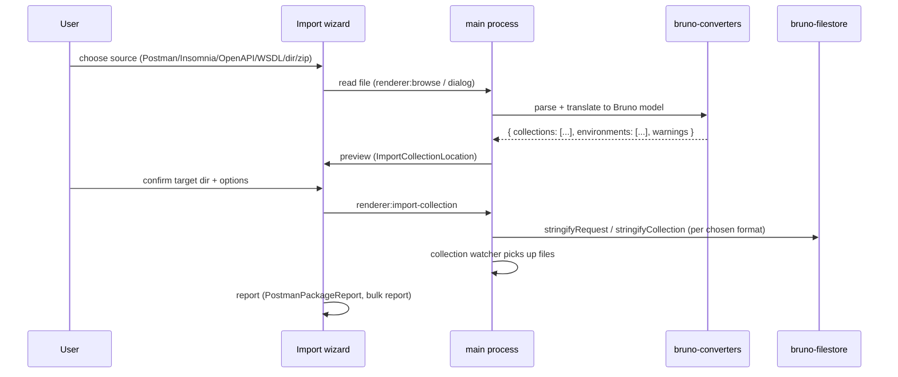

# Import & Export

Status: VERIFIED unless marked.

---

## 1. Capability matrix

| Format                              | Import          | Export            | Module                                                                  |
| ----------------------------------- | --------------- | ----------------- | ----------------------------------------------------------------------- |
| Bruno `.bru` collection (directory) | yes             | yes               | `bruno-filestore` (`bru`)                                               |
| Bruno bundle (`.zip`)               | yes             | yes               | `adm-zip` + `bruno-app/src/utils/importers` / `exporters`               |
| OpenCollection YAML                 | yes             | yes               | `bruno-filestore` (`yml`), `bruno-converters/opencollection`            |
| Postman v2 / v2.1                   | yes             | yes               | `bruno-converters/postman`                                              |
| Postman environment                 | yes             | —                 | `postman-env-to-bruno-env.js`                                           |
| Insomnia v4/v5                      | yes             | —                 | `bruno-converters/insomnia`                                             |
| OpenAPI 3 / Swagger 2               | yes (requests)  | yes (spec export) | `bruno-converters/openapi`, `bruno-app/utils/exporters/openapi-spec.js` |
| WSDL                                | yes (requests)  | —                 | `bruno-converters/wsdl`                                                 |
| cURL                                | paste → request | generate snippet  | `bruno-app/src/utils/curl`, `utils/codegenerator`                       |

---

## 2. Import pipeline

Components: `Sidebar/ImportCollection` (file/url tabs), `ImportCollectionLocation` (target + format choice), `BulkImportCollectionLocation` (980 lines, multi-collection import), `PostmanPackageReport`.

### Postman translation notes (`postman-to-bruno.js`, `postman-translations.js`)

- Collections/folders/requests → folders/requests, with `seq` assigned from order.
- Variables → environments (collection variables → a generated env or collection vars).
- Auth → Bruno auth modes; unsupported ones become a warning and a script where possible.
- Pre-request/test scripts → `script:pre-request` / `tests`, with `pm.*` API translated to `bru.*` where a mapping exists (`postman-script-report.js` records untranslatable calls).
- Form data with files → `multipartForm` entries.

This translation is **lossy by nature**; the report component exists precisely to surface what was dropped.

---

## 3. Export pipeline

| Target                 | Path                                                            |
| ---------------------- | --------------------------------------------------------------- |
| Bruno directory/bundle | `renderer:export-collection` → `stringify*` → zip               |
| OpenCollection YAML    | `bruno-to-opencollection.ts` (bidirectional, best fidelity)     |
| Postman v2.1           | `bruno-to-postman.js`                                           |
| OpenAPI spec           | `utils/exporters/openapi-spec.js` (requests → paths/operations) |

Export never mutates the collection on disk.

---

## 4. OpenAPI / API spec features (adjacent)

| Feature                                  | Description                                                   |
| ---------------------------------------- | ------------------------------------------------------------- |
| `OpenAPISpecTab`, `ApiSpecTab`           | Browse an OpenAPI spec                                        |
| `OpenAPISyncTab` + `ipc/openapi-sync.js` | Detect drift between spec and collection, apply changes       |
| `utils/api-specs`                        | Parse, resolve `$ref` (`@apidevtools/json-schema-ref-parser`) |
| `wsdl.js` IPC                            | WSDL import                                                   |

These are substantial features; see `implementation/feature-parity-matrix.md` for priority.

---

## 5. Code generation

`bruno-common/src/generate-code` and `bruno-app/src/utils/codegenerator` produce snippets for many targets (curl, HTTPie, JS fetch/axios, Python requests, Go, Java, C#, PHP, Ruby, Shell…). `httpsnippet` is a dependency in the renderer.

The generated snippet must reflect interpolated values _as typed_ (i.e. `{{host}}` stays) or resolved? (UNKNOWN — test against a live instance before porting; both behaviors exist in tools).

---

## 6. curl import

`utils/curl` parses a pasted `curl` command into a request:

- `parse-curl.js` parses flags (`-X`, `-H`, `-d`, `--data-binary`, `-F`, `-u`, `--url`, cookies, etc.).
- `curl-to-json.js` builds the request object.
- Hooked into the URL editor and GraphQL editor paste handlers (`QueryUrl.handleGraphqlPaste`).

---

## 7. Go implementation (PROPOSED)

1. Implement the internal model first; converters should translate **to and from** the internal model only.
2. OpenCollection YAML is the best long-term interchange format (it is Bruno's own migration target) — implement it alongside `.bru`.
3. For Postman, mirror Bruno's approach: convert, then report every dropped construct. Do not promise perfect fidelity.
4. Bruno's Postman importer is heavily tested (101 converter tests). Use its fixtures as your acceptance suite.
