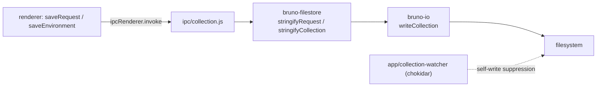

# Persistence

Status: VERIFIED for Bruno's on-disk stores; PROPOSED for the Go design.

Scope: **where state lives**, as distinct from **what the formats look like**. The `.bru`/`.yml` grammars are in `data/bru-format.md` and `data/collection-format.md`; this document covers the app-level stores (preferences, secrets, cookies, tokens, window state), the write path, encryption, and the Go replacement.

---

## 1. Bruno's persistence layout (VERIFIED)

Bruno has **no database of record** for user content. Collections are files. Everything else is one `electron-store` JSON file per concern, in Electron's `userData` directory.

| Store file (`store/*.js`) | Contents | Encrypted |
| --- | --- | --- |
| `preferences` | global preferences (proxy, certs, general, appearance) | no |
| `cookies` | cookie jar keyed by domain | yes — passkey + AES |
| `oauth2` | cached OAuth2 tokens keyed by `credentialsId` | yes |
| `secrets` | per-collection, per-environment secret variable values | yes — per value |
| `bruno-config` | `lastOpenedCollections`, app-level config | no |
| `last-opened-collections` | recent collections | no |
| `last-opened-workspaces` | recent workspaces | no |
| `default-workspace` | default workspace root | no |
| `global-environments` | global env files index | no |
| `workspace-environments` | workspace env files index | no |
| `window-state` | bounds, maximised, last monitor | no |
| `system-proxy` | cached system proxy resolution | no |
| `process-env` / `shell-env-state` | captured shell environment (for launching requests with a login-shell PATH) | no |
| `ai-keys` | AI provider keys | yes |
| `collection-security` | per-collection security settings | no |
| `tests` (`store/tests`) | test-only fixtures | n/a |

Source: `packages/bruno-electron/src/store/`
Relevant symbols: `EnvironmentSecretsStore`, `CookiesStore`, `new Store({ name: '…', clearInvalidConfig: true })`

`clearInvalidConfig: true` appears on several stores: a corrupt JSON file is **silently discarded**, not backed up. That is a real data-loss path (INFERRED) — cookie jars and OAuth tokens can vanish after a crashed write.

---

## 2. The write path for collections (VERIFIED)



Two properties matter for the port:

1. **Stringify then write.** The renderer sends a draft object; the main process stringifies to `.bru` or `.yml` and writes. Parsing is the inverse and runs in a worker pool (`services/pool`).
2. **Watcher feedback loop.** Filesystem events must be suppressed for writes the app itself caused, otherwise each save triggers a reload. `app/collection-watcher.js` owns that suppression.

Source: `packages/bruno-io/src/writeCollection/index.ts`, `packages/bruno-electron/src/app/collection-watcher.js`
Relevant symbols: `writeCollection`, `WriteCollectionOptions`, watcher ignore logic

---

## 3. Encryption (VERIFIED)

`utils/encryption.js` implements a **versioned prefix scheme**: the first three characters identify the algorithm, so old files stay readable after the scheme changes.

| Prefix | Meaning |
| --- | --- |
| `$00:` | Electron `safeStorage` (OS keychain-backed) |
| `$01:` | AES-256-CBC with a key derived from the **machine ID** |

Details observed:

- `$01` derives a 32-byte key as `sha256(machineId)` and uses an **all-zero 16-byte IV**. This is deterministic and not semantically secure; it is obfuscation, not encryption.
- `safeStorage.isEncryptionAvailable()` decides between `$00` and `$01` at write time; decryption accepts either.
- The cookie store takes a different approach again: a random 32-byte passkey is generated once, stored (`encryptedPasskey`) and used for the jar, with writes **debounced by 5000 ms** (`DEBOUNCE_MS`).

Source: `packages/bruno-electron/src/utils/encryption.js`
Relevant symbols: `aes256Encrypt`, `encryptStringSafe`, `decryptStringSafe`, `ELECTRONSAFESTORAGE_ALGO`, `AES256_ALGO`, `deriveKeyAndIv`

Source: `packages/bruno-electron/src/store/cookies.js`
Relevant symbols: `CookiesStore`, `#generatePasskey`, `DEBOUNCE_MS`

**Assessment.** The `$01` path should not be reproduced. The Go port uses the OS credential store when available and, as a fallback, AES-GCM with a per-install random key protected by the same credential store — never a machine-ID-derived key with a fixed IV.

---

## 4. Go design: persistence (PROPOSED)

### 4.1 Store inventory

| Store | File/location | Format | Encryption | Notes |
| --- | --- | --- | --- | --- |
| Collections | user-chosen directories | `.bru` / `opencollection.yml` | none (user may use git-crypt) | single source of truth |
| Preferences | `<config>/preferences.json` | JSON | none | schema-versioned |
| Window/session | `<config>/session.json` | JSON | none | written on graceful shutdown + throttled |
| Secrets | OS keychain, service `<app-id>`, account `<collection-id>/<env>/<var>` | key-value | keychain-native | fallback: `<config>/secrets.bin` AES-GCM |
| Cookies | `<data>/cookies.db` or JSON | JSON | AES-GCM | debounced flush |
| OAuth2 tokens | `<data>/oauth2.db` | JSON | AES-GCM | keyed by credentials ID |
| History | `<data>/history.db` | SQLite (WAL) | metadata plain, bodies refer to spool | **new feature** |
| Body spool | `<data>/spool/<sha256>` | raw bytes | none | content-addressed, TTL-swept |
| Logs | `<config>/logs/` | JSONL | none | rotated |
| Shell env cache | `<config>/shellenv.json` | JSON | none | login-shell PATH |

All paths come from an injected `Paths` struct — `core` never calls `os.UserConfigDir` directly. This mirrors Bruno's name-per-file layout without the Electron dependency, and keeps `core` testable with a temp dir.

### 4.2 Settings schema

```go
// internal/core/model/settings.go
type Settings struct {
    SchemaVersion int              `json:"schemaVersion"`
    General       GeneralSettings  `json:"general"`
    Proxy         ProxySettings    `json:"proxy"`
    TLS           TLSSettings      `json:"tls"`
    Editor        EditorSettings   `json:"editor"`
    Request       RequestDefaults  `json:"request"`
    Privacy       PrivacySettings  `json:"privacy"`
    Appearance    AppearanceSettings `json:"appearance"`
}
```

Migration rule (PROPOSED): load → if `SchemaVersion < current`, apply ordered migrations in memory → write back once → proceed. Never fail to start because of an old settings file; never silently discard an unreadable one — move it to `preferences.json.corrupt-<ts>` and start from defaults. This is a deliberate divergence from Bruno's `clearInvalidConfig: true`.

### 4.3 Secrets

```go
// internal/core/persistence/secrets.go
type Secrets interface {
    Get(ctx context.Context, scope SecretScope) (string, bool, error)
    Set(ctx context.Context, scope SecretScope, value string) error
    Delete(ctx context.Context, scope SecretScope) error
}

type SecretScope struct{ Collection, Environment, Name string }
```

- Backed by `mygo.Secrets` (OS credential store) in the GUI build.
- A `FileSecrets` implementation backs tests and headless CI.
- The **core never logs secret values**; the `UnresolvedVariables` event must redact them.

### 4.4 Body spool

```go
type BodyRef struct {
    ID          string // sha256 of content
    Size        int64
    ContentType string
    Encoding    string // "" | "base64" | charset
    Inline      []byte // non-nil only when Size <= inlineThreshold
    Path        string // absolute spool path when spilled
}
```

Rules:

1. Bodies ≤ 32 MiB are inlined (keeps small-response rendering instant and avoids file churn).
2. Larger bodies spill to `spool/<sha256>`; identical bodies deduplicate for free.
3. A sweeper goroutine deletes spool entries not referenced by history, saved examples, or open tabs, and older than the retention window.
4. Deleting a body is reference-counted through the history DB; the sweeper only removes orphans.

This is the mechanism that makes `research/limitations.md` §2.1 and §2.9 not apply to the port.

### 4.5 History schema (new feature)

```sql
CREATE TABLE request_history (
  id           INTEGER PRIMARY KEY AUTOINCREMENT,
  created_at   INTEGER NOT NULL,          -- unix millis
  collection_id TEXT NOT NULL,
  item_uid     TEXT NOT NULL,
  environment  TEXT,
  method       TEXT NOT NULL,
  url          TEXT NOT NULL,             -- post-interpolation
  status       INTEGER,
  duration_ms  INTEGER,
  size_bytes   INTEGER,
  request_body TEXT,                      -- 'ref:<sha256>' or NULL
  response_body TEXT,                     -- 'ref:<sha256>' or NULL
  error        TEXT,
  truncated    INTEGER NOT NULL DEFAULT 0
);
CREATE INDEX idx_history_created  ON request_history(created_at DESC);
CREATE INDEX idx_history_item     ON request_history(item_uid, created_at DESC);
```

Single writer goroutine, WAL, readers on separate connections (`implementation/go-architecture.md` §7). Write happens **after** the terminal event is published, so UI latency never depends on disk.

### 4.6 Concurrency and crash safety

| Concern | Approach |
| --- | --- |
| Atomic file writes | write `*.tmp` in the same directory → `fsync` → `rename` |
| Concurrent saves of one file | per-path mutex in `core/collection`; the watcher ignores self-writes by tracking in-flight paths |
| Corrupt file recovery | quarantine + defaults (§4.2) rather than discard |
| Cookie/token flush | debounce (Bruno uses 5 s) but **also flush on shutdown and on `ErrorOccurred`** |
| Spool GC | orphan sweep on startup and every N minutes |

### 4.7 Testing strategy

- `core/persistence` with `t.TempDir()` for every test; no global state.
- Fuzz the settings migration path with old-schema fixtures.
- Corruption tests: truncate each file mid-write, assert quarantine-and-continue.
- Spool tests: force inline threshold to 0 and to `math.MaxInt64` to exercise both branches.

Source (Bruno counterpart): `packages/bruno-electron/src/store/**`, `packages/bruno-electron/src/utils/encryption.js`, `packages/bruno-io/src/writeCollection/index.ts`
