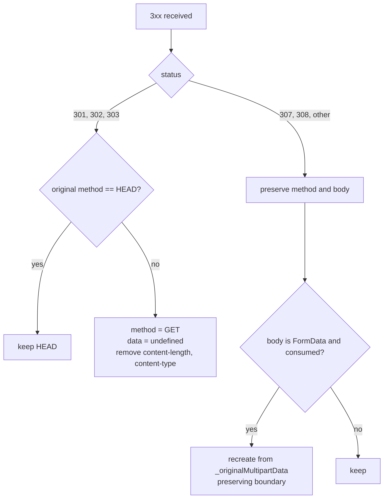

# Redirects

Status: VERIFIED unless marked.

Bruno **disables axios redirects** (`maxRedirects: 0`) and implements its own loop in the response error interceptor. Reproducing this is essential: it drives the timeline, cookie capture, and credential stripping.

Source: `packages/bruno-electron/src/ipc/network/axios-instance.js` (lines 260–560), `ipc/network/index.js` `configureRequest`.

---

## 1. Trigger conditions

A response enters the redirect branch when **all** hold:

1. `error.response` exists (axios treats 3xx as an error when `maxRedirects: 0`).
2. `redirectResponseCodes.includes(error.response.status)` (3xx family).
3. Timeline entries for the hop have been recorded.

Then:

| Check | Action |
|---|---|
| `!followRedirects` | Stop; return the 3xx as the response (cookies stored first) |
| `redirectCount >= requestMaxRedirects` | Stop; reject with the last 3xx; timeline error records the body |
| No `Location` header | Stop; reject with the 3xx |

---

## 2. Max redirects resolution

```text
request.settings.maxRedirects ?? request.maxRedirects ?? DEFAULT_MAX_REDIRECTS (5)
if (settings.followRedirects === false) → 0
```

Non-numeric or negative values fall back to the default.

---

## 3. URL resolution

```js
if (!/^https?:\/\//i.test(location)) redirectUrl = URL.resolve(error.config.url, location);
```

- Relative, root-relative, protocol-relative (`//host/path`) and query-only (`?a=b`) locations all resolve correctly.
- `location: "//host/x"` is *not* matched by the `^https?://` test, so it is resolved by `URL.resolve` (protocol-relative handling).
- A timeline `info` entry records the resolution.

---

## 4. Method and body rewriting



Notes:

- The 301/302 → GET rewrite for non-HEAD is a browser-like choice; strict RFC 7231 only requires this for 303.
- `content-length` and `content-type` re-added by the transport for the new body when present.

---

## 5. Credential handling on redirects

Branch is on **origin equality** (`isSameOrigin`): scheme + host + port.

| Case | Action |
|---|---|
| Same origin | Headers carried over unchanged |
| Cross-origin + AWS SigV4 | `__skipAwsV4Sign = true`; all `x-amz-*` headers removed |
| Cross-origin + `forwardAuthorizationHeader: false` | Remove `authorization` and `proxy-authorization`; timeline note (proxy credentials still applied by the proxy agent) |
| Cross-origin + `forwardAuthorizationHeader: true` (default) | `Authorization` forwarded (non-browser behavior; documented and intentional) |

Cookies are always re-derived from the jar for the new URL, so cross-origin cookie leakage is prevented by the jar itself.

---

## 6. Cookie capture per hop

```js
if (preferencesUtil.shouldStoreCookies()) saveCookies(error.config.url, error.response.headers);
```

Happens **before** re-issuing so intermediate `Set-Cookie` values are not lost. Also happens when redirects are disabled.

---

## 7. NTLM across redirects

`handleNtlmRedirect(requestConfig, fromUrl, toUrl, forwardAuthorizationHeader)`:

- On a different host, NTLM state must not follow — the handshake is tied to the connection and the target server.
- Credentials explicitly configured by the user (not the `Authorization` header) are handled by the adapter.

---

## 8. Proxy agents per hop

The redirect loop calls `setupProxyAgents` again for the new URL because:

- The new host may match different `no_proxy` rules.
- A PAC rule can select a different proxy per URL.
- Failures are recorded in the timeline, and the request proceeds direct.

---

## 9. Body replay for 307/308

| Body kind | Replay |
|---|---|
| `string` / `Buffer` | Safe to reuse |
| `form-data` (Node) | Streams are consumed; Bruno recreates from `request._originalMultipartData` + `request.collectionPath` with the same boundary |
| `fs.ReadStream` (large file body) | **Not re-opened** — this is a latent bug for 307/308 redirects with file bodies (INFERRED from the absence of replay logic for streams) |

---

## 10. Timeline entries generated

| Event | Entry |
|---|---|
| Each hop | `response` (`HTTP/x status text`) |
| Each hop | `responseHeader` per header |
| Relative resolution | `info` ("Resolving relative redirect URL") |
| Method rewrite | `info` ("Changed method from POST to GET for 301 redirect…") |
| Cross-origin auth strip | `info` |
| FormData recreation | `info` |
| Limit exceeded | `error` (with body text) |

---

## 11. Limit and error semantics

When the redirect limit is hit the whole request is treated as failed: the caller receives `{ error, statusText, timeline }` (transport-error path), not a 3xx response. This differs from curl's `--max-redirs` (which also fails) and from browsers (which show the last response).

---

## 12. Go implementation (PROPOSED)

```go
client := &http.Client{
    Transport: transport,
    CheckRedirect: func(*http.Request, []*http.Request) error {
        return http.ErrUseLastResponse // we follow manually
    },
}

func send(ctx context.Context, b *BuiltRequest, cfg RedirectConfig) (*Response, error) {
    for hop := 0; ; hop++ {
        resp, err := client.Do(b.ToHTTPRequest(ctx))
        if err != nil { return nil, err }
        if !cfg.Follow || !isRedirect(resp.StatusCode) { return resp, nil }
        if hop >= cfg.Max { return nil, ErrTooManyRedirects }
        loc := resp.Header.Get("Location")
        if loc == "" { return resp, nil }
        b = b.ForRedirect(resp.StatusCode, loc) // method/body/header rules above
        // cookies handled by the jar attached to the client
    }
}
```

`b.ForRedirect` should encapsulate sections 4–5 so the rules are testable in isolation.
