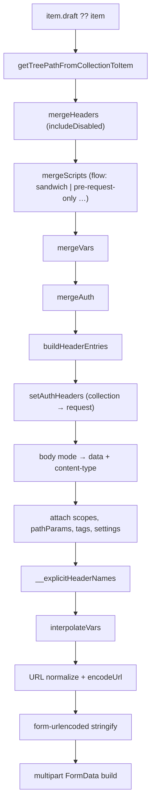

# Request Builder

Status: VERIFIED unless marked.

Input: an item tree at a path, an environment, and scope maps.
Output: a fully resolved `http.Request` (Bruno: an `axiosRequest` object).

Files: `packages/bruno-electron/src/ipc/network/prepare-request.js`, `interpolate-vars.js`, `utils/collection.js`, `utils/form-data.js`.

---

## 1. Pipeline (authoritative order)



---

## 2. Merging rules

### Headers (`mergeHeaders`)

1. Start with collection root `request.headers`.
2. Apply each folder in path order.
3. Apply request headers last.
4. **Case-insensitive special case** for `content-type`: stored under lowercase key `'content-type'`.
5. Disabled entries tracked in a separate map (used to keep the row visible in the UI, and by `omitHeaders` logic elsewhere).
6. Option `includeDisabledHeaders: true` is passed by `prepareRequest`.

### Vars (`mergeVars`)

Collection `vars:pre-request` → folder vars → request `vars:pre-request`; request `vars:post-response` handled separately. Typed values coerced via `parseValueByDataType`.

### Scripts (`mergeScripts`)

Honors `bruno.json → scripts.flow` (default `'sandwich'`). In the sandwich model: collection pre → folder pre (outer→inner) → request pre; post scripts run in reverse. The exact flow values supported are defined in `utils/collection.js` (`scriptFlow` param, line 296).

### Auth (`mergeAuth`)

See `flows/authentication-flow.md §2`. Important: the *request* object ends up with a concrete `auth` (never `inherit`) unless nothing is defined.

---

## 3. Header serialization

`buildHeaderEntries(headers)` returns `{ headers, headerEntries }`:

- `headers`: a map used for fast lookups and for the transport.
- `headerEntries`: an **ordered list of `[name, value]`** preserving duplicates (HTTP allows repeated names, e.g. `Set-Cookie`, `Cookie`, custom multi-value headers).

Later, `refreshExplicitHeaderNames(request)` computes `__explicitHeaderNames` so the transport can distinguish user headers from framework defaults.

**Go note:** use `http.Header` plus an ordered `[]Header{Name, Value}` if you need to display "as typed" ordering; `http.Header` sorts on write.

---

## 4. Body construction matrix

| Mode | `data` handed to transport | Content-Type default |
|---|---|---|
| none | absent | suppressed |
| json | string with `//`/`/* */` comments removed (`decomment`) | `application/json` |
| text | string | `text/plain` |
| xml | string | `application/xml` |
| sparql | string | `application/sparql-query` |
| graphql | `{ query, variables: JSON-ish string }` | `application/json` |
| formUrlEncoded | `[{name, value}]` → later `qs`/`buildFormUrlEncodedPayload` string | `application/x-www-form-urlencoded` |
| multipartForm | `[{type, name, value, contentType}]` → later `form-data` instance | `multipart/form-data` |
| file | `Buffer` or `ReadStream` | user contentType, else `application/octet-stream` |

### Multipart details (`utils/form-data.js`)

- Entry `type: 'file'` → `form.append(name, fs.createReadStream(absPath), { filename, contentType })`.
- Entry `type: 'text'` → `form.append(name, value)`.
- Per-entry `contentType` is honored (this is how part-level types are preserved).
- Paths are resolved relative to the collection directory.
- Array values (multi-file) append multiple times under the same name.
- Boundary: `createFormData(data, collectionPath, existingBoundary)` — if the user's Content-Type already had `boundary=…`, it is reused so the header stays truthful.

**Go note:** `mime/multipart.Writer.SetBoundary()` accepts a custom boundary — use that instead of patching headers.

---

## 5. Content-Type precedence

```text
1. A Content-Type header from the merged tree (collection/folder/request)  → contentTypeDefined = true
2. Body mode default (table above)
3. For mode=file: the selected file entry's `contentType` (overrides 2)
4. mode=none → suppress (never add)
```

---

## 6. URL handling

| Step | Detail |
|---|---|
| Merge | Request `url` is the only URL; folders/collection do not supply URLs |
| Interpolation | `{{vars}}` resolved with full scope stack |
| Scheme | `http://` prepended if absent and the URL did not start with `{{` |
| Encoding | `encodeUrl(url)` if `settings.encodeUrl` |
| Path params | `:name` replaced from enabled path params with non-empty values; OData-style `EntitySet(:key)` and `Func(a=:b)` supported |
| Query string | Preserved verbatim from the raw URL (not re-encoded) |
| API key in query | `URL.searchParams.set(key, value)` after interpolation |

Path-param algorithm (`interpolate-vars.js` lines 185–245):

1. Extract the raw query substring (`?…`) to restore later.
2. Ensure a scheme, parse with `new URL()` (invalid → `{ message: 'Invalid URL format' }`).
3. Split pathname on `/`, keep non-empty segments.
4. For each segment starting with `:`, look up a **path param with an enabled, non-empty** value; if none, keep the literal `:name`.
5. For OData segments matching `/^[A-Za-z0-9_.-]+\([^)]*\)$/`, replace embedded `:name` occurrences.
6. Reassemble `origin + path + trailingSlash + rawQuery`.

Unresolved path params are intentionally left visible (`/users/:id`) rather than producing a broken URL silently.

---

## 7. Query parameter assembly

- The `url` already contains its query string (kept in sync by the renderer reducer, see `ui/request-editor.md §2`).
- Disabled query params are **not** in the URL.
- Additional query params (API key) are appended with `searchParams.set`, which **replaces** an existing param with the same name.

---

## 8. Validation and guard rails

| Condition | Result |
|---|---|
| URL not parseable after interpolation | `{ message: 'Invalid URL format' }` thrown |
| GraphQL variables not valid JSON | `Failed to parse GraphQL variables: …` |
| File body path missing | `console.error('Error reading file:', error)`; request continues **without body** |
| Multipart file missing | Same (read stream created lazily → transport error) |
| `content-type` explicitly disabled | Treated as not defined |

---

## 9. Go design (PROPOSED)

```go
type BuildInput struct {
    Item       *Item       // with tree path
    Scopes     Scopes      // ordered maps + origin
    Settings   RequestSettings
    Collection *Collection // for relative file paths, proxy, certs
}

type BuiltRequest struct {
    Method  string
    URL     *url.URL
    Headers OrderedHeaders
    Body    BodySource   // none|bytes|stream|multipart|form
    Meta    RequestMeta  // name, tags, pathParams, scripts
    Unresolved []string
}

func Build(ctx context.Context, in BuildInput) (*BuiltRequest, error)
```

Key rules to preserve:

1. Merge before interpolation (auth structure before values).
2. Ordered headers with duplicates.
3. Comment stripping for JSON bodies (many users rely on it).
4. Path-param leave-literal behavior.
5. Never silently drop the user's Content-Type.
