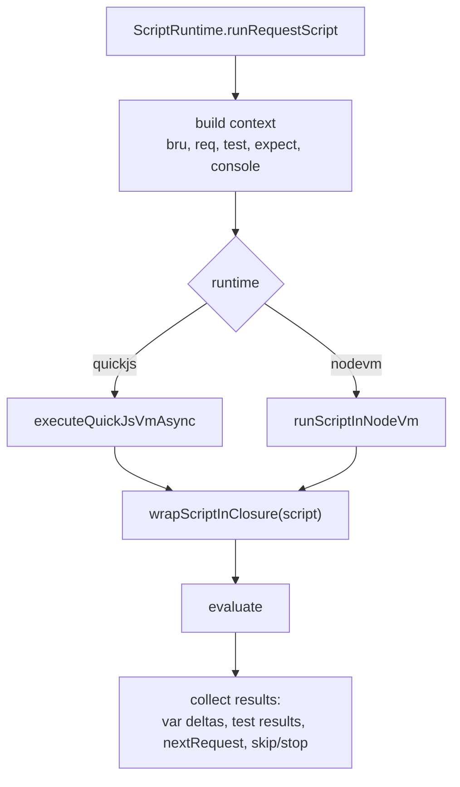

# Scripting (Logic)

Status: VERIFIED unless marked.

Companion to `flows/scripting-flow.md` (lifecycle). This document covers the runtime internals and API contracts needed to reimplement them.

---

## 1. Runtimes

| Runtime | Implementation | Selection |
|---|---|---|
| `quickjs` (**default**) | `quickjs-emscripten` WASM; host objects exposed via shims | when `scripts.runtime` is unset |
| `nodevm` | `node:vm` + custom CJS loader | `scripts.runtime: 'nodevm'` in `bruno.json` |

Both receive the same context object; only capabilities differ.



---

## 2. Context object

| Key | Type | Present in |
|---|---|---|
| `bru` | host object | all |
| `req` | `BrunoRequest` host object | pre-request, tests (read-only-ish) |
| `res` | `BrunoResponse` host object | post-response, tests, vars:post-response |
| `test` | function | scripts + tests |
| `expect`, `assert` | chai | scripts + tests |
| `console` | wrapped logger | all |
| `require` | shim/loader | all |
| `axios`, `uuid`, `nanoid`, `jwt`, `path`, `crypto-utils` | quickjs library shims | quickjs only |
| `process`, `Buffer`, timers | sandbox-provided | both |

`scriptingConfig` in nodevm context keys includes `moduleWhitelist` and `additionalContextRoots`.

---

## 3. `Bru` host-object contract

Required methods for compatibility (names are the API):

```text
Variables (runtime):  getVar, setVar, hasVar, deleteVar, deleteAllVars, getAllVars
Environment:          getEnvVar, setEnvVar, hasEnvVar, deleteEnvVar, getAllEnvVars, deleteAllEnvVars, getEnvName
Collection:           getCollectionVar, setCollectionVar, hasCollectionVar, deleteCollectionVar,
                      getAllCollectionVars, deleteAllCollectionVars, getCollectionName
Folder / request:     getFolderVar, getRequestVar
Global:               getGlobalEnvVar, setGlobalEnvVar, hasGlobalEnvVar, deleteGlobalEnvVar,
                      getAllGlobalEnvVars, deleteAllGlobalEnvVars
process:              getProcessEnv(key)
Utilities:            cwd, interpolate, sleep, isSafeMode
Requests:             sendRequest, runRequest
Credentials:          deleteOauth2Credential
Runner:               setNextRequest, runner.skipRequest, runner.stopExecution
```

Dirty flags (`_envDirty`, `_runtimeVarsDirty`, `_collVarsDirty`, `_globalEnvDirty`) decide what is persisted — only changed scopes are written.

**Name validation:** `/^[\w-.]*$/`; violations throw.

---

## 4. `req` contract

```text
getUrl/setUrl, getHost, getPath, getQueryString
getMethod/setMethod, getAuthMode
getHeaders/setHeaders/deleteHeaders, getHeader/setHeader/deleteHeader, hasJSONContentType
getBody({raw})/setBody, disableParsingResponseJson
setMaxRedirects, getTimeout/setTimeout
onFail(cb), getExecutionMode, getName, getPathParams, getTags
```

Semantics:

- Mutations to URL/headers/body/timeout apply to the real request (they occur before interpolation).
- `setMethod` also updates `mode`-specific behavior (body handling keyed by content type).
- `onFail(cb)` runs only on transport errors; variables it sets are persisted.

---

## 5. `res` contract

```text
getStatus, getStatusText, getHeader, getHeaders, getBody, setBody,
getResponseTime, getUrl, getSize, getDataBuffer
```

`getBody()` returns parsed JSON when the body parsed as JSON, otherwise text; `{ raw: true }` (where supported) returns the string.

---

## 6. `test()` and result collection

```js
test('status is 200', () => {
  expect(res.getStatus()).to.equal(200);
});
```

`createBruTestResultMethods(bru, assertionResults, chai)`:

- Wraps each `test` in try/catch.
- Records `{ status: 'pass'|'fail', description, error?, expected?, actual? }`.
- Async tests are supported; `waitForPendingTests()` drains promises before returning.
- Appends **assertion results** to the same stream so the Tests tab is unified.

---

## 7. Runner control

| Call | Effect |
|---|---|
| `bru.setNextRequest(name)` | Jump (data-driven loops); `null` ends the run |
| `bru.runner.skipRequest()` | Skip current request (pre-request only) |
| `bru.runner.stopExecution()` | Stop after current |

Returned on every script result as `nextRequestName`, `skipRequest`, `stopExecution`.

---

## 8. `bru.runRequest` (nested execution)

`runRequestByItemPathname(relativePathname, callerBru)`:

- Resolves the path against the collection, appending the format extension if missing.
- Clones the item and calls `runRequest({ …, runInBackground: true, parentRequestUid })`.
- Records a `scripted-request` entry for the timeline.
- Rejects on transport/script error; resolves the summary on success.
- gRPC/WS targets resolve with `{ status: 'skipped', statusText: 'bru.runRequest does not support …' }`.

Guard rails: recursion depth and cycle protection are the script author's responsibility (no explicit depth limit found — UNKNOWN whether one exists upstream).

---

## 9. Sandbox security

| Control | QuickJS | Node VM |
|---|---|---|
| Filesystem | Not available except shims | Only inside `additionalContextRoots` |
| Node builtins | Whitelisted shims only | `scripts.moduleWhitelist` |
| Network | Only via `bru.sendRequest` (URL-validated) | Same + `require('http')` if whitelisted |
| Timeouts | WASM trap on runaway | vm timeout (UNKNOWN exact) |
| Prototype tampering | Isolated realm | `safeGlobals`, typed-array mixin |

`url-validation.ts` blocks obviously unsafe destinations (loopback/link-local/metadata IPs) for `bru.sendRequest`, which is a mitigation against prompt-injected scripts.

---

## 10. Error formatting

`formatErrorWithContextV2` reconstructs the `.bru` source region around the failing script line, because the executed script is wrapped. Exposed pieces: `findScriptBlockStartLine/EndLine`, YML equivalents, `parseErrorLocation`, `adjustLineNumber`, `adjustStackTrace`.

---

## 11. Go implementation (PROPOSED)

```go
package scripting

type Engine interface {
    Run(ctx context.Context, src string, scope *Scope) (*Outcome, error)
}

type Outcome struct {
    Tests      []TestResult
    Deltas     Deltas            // per-scope maps of changed vars
    NextRequest *string
    Skip, Stop  bool
}
```

- Use `goja` for QuickJS parity. Register `bru`, `req`, `res`, `test`, `expect` as Go funcs (goja handles host interop well).
- Implement `expect` as a small Go DSL with chai-compatible messages and `.equal/.to/.be/.not/.include/.match/…` chains; alternatively load chai from a bundled JS file if message parity is critical.
- Enforce a per-script deadline with `vm.Interrupt`.
- Keep a `Scope` struct that records dirty flags exactly like Bruno, so persistence stays cheap.
