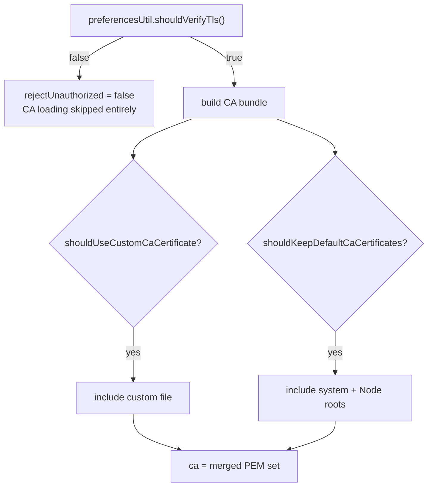

# TLS & Certificates

Status: VERIFIED unless marked.

---

## 1. Two independent decision axes



Source: `packages/bruno-electron/src/ipc/network/cert-utils.js` lines 20–50; `bruno-requests/src/utils/ca-cert.ts`.

---

## 2. CA bundle construction

`getCACertificates({ caCertFilePath, shouldKeepDefaultCerts })` returns:

```ts
{ caCertificates: string /* newline-joined PEM */,
  caCertificatesCount: { system: number, root: number, custom: number, extra: number } }
```

| Source | Implementation |
|---|---|
| **system** | `tls.getCACertificates('system')` (cached in module scope) |
| **root** | `tls.rootCertificates` (Node's bundled roots) — included when "keep default" is on |
| **custom** | The user-selected `.pem`/`.crt` file |
| **extra** | `process.env.NODE_EXTRA_CA_CERTS` file, if present |

Certificates are de-duplicated into a `Set` before joining. Counts are shown in the UI so users can see why a server is trusted.

---

## 3. Client certificates

Model (`common/auth.ts` is unrelated; this is `bruno.json → clientCertificates.certs` and preferences):

```ts
{
  domain?: string;          // e.g. "*.api.example.com" — interpolated
  type?: 'cert' | 'pfx';    // default 'cert'
  certFilePath?: string;
  keyFilePath?: string;
  pfxFilePath?: string;
  passphrase?: string;
  disabled?: boolean;
}
```

Matching algorithm (`cert-utils.js` lines 62–110):

1. Interpolate `domain` and the request URL with all variable scopes.
2. Build regex: `^(https://|grpc://|grpcs://|ws://|wss://)?` + domain with `.` escaped and `*` → `.*`.
3. First match wins (collection certs first, then global certs).
4. Relative file paths resolve against the collection directory.
5. `cert`/`key` read as Buffers; `pfx` read as a Buffer; `passphrase` interpolated.
6. Missing files throw `Error reading cert/key file…` / `Error reading pfx file…`.

Scope: client certs come from the collection config **and** global preferences, merged (`[...collectionCerts, ...globalCerts]`).

---

## 4. Applying TLS options to agents

```ts
const tlsOptions = {
  ...httpsAgentRequestFields,      // keepAlive, rejectUnauthorized, ca, caCertificatesCount
  ...certsConfig,                  // cert, key, pfx, passphrase
  secureProtocol: undefined,
  minVersion: 'TLSv1',
  rejectUnauthorized: rejectUnauthorized !== undefined ? rejectUnauthorized : true
};
```

Notable:

- `minVersion: 'TLSv1'` is set explicitly — very permissive by modern standards. A Go port should default to TLS 1.2 minimum unless the user opts into legacy TLS (PROPOSED divergence, documented).
- No cipher-suite configuration is exposed (UNKNOWN whether the UI has it; not found in preferences).

### Proxy + TLS interaction (a known upstream bug, patched)

`PatchedHttpsProxyAgent` forwards `cert`, `key`, `pfx`, `passphrase`, `rejectUnauthorized`, `secureContext` to the **target** TLS upgrade after CONNECT, because the upstream agent ignored them. Comment references `https-proxy-agent` issue #194.

- When the proxy itself is HTTPS, TLS options are also applied to the proxy connection.
- Custom CAs are converted to a `secureContext` in the agent cache so they are added **on top of** OpenSSL defaults rather than replacing them.

---

## 5. Agent caching and TLS session reuse

`agent-cache.ts`: `getOrCreateHttpsAgent({ AgentClass, options, proxyUri, timeline, disableCache, hostname })`

- Cache key includes agent class, options, proxy URI, and **hostname** so TLS sessions are reused per host.
- `disableCache` forces a fresh agent (used by `bru.sendRequest` in some paths).
- `cacheSslSession` preference controls session caching.
- Agents are `keepAlive: true` unless `connection` is omitted.

---

## 6. Secure context for cookies

`isPotentiallyTrustworthyOrigin` treats `https`, `wss`, `file`, and loopback hosts as secure, which enables `Secure` cookies for those origins even over plain HTTP on localhost.

---

## 7. TLS errors and the UI

| Situation | Result |
|---|---|
| Hostname mismatch | Transport error (`error: 'Hostname/IP does not match certificate's altnames: …'`) |
| Self-signed | `UNABLE_TO_VERIFY_LEAF_SIGNATURE` / `SELF_SIGNED_CERT_IN_CHAIN` |
| Expired cert | `CERT_HAS_EXPIRED` |
| Client cert rejected | `ERR_SSL_…` from the server or handshake failure |

Bruno surfaces the raw Node error message; users resolve it by disabling verification or importing the CA.

---

## 8. Go implementation (PROPOSED)

```go
type TLSConfig struct {
    InsecureSkipVerify bool
    RootCAs            *x509.CertPool    // system + custom + extra
    Certificates       []tls.Certificate // client certs matched by host
    MinVersion         uint16            // default tls.VersionTLS12
}

type CertMatcher struct{ /* domain patterns → *tls.Certificate */ }

func BuildFor(host string) (*tls.Config, error)
```

1. Load system pool with `x509.SystemCertPool()`; append custom PEMs; append `SSL_CERT_FILE` / user config extra files.
2. Match client certs per request host; cache derived `tls.Config` per (proxy, host, cert config).
3. For HTTPS proxies, use a separate `tls.Config` for the proxy hop and a `DialTLSContext` that upgrades after CONNECT.
4. Keep `InsecureSkipVerify` as the explicit user opt-out; never enable it implicitly.
