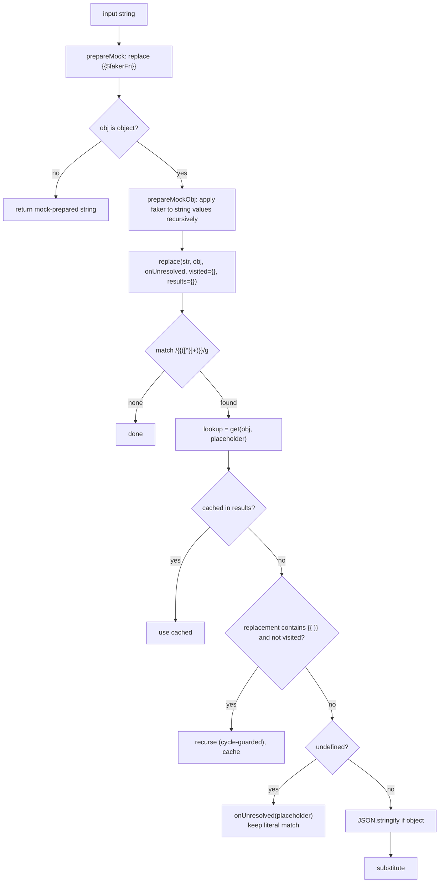

# Variable Interpolation

Status: VERIFIED unless marked.

Two documents overlap on purpose: `flows/environment-resolution.md` covers *scopes and precedence*; this document covers the *algorithm and escaping*, which must be byte-identical for compatibility.

---

## 1. API

```ts
interpolate(
  str: string,
  obj: Record<string, any>,
  options?: { escapeJSONStrings?: boolean; onUnresolved?: (name: string) => void }
): string
```

Source: `packages/bruno-common/src/interpolate/index.ts` (170 lines, 883-line test suite).

---

## 2. Algorithm



Key properties:

| Property | Detail |
|---|---|
| Placeholder syntax | `{{name}}`; content may not contain `}` |
| Lookup | lodash `get` → supports `a.b.c` and `a[0].b` |
| Object values | `JSON.stringify` before substitution |
| Recursive resolution | Variable values may reference other variables |
| Cycle protection | `visited` set of raw match strings |
| Memoization | `results` map keyed by the raw `{{…}}` match |
| Unresolved | Left verbatim; reported once via `onUnresolved` |
| Faker | `{{$keyword}}` replaced from `mockDataFunctions` before variable lookup |

---

## 3. JSON escaping mode

When `escapeJSONStrings` is true, both faker output and variable values are escaped:

```ts
const JSON_SPECIAL_CHARS = /[\\\n\r\t\"]/;
str.replace(/\\/g, '\\\\')
   .replace(/\n/g, '\\n')
   .replace(/\r/g, '\\r')
   .replace(/\t/g, '\\t')
   .replace(/\"/g, '\\"');
```

Used whenever interpolating into a JSON document (string body or object body) so a token containing quotes cannot break the payload.

**Gap (VERIFIED):** other control characters (e.g. `\u0000`–`\u001f`) are not escaped. A Go port replicating this exactly will preserve the same edge-case bug; document it.

---

## 4. Where interpolation is applied

| Target | Escaping |
|---|---|
| URL | no |
| Header names / values | no |
| JSON body (string) | yes |
| JSON body (object) | yes (stringify → interpolate → parse) |
| GraphQL `query` / `variables` | yes (interpolated separately) |
| form-urlencoded values | no |
| multipart text values / filenames | no |
| gRPC / WS message bodies | yes |
| path params | no |
| proxy fields, auth fields | no |
| API key (query placement) | no |

---

## 5. Env pre-interpolation

Before the general pass, every environment value is interpolated **against `process.env` only**:

```js
forOwn(envVariables, (value, key) => {
  envVariables[key] = interpolate(value, { process: { env: {} } });   // note: pass-through object
});
```

The net effect: `API_HOST: "{{process.env.HOST}}"` resolves at send time from the collection/workspace/OS `.env` chain. The environment map is deep-cloned first, so stored values are not mutated.

---

## 6. Interpolation options object shape

Side-effect-free lookup requires `process.env` to be a **nested object**:

```js
const combinedVars = {
  ...globalEnvironmentVariables,
  ...collectionVariables,
  ...envVariables,
  ...folderVariables,
  ...requestVariables,
  ...oauth2CredentialVariables,
  ...runtimeVariables,
  ...promptVariables,
  process: { env: { ...processEnvVars } }
};
```

Note the last spread wins — a user variable literally named `process` would be overwritten.

---

## 7. Faker functions

`mockDataFunctions` (`bruno-common/src/utils/faker-functions.ts`) maps `{{$name}}` to generated values, e.g. `{{$randomFirstName}}`, `{{$randomEmail}}`, `{{$randomUUID}}`, `{{$isoTimestamp}}`.

- Applied *before* variable lookup, so faker output cannot be re-interpolated as a variable.
- In JSON-escaping mode the generated value is escaped.
- Unrecognized keywords are left as-is.

---

## 8. Unresolved-variable tracking

`trackUnresolvedVariables(request, parentSet)` in `bruno-js/src/unresolved-variables.js`:

- Creates a `Set` on `request.__unresolved` (INFERRED field name; the collector stores on the request object).
- Merges with the parent set for nested `bru.runRequest`.
- Reported to the UI through throttled events.

---

## 9. Go implementation (PROPOSED)

```go
func Interpolate(s string, vars map[string]any, opts InterpolateOptions) (out string, unresolved []string)

type InterpolateOptions struct {
    EscapeJSON   bool
    OnUnresolved func(name string)
}
```

Implementation notes:

1. Implement `lookup` with a dotted-path resolver that supports `a.b[0].c`.
2. Keep memoization keyed by the raw placeholder — without it, a value used 10 000 times in a large body re-resolves 10 000 times.
3. Copy the escape table exactly.
4. Avoid reflection where possible: pre-flatten the variable maps into a `path → value` index once per request.
