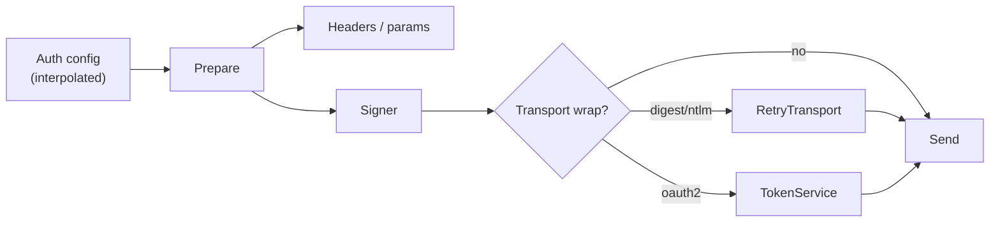

# Authentication Providers (Plugin Perspective)

Status: VERIFIED.

How auth providers plug into Bruno — as built-in, closed implementations — and how a Go port should structure them for parity *and* extensibility.

---

## 1. Registration model in Bruno

There is **no registry**. A provider exists because code is written for it in five places:

| Layer | File | What to add |
|---|---|---|
| DSL grammar | `bruno-lang/v2/src/bruToJson.js`, `jsonToBru.js` | `auth:<name>` block rule + semantic action |
| Data model | `bruno-schema-types/src/common/auth.ts` | interface + `AuthMode` union member |
| Preparation | `bruno-electron/src/ipc/network/prepare-request.js` `setAuthHeaders` | case (×2: collection auth, request auth) |
| Execution | `bruno-electron/src/ipc/network/index.js` `configureRequest` | interceptor / adapter / token flow |
| UI | `bruno-app/src/components/RequestPane/Auth/` | form component |

Also relevant: interpolation of credential fields (`interpolate-vars.js` has a block per provider), and CSP/sensitive-field lists (`utils/sensitive-fields.js`).

This five-point duplication is the main reason a custom auth scheme requires a fork.

---

## 2. Built-in provider catalogue

| Mode | Signing | Transport impact | Interactive | Notes |
|---|---|---|---|---|
| `none` | — | — | no | |
| `inherit` | resolves at prepare | — | no | |
| `basic` | `Authorization: Basic b64(u:p)` | — | no | UTF-8 encoding |
| `bearer` | `Authorization: Bearer <t>` | — | no | |
| `apikey` | header or query param | — | no | |
| `digest` | challenge-response | retry loop | no | MD5 / SHA-256 |
| `ntlm` | 3-leg handshake | adapter | no | connection-bound |
| `oauth1` | HMAC/RSA/PLAINTEXT | — | no | `includeBodyHash` |
| `oauth2` | Bearer or query | token fetch | code/implicit | 4 grants + PKCE |
| `awsv4` | SigV4 | signing interceptor | no | profile support |
| `wsse` | UsernameToken digest | — | no | SHA-1 |
| `akamai-edgegrid` | EG1-HMAC-SHA256 | signing interceptor | no | |

---

## 3. Provider contract (normalized from implementation)

Each provider must answer four questions:

1. **What does it read from configuration?** (fields, interpolation rules)
2. **Does it add headers/query at prepare time?**
3. **Does it need to sign after interpolation?**
4. **Does it need to intercept the transport (retry, handshake, token fetch)?**



---

## 4. Cross-cutting concerns every provider shares

| Concern | Rule |
|---|---|
| Inheritance | `inherit` resolved by `mergeAuth` before prepare |
| Interpolation | Credentials interpolated with the full scope stack |
| Sensitive fields | Path list in `utils/sensitive-fields.js` marks masked fields |
| Redirects | `forwardAuthorizationHeader` governs cross-origin forwarding |
| Script hooks | `bru.deleteOauth2Credential()` for OAuth2; `req.setHeader` can override |
| Caching | OAuth2 only (by `credentialsId`) |

---

## 5. Go provider registry (PROPOSED)

```go
package auth

type Mode string

type Config struct {
    Mode     Mode
    Raw      map[string]any     // from the file, uninterpolated
    Resolved map[string]string  // after interpolation
    Scope    CredentialScope    // collection | folder | request
    ID       string             // credentialsId where applicable
}

type Provider interface {
    Mode() Mode
    Prepare(ctx context.Context, req *Request, cfg *Config) error
    // Sign is optional; return nil if unnecessary.
    Sign(ctx context.Context, req *http.Request, cfg *Config) (Signer, error)
}

type Signer interface {
    Sign(*http.Request) error
}

type TransportProvider interface {
    Provider
    // Wrap returns a RoundTripper that implements the scheme (digest/ntlm).
    Wrap(base http.RoundTripper, cfg *Config) http.RoundTripper
}

var registry = map[Mode]Provider{}

func Register(p Provider)  // called from init() in provider packages
func Get(m Mode) (Provider, bool)
```

Guidelines:

1. `Register` from `init()` in each provider's package, with a blank import in the app wiring — idiomatic Go, no reflection.
2. Keep the DSL/serialization mapping separate: a `Codec` per mode converts `Config` ⇄ `.bru` block, so adding a provider does not touch the parser core.
3. Providers must not depend on the GUI; interactive flows (OAuth2) get an injected `Browser`/`CallbackServer` interface.
4. Add a conformance test suite: for each provider, "given this config and this request, expect these headers/effects".
