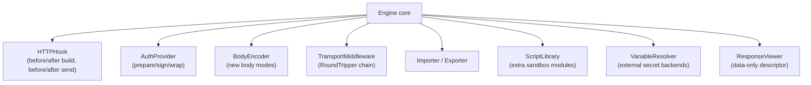

# Extensibility Proposal (Go-Native)

Status: **PROPOSED**. Nothing in this document exists in Bruno; it is a recommendation for the Go application, constrained by the findings in `extension-architecture.md` and `plugin-system.md`.

---

## 1. Principles

1. **Parity first.** Scripts must work exactly like Bruno's. No extension feature is required to reach feature parity.
2. **Compile-time by default.** Extensions are Go packages registered at init, not dynamically loaded binaries. This keeps signing, secret handling, and sandbox guarantees auditable.
3. **Two trust tiers.** *Trusted* (in-tree code, full access) vs *Untrusted* (scripts, sandboxed).
4. **Small interfaces, versioned.** Every extension interface carries an explicit version constant.
5. **No GUI in extensions.** Extensions may declare UI *data* (a form schema), never UI code.

---

## 2. Extension points



### 2.1 HTTPHook

```go
type HookPhase int
const (BeforeBuild HookPhase = iota; AfterBuild; BeforeSend; AfterResponse)

type HTTPHook interface {
    Name() string
    Phase() HookPhase
    Apply(ctx context.Context, r *HookRequest) error
}

type HookRequest struct {
    Request  *BuiltRequest
    Response *ParsedResponse
    Config   map[string]any // per-collection hook config
}
```

Use case: corporate signing, header injection, audit logging.

### 2.2 BodyEncoder

```go
type BodyEncoder interface {
    Mode() string                              // e.g. "cbor"
    DefaultContentType() string
    Encode(input any, cfg map[string]any) (io.Reader, error)
    Decode?  // optional, for pretty-printing responses
}
```

Use case: protobuf/gRPC-web, msgpack, custom encodings.

### 2.3 VariableResolver

```go
type VariableResolver interface {
    Scheme() string                       // "vault", "aws-ssm", "1password"
    Resolve(ctx context.Context, ref string) (string, error)
}
```

Mirrors Bruno's `vars:externalsecrets:<provider>` concept but generalized.

### 2.4 Importer / Exporter

```go
type Importer interface {
    Name() string
    Detect(path string, sample []byte) bool
    Import(ctx context.Context, src Source) (*ImportResult, error)
}

type Exporter interface {
    Name() string
    Export(ctx context.Context, c *Collection, w io.Writer) error
}
```

### 2.5 ScriptLibrary

```go
type ScriptLibrary interface {
    Name() string               // require("name")
    Bind(vm *goja.Runtime) error
}
```

---

## 3. Registration and wiring

```go
// internal/plugins/plugins.go
package plugins

func RegisterAll() {
    auth.Register(authbasic.Provider())
    auth.Register(authbearer.Provider())
    …
    body.Register(cbor.Encoder())
    hooks.Register(corpsearchhook.New())
}
```

Deterministic ordering, no reflection, no dynamic discovery. Third-party extensions (if ever) are Go modules imported by the user's own build — a *build-time* plugin model, matching the security posture of tools like Caddy (with `xcaddy`) but simpler.

---

## 4. UI declaration (data-only)

An extension may contribute a form:

```go
type FormSchema struct {
    Fields []FieldDescriptor // name, label, type(text|secret|select|file), options, required
}
```

The GUI renders it with its own widgets. This preserves the "no UI code from extensions" rule while still making custom auth configurable.

---

## 5. Trust and safety rules

| Rule | Reason |
|---|---|
| Extensions never receive raw secret bytes unless they declare `Secrets()` | Least privilege |
| Hooks observe but cannot persist | Prevents silent data egress |
| Scripts cannot call extension APIs unless the extension opts in | Keeps sandbox surface small |
| Importers run on untrusted input → must be fuzz-tested | Standard for parsers |
| No dynamic `plugin.Open` in v1 | ABI fragility across platforms |

---

## 6. Roadmap alignment

| Phase | Extension work |
|---|---|
| 1–3 | None (core only) |
| 4 | `AuthProvider` registry (internal) |
| 5 | `ScriptLibrary` registry |
| 6 | `Importer`/`Exporter` registry |
| 7 | `HTTPHook`, `BodyEncoder`, `VariableResolver`; document the Go-module extension model |

---

## 7. What we deliberately do **not** build

- A GUI plugin marketplace.
- Dynamic loading of `.so`/`.dll`/`.dylib`.
- A general event bus for third-party subscribers (hooks are synchronous and explicit).
- JS API surface beyond Bruno's (`bru`, `req`, `res`); extra APIs belong in Go extensions.
