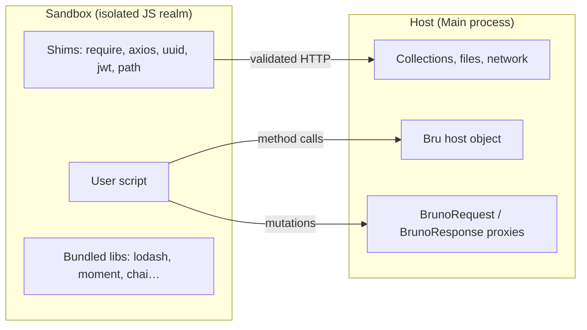

# Scripting Runtime (Plugin Perspective)

Status: VERIFIED unless marked.

How scripts function as Bruno's extension mechanism, and what a Go port must replicate.

---

## 1. Runtime boundaries



| Direction | Allowed |
|---|---|
| Script → host | Only through registered host objects/functions |
| Host → script | Only return values marshalled into the sandbox |
| Script → filesystem | No (quickjs); constrained roots (nodevm) |
| Script → network | Only `bru.sendRequest` / whitelisted modules |
| Script → process | No `process.exit`; timers sandboxed |

---

## 2. Engine selection and lifecycle

```js
const runtime = scriptingConfig.runtime || 'quickjs';
```

- Set per collection from `bruno.json → scripts.runtime` (via `getJsSandboxRuntime`).
- QuickJS module is memoized; a WASM trap triggers a module recycle.
- Node VM uses `AsyncLocalStorage` to keep the script context across async callbacks and a shared npm module cache across scripts.

---

## 3. Timing and execution model

| Script type | Sync/Async | Notes |
|---|---|---|
| `script:pre-request` | async | `await` supported; `bru.sendRequest` returns a promise |
| `script:post-response` | async | |
| `tests` | async | `test()` may return promises; runner drains them |
| `vars:post-response` values | sync | each is an expression, evaluated in order |
| `assert` LHS/RHS | sync | expressions |

---

## 4. Data passed in

The context is built fresh per execution from explicit inputs (no hidden globals):

```js
{ bru, req, res, test, expect, assert, __brunoTestResults, __bruSetScope, console }
```

plus the sandbox's own globals (Buffer, process, timers).

---

## 5. Data extracted

| Output | Destination |
|---|---|
| Var deltas (per scope) | Renderer + file writes |
| Test results | Tests tab / runner report |
| `nextRequest`, `skip`, `stop` | Collection runner |
| `scriptedRequestEntries` | Timeline |
| `oauth2CredentialsToReset` | Credential cache |
| Console output | Devtools / reporter |

`cleanJson(...)` is applied to every output before use, to strip functions/cycles that cannot cross the sandbox boundary.

---

## 6. Sandbox library surface (quickjs)

| Shim | Provided API |
|---|---|
| `require('axios')` | `method/url/data/headers/params` subset routed through the host |
| `require('uuid')` | `v4`, namespaced generation |
| `require('nanoid')` | `nanoid()` |
| `require('jwt')` | decode/verify/sign helpers |
| `require('path')` | POSIX-ish path helpers |
| `require('crypto-utils')` | hashing, HMAC, base64 |
| bundled | lodash, moment, chai, chai-string, cheerio, crypto-js, ajv, tv4, json-query, xml2js, xml-formatter, yaml, node-fetch (where applicable) |

Node VM instead sees whatever the whitelist permits, including real Node builtins.

---

## 7. Go port design (PROPOSED)

```go
package scripting

type Host struct {
    Bru  *BruAPI
    Req  *RequestProxy
    Res  *ResponseProxy
    Out  *OutputSink
}

type Options struct {
    Runtime   string        // "goja" (default)
    Timeout   time.Duration
    AllowedModules map[string]bool // parity with moduleWhitelist
}

func (e *Engine) Run(ctx context.Context, src string, h Host, o Options) (Outcome, error)
```

Implementation guidance:

1. Register Go functions through goja `runtime.ToValue`; keep proxies thin.
2. Provide a `require` whose result is a `map[string]any` of Go-backed modules — no filesystem.
3. Implement `Promise` support natively: `bru.sendRequest` returns a goja promise resolved by a goroutine.
4. Guard runaway scripts with `vm.Interrupt` + context deadline.
5. Emulate `cleanJson` by converting results to plain Go values before crossing the boundary.
