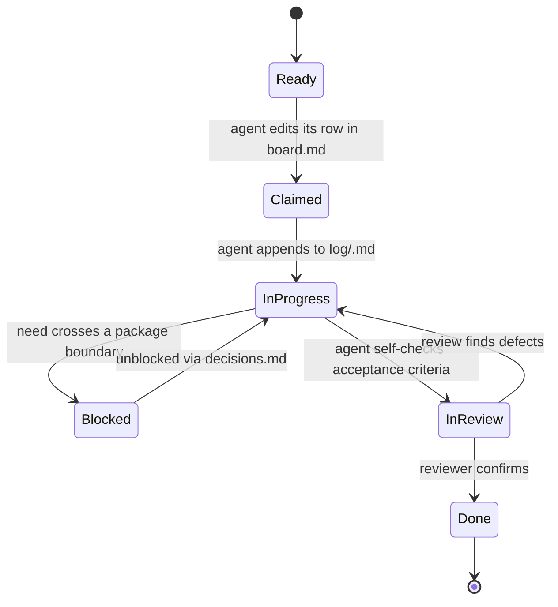

# Multi-Agent Progress Tracking

Purpose: let several agents implement this project **simultaneously without editing the same file at the same time**.

Read this page fully before claiming any work.

---

## 1. The rule

> **One work package = one owning agent. One work package = a disjoint set of files.**

If two packages would touch the same file, they are the wrong packages. Fix the split before starting, not after a conflict.

The canonical assignment of file paths to work packages is [`ownership.md`](ownership.md). It is the authority: if you are about to write a file that is not in your package's row, **stop** and either (a) work in a different package, or (b) raise a coordination request (§5).

---

## 2. Files in this directory

| File | Purpose | Who writes it |
| --- | --- | --- |
| [`README.md`](README.md) | This page — the protocol | Nobody during implementation; change only by agreement |
| [`ownership.md`](ownership.md) | **File-path → work-package map.** The anti-collision contract | Nobody during implementation |
| [`packages.md`](packages.md) | Every work package: scope, deliverables, dependencies, acceptance criteria | Nobody during implementation |
| `board.md` | Live status table: package → agent → state | Each agent, **only its own row** |
| `log/<package>.md` | Per-package append-only journal | **Only** the owning agent |
| `decisions.md` | Cross-package decisions and interface changes | Any agent, append-only at the bottom |
| `blockers.md` | Anything blocking progress, with the ask | Any agent, append-only |

`board.md`, `decisions.md`, `blockers.md` and `log/*` are the only files that change during implementation. Every one of them is designed for concurrent edits with minimal conflict (own row / append at end).

---

## 3. Lifecycle of a work package



Never set a package to `Done` yourself; another agent or the human confirms it. This is deliberate — self-confirmed completion is how parallel work silently drifts.

---

## 4. Claiming work (do this first)

1. Open `board.md`.
2. Find a package in state `Ready` whose dependencies are all `Done`.
3. Check `ownership.md` — no other agent may own a package that shares a path with it.
4. Edit **only that package's row**: set `Agent`, `State: Claimed`, `Claimed (UTC)`. Do not touch other rows.
5. Create `log/<package>.md` from the template in §7 if it does not exist.
6. Start work.

One agent should own **at most two** packages at a time, and only if they are adjacent in the dependency graph.

---

## 5. Coordination requests

When your work needs a change outside your file set:

| Situation | Action |
| --- | --- |
| You need a new exported symbol from another package | Append to `decisions.md`: *what you need, the signature you want, the package.* The owner implements it; you do not. |
| You believe a file must move between packages | Append to `blockers.md`. Do not move it. |
| Two packages genuinely need the same file | Append to `blockers.md` with the reason and a proposed re-split. The human resolves it. |
| An interface must change and consumers exist | `decisions.md`, with every affected package listed. Consumers do not change their behaviour until the owner lands the change. |
| You are blocked and cannot proceed | `blockers.md` + set your row to `Blocked`. Do not silently go idle. |

`decisions.md` and `blockers.md` are **append-only**. Never edit or delete another agent's entry. If a decision changes, append a new entry that supersedes it and names the old one.

---

## 6. Preventing conflicts in shared files

The three shared files are edited concurrently, so:

| File | Edit pattern | Conflict risk |
| --- | --- | --- |
| `board.md` | Change only your own row; one row per package | Low. If a merge conflict occurs, keep both rows — they are independent |
| `decisions.md` | Append a new section at the **end** of the file | Low. On conflict, keep both blocks and order by timestamp |
| `blockers.md` | Append at the **end** | Low. Same resolution |
| `log/<package>.md` | Only your own file; append entries | None — no sharing |

Rules that keep it that way:

- Never re-sort, re-number or reformat `board.md`.
- Never "tidy" an append-only file.
- Write the UTC timestamp yourself — do not rely on tooling to insert it.

---

## 7. Log template

Create `log/<package>.md` with:

```md
# <package-id> — <title>

Owner history: <agent> (claimed <UTC>)

## Entries

### <UTC> — <agent>
- Did: <what changed, file paths>
- Tests: <what you ran, what passed>
- Notes: <anything the next agent needs>
```

Append a new `###` block per session. Keep entries short and factual.

---

## 8. Definition of done

A package may move to `InReview` only when **all** of these hold:

1. Every deliverable in its `packages.md` row exists.
2. The acceptance criteria in that row are met, and you state how you verified each.
3. `gofmt`/`go vet` clean; `go test ./...` passes for the packages you own.
4. No file outside your ownership row was modified (check your diff).
5. `log/<package>.md` records the final state.

---

## 9. Checking your change set (do this before reporting)

`scripts/check-ownership.sh` enforces `ownership.md` against your diff:

```sh
# Name your package: fails if you touched anything outside its row.
scripts/check-ownership.sh --pkg UI-THEME

# No package: fails on any file that no package owns at all.
scripts/check-ownership.sh

# Check a commit range instead of the working tree.
scripts/check-ownership.sh --range origin/master..HEAD
```

The shared progress files in §6 are always allowed and are not reported:
`board.md`, your `log/<package>.md`, and append-only `decisions.md` /
`blockers.md`.

A failure is a contract violation — either revert the stray file, or raise the
split in `blockers.md`. Do not work around it.

Also run `python3 ui-map/_tools/verify.py` after touching anything in
`ui-map/`; it fails on a broken citation or doc link.

## 10. If you are the only agent

Follow the same protocol. The lifecycle, the log and the board are what make a later hand-off — human or agent — safe. Skipping them costs far more later than it saves now.
