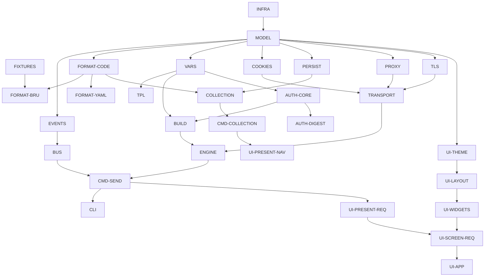

# Work Packages

Each package is independently claimable. **Dependencies** list packages that must be `Done` first. **Acceptance** is what a reviewer checks. File ownership for every package is in [`ownership.md`](ownership.md).

Phases refer to `docs/implementation/implementation-roadmap.md`. Package ids are stable — use them verbatim in `board.md` and `log/`.

---

## Phase 0 — Foundations

### `INFRA` — Build, CI, dependency policy

- **Scope:** `go.mod`/`go.sum`, lint config, CI workflows enforcing gates, vendoring, version stamping.
- **Deps:** none.
- **Acceptance:**
  1. CI rejects any dependency of `core/` or `app/` on `github.com/egoist/mygo`, `github.com/lobehub/lobe-mygo`, `gioui.org` or `fyne.io` (the check in `go-architecture.md` §1, with `lobe-mygo` added).
  2. `govulncheck`, `go vet`, `staticcheck`, `gofmt -l` all run and are required.
  3. `go build ./...` works on Linux, macOS, Windows runners with no CGO.
  4. MyGo and Lobe MyGo are pinned to exact versions.

### `FIXTURES` — Test corpora

- **Scope:** vendoring or generating Bruno fixtures (`.bru` files, collections, environments) and shared test helpers.
- **Deps:** none (may proceed from the Bruno clone at `bruno/`).
- **Acceptance:**
  1. A pinned corpus exists for: `.bru` request/collection/folder/env, `.yml` equivalents, interpolation cases, auth cases, script fixtures.
  2. Each corpus records the upstream source commit.
  3. `internal/testutil` provides temp-dir, golden-file and `httptest` helpers.
  4. Nobody needs network access to run the tests.

---

## Phase 1 — Core

### `MODEL` — Domain types

- **Scope:** `Collection`, `Item`, `Folder`, `Request` (with `Saved`/`Draft`), `Body` union, `Auth` config, `Result`, `Timeline`, `BodyRef`, `Settings`, `Environment`, `TestResult`, `AssertionResult`.
- **Deps:** none.
- **Acceptance:**
  1. Types round-trip through JSON without loss (`encoding/json` golden tests).
  2. `Body` is a sealed union with exactly the modes Bruno supports (`none/json/text/xml/sparql/form-urlencoded/multipart/file/graphql`).
  3. `BodyRef` carries `ID/Size/ContentType/Encoding/Inline/Path` and never holds large payloads inline by default.
  4. No import of `internal/core/engine` or above (pure data).

### `EVENTS` — Typed event contract

- **Scope:** the `Event` interface, `Kind` enum and every event struct from `interface-design.md` §4.
- **Deps:** `MODEL`.
- **Acceptance:**
  1. Every `Kind` constant has a concrete type and a doc comment stating its producer.
  2. A table-driven test asserts `Kind()` uniqueness and that no event carries a pointer into core-owned mutable state (except explicitly documented `ErrorOccurred.Err`).
  3. Terminal-event invariant is documented and testable: for each `RequestQueued`, exactly one of `ResponseReceived`/`ErrorOccurred`.

### `BUS` — Event bus and state actor

- **Scope:** subscription, buffered delivery, back-pressure rules, `StateActor` (`Snapshot`/`Apply`/`Subscribe`).
- **Deps:** `EVENTS`, `MODEL`.
- **Acceptance:**
  1. Buffered channel with a documented size; on overflow `ResponseChunk` is dropped/coalesced and terminal events are **never** dropped (tested).
  2. `Apply` runs strictly serialized on one goroutine (race-detector test with many concurrent callers).
  3. Snapshots are immutable to the reader (mutation by a consumer cannot be observed).
  4. Unsubscribe is leak-free (goroutine-count test).

### `FORMAT-CODE` — Codec interface and detection

- **Scope:** `Codec` interface, registry, format detection (`bruno.json` vs `opencollection.yml`).
- **Deps:** `MODEL`.
- **Acceptance:**
  1. `Codec` is defined here, implemented by `FORMAT-BRU`/`FORMAT-YAML`.
  2. Detection is deterministic and tested on both dialects and on a directory containing both.
  3. Adding a codec requires no change to this package beyond a `Register` call by the implementation.

### `FORMAT-BRU` — `.bru` parser and writer

- **Scope:** recursive-descent lexer/parser/writer for request, collection, folder, environment and dotenv; `extends`/`color` top-level rules; multipart `@file`/`@contentType` annotations.
- **Deps:** `MODEL`, `FORMAT-CODE`, `FIXTURES`.
- **Acceptance:**
  1. Parses the whole fixture corpus with zero errors.
  2. Round-trip is byte-stable modulo key order for ≥ 95 % of fixtures (measured and reported).
  3. Malformed input returns an error with line and column, never a panic (fuzz test).
  4. `extends` as a bare rule and `extends [ a, b ]` as a list both parse.

### `FORMAT-YAML` — OpenCollection codec

- **Scope:** `opencollection.yml` collection/folder/request/environment parse and write.
- **Deps:** `MODEL`, `FORMAT-CODE`, `FIXTURES`.
- **Acceptance:**
  1. Round-trip through YAML preserves all modelled fields.
  2. Both dialects normalise into the same `model` types (`FORMAT-CODE` parity test).
  3. No `noUnknown()`-style strictness is invented; unknown keys are preserved or reported, not silently dropped (state which, in the log).

### `VARS` — Scopes, precedence, interpolation

- **Scope:** ordered `Scopes`, provenance, `Interpolate` (recursive with depth guard, JSON-escape mode), dynamic variables, `{{?Prompt}}` extraction, unresolved reporting.
- **Deps:** `MODEL`, `FIXTURES`.
- **Acceptance:**
  1. Passes a port of Bruno's `interpolate.spec.ts` cases.
  2. Precedence matches `flows/environment-resolution.md` exactly, asserted as a table.
  3. Recursion depth guard prevents infinite substitution (tested).
  4. Unresolved names are reported with their scope, and secret values are never echoed.

### `TPL` — Bru template transform (PROPOSED only if needed)

- **Scope:** `vars:pre-request` / `vars:post-response` declarative blocks, kept separate from JS scripting so `VARS` need not depend on the script engine.
- **Deps:** `MODEL`, `VARS`.
- **Acceptance:** block semantics match `flows/scripting-flow.md`; no `goja` import.

### `COOKIES` — Cookie jar

- **Scope:** `net/http/cookiejar` wrapper, trustworthy-origin policy, export/import, persistence hook.
- **Deps:** `MODEL`.
- **Acceptance:** jar semantics match `logic/cookies.md`; domain/path/secure rules tested; persistence is injected (not imported).

### `PERSIST` — Stores, secrets, body spool

- **Scope:** settings with schema migration, `Secrets` interface, cookie/token stores, `BodyStore` with `BodyRef` spooling and GC, history schema.
- **Deps:** `MODEL`.
- **Acceptance:**
  1. All paths come from an injected `Paths` struct (no direct `os.UserConfigDir`).
  2. Corrupt JSON is quarantined, not discarded (tested).
  3. Bodies above the inline threshold spill to disk and dedupe by hash (tested with threshold forced to 0 and to max).
  4. Spool GC removes only orphans (reference-count test).
  5. `FileSecrets` implementation works with no keyring for CI.

### `COLLECTION` — Tree loading and watching

- **Scope:** load/save/reload a collection tree, `seq` ordering, merge helpers, watcher with self-write suppression.
- **Deps:** `MODEL`, `FORMAT-CODE`, `PERSIST`.
- **Acceptance:**
  1. External edit reloads without losing drafts; deleted files remove items; renamed files remap UIDs (per `flows/collection-lifecycle.md`).
  2. Self-writes do not trigger reload (tested).
  3. 1 000-request collection loads in < 2 s (benchmark recorded).

### `BUILD` — Request construction

- **Scope:** merge collection → folder → request, ordered header merge, URL normalisation, query params preserving order and duplicates, body construction per mode, path params.
- **Deps:** `MODEL`, `VARS`, `AUTH-CORE`.
- **Acceptance:**
  1. `logic/request-builder.md` behaviour reproduced, including implicit `http://` when scheme is absent and the URL has no leading `{{`.
  2. Header merge is case-insensitive, last-writer-wins, explicit-empty deletes (documented decision `UQ-B1`).
  3. Query params never reorder or drop duplicates (no `url.Values`).
  4. Multipart preserves declaration order and file annotations.

### `TRANSPORT` — HTTP execution

- **Scope:** `http.Client` with manual redirect loop (`CheckRedirect: ErrUseLastResponse`), `httptrace` timeline, cancellation, streaming chunks into the sink, response parsing hand-off.
- **Deps:** `MODEL`, `PROXY`, `TLS`, `COOKIES`, `EVENTS`.
- **Acceptance:**
  1. Redirect matrix passes: 301/302/303 → GET, 307/308 preserve method and body, relative `Location`, limit exceeded (tested).
  2. Cancellation propagates to the socket and stops script execution downstream (tested).
  3. Timing timeline matches `logic/http-engine.md` phases.
  4. Body size cap and spill honoured via `PERSIST` `BodyStore`.

### `PROXY` — Proxy configuration

- **Scope:** off/manual/system/PAC, SOCKS5, per-request override.
- **Deps:** `MODEL`.
- **Acceptance:** each mode selectable; PAC evaluation uses the restricted `goja` globals (`dnsResolve`, `isInNet`, `shExpMatch`, `myIpAddress`, `dnsDomainIs`); unknown WPAD order documented rather than guessed (`UQ-B2`).

### `TLS` — TLS and certificates

- **Scope:** CA bundle override, client certificates, passphrases, collection-vs-global precedence.
- **Deps:** `MODEL`, `PERSIST` (secrets).
- **Acceptance:** the four-way precedence matrix from `tests/ssl/client-certs` reproduced and tested.

### `AUTH-CORE` — Auth registry and base providers

- **Scope:** `AuthProvider` interface, registry, and `none`/`basic`/`bearer`/`apikey`/`wsse`.
- **Deps:** `MODEL`, `VARS`.
- **Acceptance:**
  1. Adding a provider is one file plus one `Register` call (demonstrated by `AUTH-ADV`).
  2. Inherit resolution works through the merge chain.
  3. Each provider has a table test asserting the exact header/query effect.

### `ENGINE` — Pipeline

- **Scope:** `Engine`, `Input`, `Result`, `EventSink`, phase ordering, post-processing hooks.
- **Deps:** `BUILD`, `TRANSPORT`, `AUTH-CORE`, `COOKIES`, `EVENTS`.
- **Acceptance:**
  1. Phase order matches `flows/request-lifecycle.md` and is asserted with recording fakes.
  2. Exactly one `Result` or error per `Do`.
  3. No `ui/*` import; no `image` import.

### `CMD-SEND` — Send/cancel commands

- **Scope:** `SendRequest`, `CancelRequest`, request registry, context wiring, event publication.
- **Deps:** `ENGINE`, `BUS`, `EVENTS`.
- **Acceptance:** every `RequestQueued` yields exactly one terminal event including on cancel (emitted as `ErrorOccurred{Err: context.Canceled}` with a distinct scope).

### `CMD-COLLECTION` / `CMD-ENV` / `CMD-SETTINGS` / `CMD-RUNNER` — Remaining commands

- **Scope:** load/save/delete/move/new/reload items; select/save environment; preferences and token-cache clearing; runner invocation and control (`setNextRequest`, `skipRequest`, `stopExecution`).
- **Deps:** `COLLECTION`, `BUS`, `PERSIST`.
- **Acceptance:** each command emits the documented events and is idempotent where the UI assumes it.

### `CLI` — Headless runner entry

- **Scope:** `cmd/fearless-cli` with `run`, `import`, `export`, environment flags, exit codes.
- **Deps:** `CMD-SEND`, `ENGINE`, `FORMAT-BRU`.
- **Acceptance:**
  1. Runs a collection end-to-end with no GUI packages linked (verified with `go list -deps`).
  2. Environment selection flags match `run-default-environment` / `cli-global-env-var-override` behaviour.
  3. Non-zero exit on failure.

---

## Phase 2 — GUI

### `UI-THEME`

- **Scope:** `theme.Apply` call point, token accessor, per-method HTTP colour map (our own — Lobe has none), Bruno-theme-JSON import as an optional format.
- **Deps:** `MODEL`.
- **Acceptance:** light/dark follows system; the four-way method colour table is exact; no component is restyled individually.

### `UI-LAYOUT`

- **Scope:** region budget, `Split`/`SplitVertical`/`SplitPercent` composition, `DraggableSideNav`/`DraggablePanel` usage, console dock.
- **Deps:** `UI-THEME`.
- **Acceptance:** the §8.3 region budget is met at 100–200 % DPI; split ratios persist; nothing in this package reads domain state.

### `UI-WIDGETS`

- **Scope:** the eight custom widgets from `ui/components.md` §6.6 — code editor with `{{var}}` completion, request tab bar, collection tree, key-value grid, method badge, splitter helpers, virtualised lists, free-text combobox.
- **Deps:** `UI-THEME`, `UI-LAYOUT`.
- **Acceptance:** each widget has a `ui.Tester` test including an accessibility assertion; grid preserves disabled-row semantics and Tab/Enter navigation.

### `UI-PRESENT-REQ` / `UI-PRESENT-NAV` / `UI-PRESENT-SET`

- **Scope:** pure Go view-models per region; no Lobe or MyGo import beyond plain data.
- **Deps:** `MODEL`, `EVENTS`, `BUS`.
- **Acceptance:** fully unit-testable headlessly; no `github.com/lobehub` or `github.com/egoist` import (CI-checked).

### `UI-SCREEN-SHELL` / `UI-SCREEN-REQ` / `UI-SCREEN-RESP` / `UI-SCREEN-NAV` / `UI-SCREEN-SET`

- **Scope:** one package per screen, rendering `Snapshot()` through Lobe components. `SHELL` is the window chrome (title bar, status row, dock); `REQ` the request editor with its sub-tabs; `RESP` the response viewer; `NAV` the sidebar/collection explorer; `SET` the settings panes.
- **Deps:** the matching `UI-PRESENT-*` package, `UI-WIDGETS`.
- **Acceptance:** view functions are pure; no domain mutation inside a `View` closure; golden screenshots after theme changes. Each screen package has a headless `ui.Tester` smoke test.

### `UI-APP`

- **Scope:** window creation, menu bar, keybinding router (using `display.HotkeyBinding`/`FormatHotkey`), root view, `theme.Apply` once, `ToastHost` once.
- **Deps:** all `UI-SCREEN-*`, `PLATFORM`.
- **Acceptance:** `mygo.App.Run()` called from `main`; no UI mutation from background goroutines; `field.Upload` callbacks marshalled through `Window.Update`.

### `UI-DIALOGS`

- **Scope:** confirmations, prompt-variable modal, import/export flows, save-transient-request.
- **Deps:** `UI-WIDGETS`, `CMD-*`.
- **Acceptance:** `feedback.Modal` closes only after the action succeeds.

### `PLATFORM`

- **Scope:** `dialog`, `secrets` (via `mygo.Secrets`), `browser` (system browser + loopback), `watcher` (via `mygo.WatchFiles`), `windowstate`.
- **Deps:** `PERSIST`.
- **Acceptance:** every OS-specific concern is behind an interface and has a headless fake for CI.

---

## Phase 4 — Auth and environments

### `AUTH-DIGEST`

- **Scope:** digest challenge/response `RoundTripper`. **Deps:** `AUTH-CORE`. **Acceptance:** succeeds against a challenge server using the retry `RoundTripper`.

### `AUTH-NTLM`

- **Scope:** NTLM handshake. **Deps:** `AUTH-CORE`. **Acceptance:** succeeds against an NTLM server; type-1/2/3 messages verified.

### `AUTH-OAUTH1`

- **Scope:** OAuth1 signature base string, HMAC-SHA1 and PLAINTEXT. **Deps:** `AUTH-CORE`. **Acceptance:** golden vectors match.

### `AUTH-OAUTH2`

- **Scope:** grants (auth-code + PKCE, client-credentials, password, device), token cache keyed by credentials id, refresh. **Deps:** `AUTH-CORE`, `PERSIST`, `PLATFORM`. **Acceptance:** end-to-end flow without a WebView; refresh works; CLI prints the URL instead of opening a browser.

### `AUTH-AWSV4` / `AUTH-EDGEGRID`

- **Scope:** SigV4 (with session token) and Akamai EdgeGrid signing. **Deps:** `AUTH-CORE`. **Acceptance:** signatures match a reference for fixed clock/credentials.

### `ENV-FILES`

- **Scope:** `.bru` and `.yml` environment parse/write, `extends` resolution with cycle detection, secret flags, global environments, `.env`. **Deps:** `VARS`, `FORMAT-*`, `PERSIST`. **Acceptance:** precedence table from `flows/environment-resolution.md` passes; cycles rejected with a clear error.

---

## Phase 5 — Scripting

### `SCRIPT-RUNTIME`

- **Scope:** `goja` sandbox, globals, module allow-list, interruption deadlines, promise support, per-execution engine instance.
- **Deps:** `MODEL`, `EVENTS`.
- **Acceptance:** runaway script terminates at deadline without leaking goroutines (`-race`); the inbuilt-library set matches `tests/scripting/inbuilt-libraries` (or the gap is documented in `UQ-B5`).

### `SCRIPT-BRU-API`

- **Scope:** `bru`, `req`, `res`, `test`, `expect`, `bru.sendRequest`, `bru.runRequest`.
- **Deps:** `SCRIPT-RUNTIME`, `ENGINE`.
- **Acceptance:** Bruno script fixtures produce identical variable deltas, results and console output; scripted requests appear as `ScriptedRequest` events.

### `SCRIPT-POST`

- **Scope:** `core/engine/post` — `vars:post-response`, assertions operator table (28 operators), test harness, error mapping to `.bru` lines.
- **Deps:** `SCRIPT-BRU-API`, `ENGINE`.
- **Acceptance:** partial results preserved when a script throws; errors carry file/line.

---

## Phase 6 — Conversion

### `CONV-POSTMAN` / `CONV-INSOMNIA` / `CONV-OPENAPI` / `CONV-CURL`

- **Scope:** importers/exporters. **Deps:** `FORMAT-CODE`, `MODEL`, `FIXTURES`.
- **Acceptance:** importing converter fixtures yields structurally equivalent collections; every dropped construct is reported.

### `CODEGEN`

- **Scope:** curl/Go/JS/Python generators. **Deps:** `BUILD`. **Acceptance:** generated curl reproduces the request byte-for-byte against the same server.

---

## Phase 7 — Advanced

### `ADV-STREAM`

- **Scope:** incremental SSE rendering, large-body streaming, progress. **Deps:** `TRANSPORT`, `UI-SCREEN-RESP`. **Acceptance:** stream renders without buffering the whole body; cancellation mid-stream tested.

### `ADV-RUNNER`

- **Scope:** folder/collection runner, tags, delay, iterations, data files, JUnit/HTML reports, fail-fast. **Deps:** `CMD-RUNNER`, `SCRIPT-*`. **Acceptance:** tags/selection respected; exit codes correct.

### `ADV-GRPC` / `ADV-WS`

- **Scope:** gRPC and WebSocket request types. **Deps:** `TRANSPORT`, `MODEL`. **Acceptance:** lifecycle, metadata, multi-message forms match `tests/grpc` and `tests/websockets` at feature level.

### `ADV-HISTORY`

- **Scope:** SQLite history store + UI. **Deps:** `PERSIST`, `UI-SCREEN-RESP`. **Acceptance:** retention policy from `UQ-D3` enforced; write never blocks the UI.

### `ADV-EXTENSIONS`

- **Scope:** registries (`HTTPHook`, `BodyEncoder`, `VariableResolver`, `Importer`/`Exporter`). **Deps:** `ENGINE`. **Acceptance:** each registry exercised by at least one internal implementation.

---

## Dependency summary

