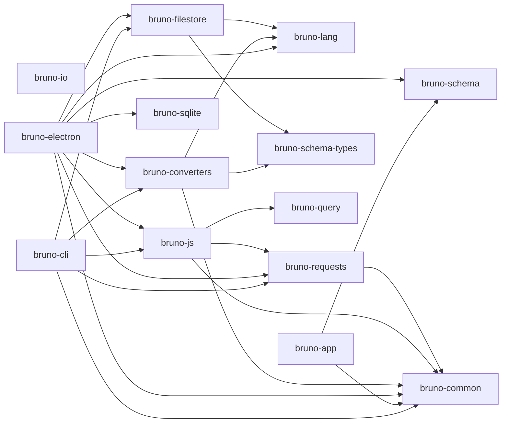

# Dependencies

All versions below are read from the individual `package.json` files at the analyzed commit (VERIFIED). Root `overrides` pin axios to `1.21.0` across the monorepo.

---

## 1. Workspace-internal dependency graph (VERIFIED)

Derived from `dependencies` sections of each package.

Notable: **`bruno-lang` is intentionally a leaf** — a comment in `bruToJson.js` states bruno-lang cannot import `@usebruno/common`, so it re-implements a few helpers locally.

---

## 2. Third-party dependencies by concern

### HTTP transport & networking (`bruno-requests`, `bruno-electron`)

| Package | Version | Use |
|---|---|---|
| `axios` | 1.21.0 | HTTP client (custom adapter, interceptors) |
| `https-proxy-agent`, `http-proxy-agent` | ~7.0.x | HTTP(S) proxy tunnelling |
| `socks-proxy-agent` | ~8.0.5 | SOCKS proxies |
| `pac-resolver` | ^7.0.1 | Proxy auto-config (PAC) JS evaluation |
| `system-ca` | ^2.0.1 | System trust store certificates |
| `tough-cookie` | ^6.0.0 | Cookie jar |
| `qs` | 6.16.1 | Query string / form-urlencoded serialization |
| `form-data` | 4.0.6 | Multipart bodies |
| `aws4-axios` | ^3.3.15 | AWS SigV4 signing interceptor |
| `axios-ntlm` | ^1.4.2 | NTLM handshake |
| `ws` | 8.21.3 | WebSocket requests |
| `@grpc/grpc-js`, `@grpc/proto-loader`, `grpc-js-reflection-client` | — | gRPC requests |
| `@aws-sdk/credential-providers` | 3.1019.0 | AWS profile/credential resolution |
| `content-disposition`, `mime-types` | — | Response filename / content sniffing |
| `decomment` | ^0.9.5 | Strip `//` and `/* */` comments from JSON bodies before send |
| `shell-env` | ^4.0.1 | Read login-shell env for `process.env` variables |

### Scripting (`bruno-js`)

| Package | Use |
|---|---|
| `quickjs-emscripten` ^0.32.0 | Default sandbox runtime (fast, wasm) |
| `node:vm` (builtin) | Alternative "nodevm" runtime with a restricted module loader |
| `chai` ^4.3.7, `chai-string` | `expect` / `assert` in scripts |
| `ajv`+`ajv-formats`, `tv4` | JSON schema validation helpers |
| `cheerio` ^1.0.0 | HTML parsing in scripts |
| `crypto-js` ^4.2.0 | Hashing/encryption helpers exposed to scripts |
| `jsonwebtoken` | JWT helpers |
| `json-query` | JSONPath-like queries |
| `xml2js`, `xml-formatter`, `yaml` | XML/YAML helpers |
| `moment` ^2.29.4 | Date helpers (`req.getUrl()`, `res.getBody()` etc. docs) |
| `@faker-js/faker` | `{{$randomFirstName}}`-style dynamic variables |

### DSL & formats

| Package | Use |
|---|---|
| `ohm-js` ^16.6.0 | PEG-like grammar for `.bru` |
| `arcsecond` ^5.0.0 | Appears in `bruno-lang` deps (legacy v1 parser) |
| `dotenv` ^16.3.1 | `.env` files → variables |
| `lodash` 4.18.1 | Utility functions throughout |

### Renderer (`bruno-app`)

| Package | Use |
|---|---|
| `@reduxjs/toolkit` ^1.8.0, `react-redux` | State |
| `react`, `react-dom` | UI |
| `codemirror` 5.65.2, `codemirror-graphql` | Editors (CodeMirror **5**, not 6) |
| `@tiptap/*` ^2.x | Rich-text docs tab |
| `@tabler/icons` ^1.46.0 | Icons |
| `@fontsource/inter` | Typography |
| `@prantlf/jsonlint` | JSON lint strip-comments / error line detection |
| `mousetrap` | Keybindings |
| `dompurify` ^3.4.17 | HTML sanitization |
| `diff`, `diff2html` | Response diff view |
| `swagger-ui-react`, `@usebruno/graphql-docs` | API spec / GraphQL documentation views |
| `@xterm/xterm` | In-app terminal |
| `fast-fuzzy` | Sidebar/global search |
| `rsbuild` | Bundler (replaced webpack) |

### Electron main extras

| Package | Use |
|---|---|
| `electron`, `electron-store` | Shell + encrypted-ish settings files |
| `chokidar` ^3.5.3 | FS watching per collection |
| `@lydell/node-pty` | Terminal |
| `cors`, `@apidevtools/json-schema-ref-parser` | Mock server, OpenAPI |
| `ai`, `@ai-sdk/openai`, `@ai-sdk/anthropic` | AI assistant (out of scope for port) |
| `adm-zip`, `archiver` | Import/export bundles |
| `simple-git` (see `utils/git.js`) | Git integration |

---

## 3. Node built-ins relied upon (relevant to a Go port)

| Built-in | Where used | Go replacement |
|---|---|---|
| `node:http`, `node:https`, `node:tls` | `bruno-requests/src/utils/http-https-agents.ts` | `net/http`, `crypto/tls` |
| `node:zlib` | gzip/br/deflate auto-decompress (via axios/undici) | `compress/gzip`, `github.com/andybalholm/brotli` |
| `node:crypto` | WSSE digest, PKCE, hashing | `crypto/*` |
| `node:vm` | Node-VM sandbox | `goja` / `quickjs` binding (PROPOSED) |
| `node:child_process` (via `shell-env`) | login-shell env | read `/etc/environment`, user profile |
| `node:fs/promises` | All persistence | `os`, `io/fs` |
| `node:sqlite` (via `bruno-sqlite`) | File index DB | `modernc.org/sqlite` (CGO-free) or `mattn/go-sqlite3` |

---

## 4. Version pinning notes (VERIFIED)

- Root `package.json` `overrides` force `axios: 1.21.0`, `tar: 7.5.22`, `brace-expansion@5: 5.0.12`, `minimatch@10.brace-expansion: 5.0.12`, `rollup: 3.30.0`, `pbkdf2: 3.1.7`, `@prantlf/jsonlint.ajv: 8.18.0`, `@prantlf/jsonlint.diff: 5.2.2`, `swagger-ui-react.js-yaml: 4.3.2`, `httpsnippet.form-data: 4.0.6`, `jshint.lodash: 4.18.1`, `jshint.minimatch: 3.1.5`, `electron-store.conf.json-schema-typed: 8.0.1`.
- Monorepo uses **lerna-lite** (`@lerna-lite/cli` ^4.11.2) + npm workspaces.
- Internal packages are versioned `0.1.0` (`bruno-common`, `bruno-requests`, `bruno-filestore`, `bruno-query`, `bruno-io`, `bruno-converters`) and `0.12.0` (`bruno-js`, `bruno-lang`).

---

## 5. Implications for the Go implementation

| Aria | Note |
|---|---|
| `axios` 1.21 with a custom `transformRequest` | Bruno must stop axios from auto-JSON-stringifying response already-stringified bodies; Go `net/http` needs no equivalent, but the same "don't double-encode" rule applies. |
| `https-proxy-agent` / `socks-proxy-agent` | Go has `net/http` `Proxy: func(*Request) (*url.URL, error)` for HTTP proxies; SOCKS needs `golang.org/x/net/proxy`. |
| `pac-resolver` (JS) | Go has no first-class PAC evaluator — needs a JS engine to run PAC scripts (PROPOSED: `goja`). |
| `quickjs-emscripten` | Go equivalent must be picked (goja vs quickjs). See `implementation/dependency-recommendations.md`. |
| `electron-store` | JSON file persistence; Go can use plain files or `bbolt` for secrets (PROPOSED). |
