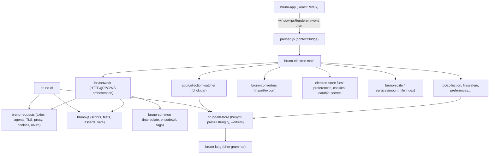

# Source Map

Snapshot analyzed: `usebruno/bruno` @ `60d7517d0545ef82c032c10dcbb6a3c815d246cf` (2026-11-09), cloned into `bruno/` at the project root (shallow clone, `--depth 1`).

All paths in this documentation are relative to the `bruno/` directory unless stated otherwise.

**Status legend** — VERIFIED: directly observed in source. INFERRED: derived from multiple files. PROPOSED: recommendation for the Go port. UNKNOWN: not established.

---

## 1. Top-level layout (VERIFIED)

```text
bruno/
├── package.json            # npm workspaces + lerna-lite monorepo root
├── lerna.json
├── playwright/             # e2e harness for Electron
├── tests/                  # ~50 e2e spec directories (playwright projects)
├── scripts/                # dev/build orchestration (dev.js, build-electron.js…)
└── packages/
    ├── bruno-app/          # React renderer (rsbuild + Redux + Tailwind)
    ├── bruno-electron/     # Electron main process, IPC handlers, all privileged logic
    ├── bruno-lang/         # .bru DSL grammar + parse/stringify (ohm-js)
    ├── bruno-filestore/    # Format abstraction: bru + yml parsers/serializers, worker pool
    ├── bruno-requests/     # Transport: axios factories, agents, proxy, TLS, auth helpers, ws, grpc
    ├── bruno-js/           # Script runtime (`bru`, `req`, `res`, `test`, `expect`, sandboxes)
    ├── bruno-common/       # Shared pure utils: interpolate, encodeUrl, tags, codegen, runner
    ├── bruno-cli/          # Node CLI runner (`bru run`)
    ├── bruno-converters/   # Postman / Insomnia / OpenAPI / WSDL / OpenCollection import & export
    ├── bruno-schema/       # JSON validation (ajv/yup schemas)
    ├── bruno-schema-types/ # TypeScript type definitions for the data model
    ├── bruno-query/        # JSON/XML query evaluation (json-query helpers)
    ├── bruno-sqlite/       # node:sqlite wrapper: file index / snapshots
    ├── bruno-toml/         # TOML <-> JSON (used by some API spec tooling)
    ├── bruno-io/           # Collection write pipeline
    ├── bruno-graphql-docs/ # GraphQL introspection doc rendering
    ├── bruno-docs/         # Placeholder package (package.json + readme only — **no code**)
    └── bruno-tests/        # Test fixture collections + docker-compose test servers
```

Source counts (VERIFIED, files matching `*.js|ts|tsx|jsx` excluding `node_modules`/`dist`):

| Package | Source files | Test files |
|---|---|---|
| bruno-app | 1544 | 220 |
| bruno-electron | 218 | 85 |
| bruno-converters | 159 | 101 |
| bruno-cli | 77 | 41 |
| bruno-js | 106 | 42 |
| bruno-filestore | 80 | 27 |
| bruno-requests | 63 | 25 |
| bruno-common | 62 | 24 |
| bruno-lang | 58 | 33 |
| bruno-sqlite | 29 | 6 |
| bruno-schema-types | 21 | 0 |
| bruno-io | 7 | 1 |
| bruno-schema | 9 | 5 |
| bruno-query | 4 | 1 |
| bruno-toml | 3 | 1 |
| bruno-docs | 0 | 0 |

---

## 2. Entry points

| Process | Entry | Symbols |
|---|---|---|
| Electron main | `packages/bruno-electron/src/index.js` | `app.on('ready')`, `registerNetworkIpc(mainWindow)`, `openCollection(...)` |
| Preload bridge | `packages/bruno-electron/src/preload.js` | `contextBridge.exposeInMainWorld('ipcRenderer', …)` |
| Renderer | `packages/bruno-app/src/index.js` → `pages/index.js` → `pages/Main.js` → `pages/Bruno/index.js` | `Main`, `Bruno` |
| CLI | `packages/bruno-cli/src/index.js` | command registration (`run`, `import`, `export`, `publish`…) |
| Test harness | `packages/bruno-tests/docker-compose.yml`, `tests/` (Playwright projects) | — |

Source: `packages/bruno-electron/src/index.js`
Relevant symbols: `restrictIpcToAppFrames`, `registerNetworkIpc`, `on('ready')` (line 209), IPC registration block (lines 552–568)

---

## 3. Module responsibilities (the map)



### Package → key subsystem

| Package | Responsibility | Key files |
|---|---|---|
| `bruno-app` | All UI, draft editing, Redux state, IPC calls, response rendering, codegen, curl import | see §4 |
| `bruno-electron` | Privileged operations: HTTP execution, FS, watchers, cookies, OAuth, mock server, git, AI proxies | `src/ipc/network/index.js` (2320 lines) |
| `bruno-lang` | `.bru` grammar: request, collection, folder, environment, dotenv → JSON, and reverse | `v2/src/bruToJson.js`, `jsonToBru.js`, `envToJson.js`, `collectionBruToJson.js` |
| `bruno-filestore` | Format-agnostic `parseRequest/stringifyRequest/parseCollection/...` with `bru` and `yml` backends; runs in web workers | `src/index.ts`, `src/formats/bru/*`, `src/formats/yml/*` |
| `bruno-requests` | `makeAxiosInstance`, http/https agent builder (proxy/PAC/TLS/client certs), cookie jar, OAuth1, NTLM, digest, edgegrid, `bru.sendRequest` | `src/network/*`, `src/utils/http-https-agents.ts` (642 lines), `src/cookies/index.ts` |
| `bruno-js` | `Bru` scripting API, `BrunoRequest`, `BrunoResponse`, `ScriptRuntime`, `TestRuntime`, `AssertRuntime`, `VarsRuntime`, `quickjs`/`node-vm` sandboxes | `src/bru.js`, `src/runtime/*`, `src/sandbox/*` |
| `bruno-common` | `interpolate`, `encodeUrl`, tag resolution, collection runner primitives, code generators, OpenAPI sync | `src/interpolate/index.ts` |
| `bruno-cli` | Headless runner; reuses the same JS runtime + requests transport | `src/runner/*` |
| `bruno-converters` | Postman v2/v2.1, Insomnia, OpenAPI 3, WSDL, OpenCollection; both directions | `src/postman`, `src/insomnia`, `src/openapi`, `src/opencollection` |

---

## 4. Renderer source map (`bruno-app/src`)

### 4.1 State (`providers/ReduxStore`)

`index.js` registers the reducers and middleware (VERIFIED):

```text
app, collections, tabs, notifications, globalEnvironments, logs,
performance, workspaces, apiSpec, openapiSync, mockServer, chat,
collectionMigration
middleware: tasksMiddleware, draftDetectMiddleware, autosaveMiddleware,
            snapshotMiddleware (+ debug, benchmark in dev)
```

| File | Lines | Contents |
|---|---|---|
| `slices/collections/index.js` | 4549 | `collections[]` with nested `items[]` trees, drafts, responses, per-item request states, timeline |
| `slices/collections/actions.js` | 3955 | Thunks: `sendRequest`, `saveRequest`, `newRequest`, `runCollectionFolder`, `importCollection`, `saveEnvironment`… |
| `slices/collections/exampleReducers.js` | 1210 | Response-example tree reducers |
| `slices/workspaces/actions.js` | 1566 | Workspace CRUD, git, spec files |
| `slices/tabs.js` | 713 | Open tabs, `activeTabUid`, per-tab `requestPaneTab`/`responsePaneTab`/`responseFormat` |
| `slices/app.js` | 489 | Preferences mirror, sidebar collapse, modals, zoom |

Source: `packages/bruno-app/src/providers/ReduxStore/index.js`
Relevant symbols: `configureStore`, `reducer` keys

### 4.2 Components (major)

| Component path | Purpose |
|---|---|
| `components/Sidebar/` | Collections tree, workspaces, import, git, new request/folder/collection |
| `components/RequestTabs/` | Tab strip + `CollectionHeader` (environment selector, runner launcher, settings) |
| `components/RequestTabPanel/` | Hosts request pane (top) and response pane (bottom or right) |
| `components/RequestPane/HttpRequestPane` | Request editor tab bar: Params, Body, Headers, Auth, Vars, Script, Assert, Tests, Docs, App, Settings |
| `components/RequestPane/QueryUrl` | Method selector + URL input + send button |
| `components/ResponsePane/` | Response tabs (Response, Headers, Timeline, Tests), status/time/size, body viewer |
| `components/MultiLineEditor`, `SingleLineEditor`, `CodeEditor` | CodeMirror 5 wrappers with variable autocomplete |
| `components/Preferences/` | Global settings (General, Proxy, Certificates, Keybindings, Themes, AI, Cache…) |
| `ui/` | Design-system primitives: `Button`, `Select`, `MenuDropdown`, `ContextMenu`, `Toggle`, `Tabs` (`ResponsiveTabs`), `Modal`, `MethodBadge`… |

### 4.3 Hooks / Providers

| Path | Purpose |
|---|---|
| `providers/Hotkeys/keyMappings.js` | All default key bindings, per OS |
| `providers/PromptVariables` | Modal to collect `prompt` variables before send |
| `providers/Theme` | Theme tokens, light/dark |
| `providers/Toaster` | Toasts |
| `hooks/useKeybinding*`, `useResizablePanel`, `usePersistedState`… | UI behavior |

---

## 5. Electron main source map (`bruno-electron/src`)

| Area | Files |
|---|---|
| App bootstrap | `index.js`, `app/menu-template.js`, `app/collections.js`, `app/collection-watcher.js`, `app/workspace-watcher.js`, `app/dotenv-watcher.js` |
| IPC | `ipc/network/index.js`, `ipc/collection.js`, `ipc/filesystem.js`, `ipc/preferences.js`, `ipc/workspace.js`, `ipc/global-environments.js`, `ipc/snapshot.js`, `ipc/git.js`, `ipc/mock-server/`, `ipc/ai/`, `ipc/sqlite.js` |
| Network internals | `ipc/network/prepare-request.js`, `interpolate-vars.js`, `apply-collection-vars.js`, `awsv4auth-helper.js`, `cert-utils.js`, `axios-instance.js`, `authorize-user-in-window.js`, `grpc-*`, `ws-*` |
| Stores | `store/preferences.js`, `store/cookies.js`, `store/oauth2.js`, `store/env-secrets.js`, `store/bruno-config.js`, `store/process-env.js`, `store/default-workspace.js` |
| Services | `services/pool` (worker pool), `services/mount` (file index), `services/snapshot`, `services/transient`, `services/runner-exchange` |
| Utils | `utils/collection.js` (merge headers/vars/auth/scripts, path resolution), `utils/cookies.js`, `utils/form-data.js`, `utils/oauth2.js`, `utils/parse.js`, `utils/filesystem.js` |

---

## 6. What was *not* deeply analyzed

- AI assistant IPC (`ipc/ai/`, `ai-sdk` usage) — out of scope for a HTTP client port; noted in `research/limitations.md`.
- Mock server internals (`ipc/mock-server/index.js`) — noted only.
- OpenAPI sync / API spec editor, WSDL import — summarized at feature level in `implementation/feature-parity-matrix.md`.
- Terminal (`@lydell/node-pty`) and git integration — summarized.
- Exact behavior of `bruno-converters` importers per format — summarized at module level (159 source files, 101 tests).
