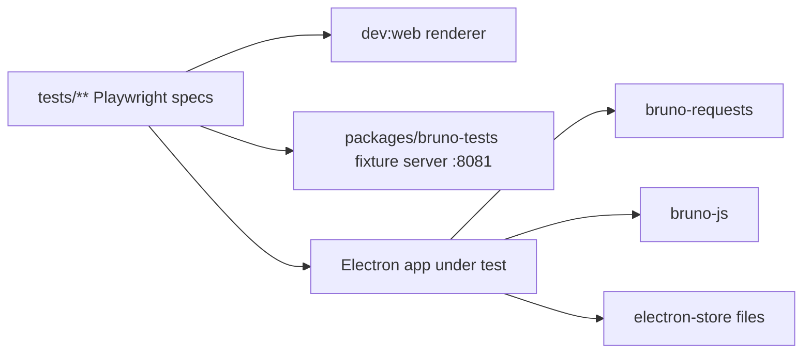
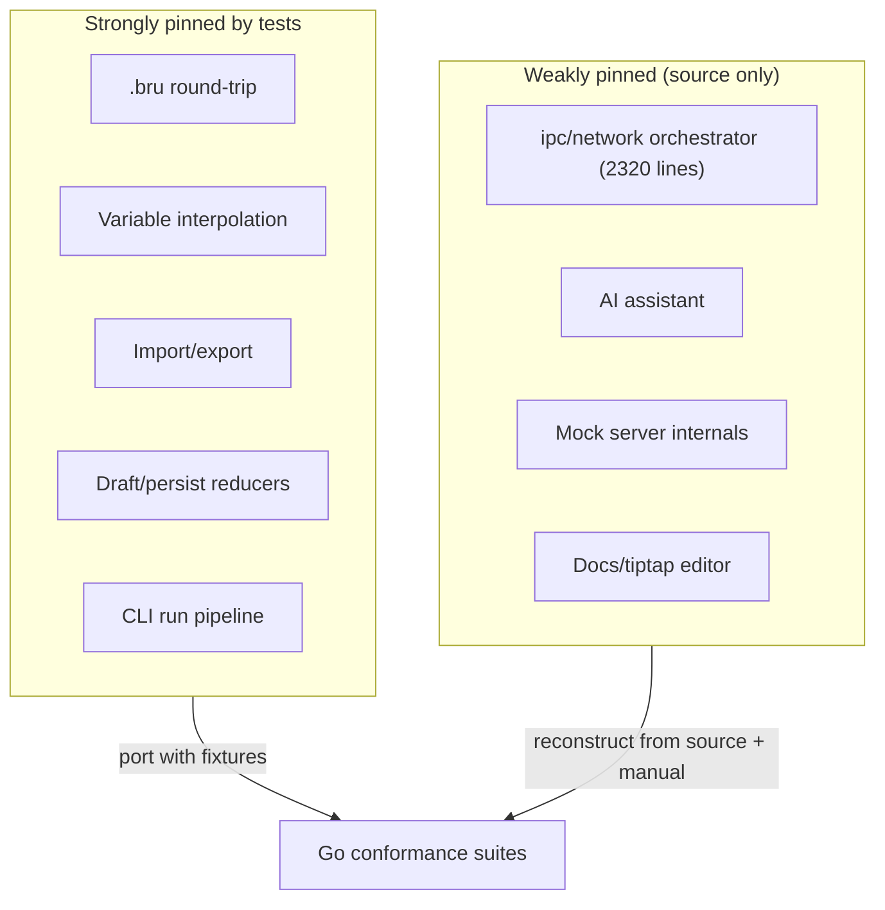

# Test Coverage

Status: VERIFIED for file counts and harness configuration; INFERRED where a suite's intent is read from its directory name and fixture contents.

Scope: what the Bruno repository at `60d7517d0545ef82c032c10dcbb6a3c815d246cf` actually tests, and what that tells the Go port about which behaviour is *pinned* by tests and which is only described in code.

Why this matters for the port: a suite that exists upstream is a **free conformance corpus**. Where Bruno tests a behaviour, the Go implementation can be validated against the same fixtures instead of relying on prose. Where no suite exists, the Go implementation is the first thing to pin that behaviour down, and the risk of an accidental behaviour change is higher.

---

## 1. Test harness inventory (VERIFIED)

Bruno runs three independent test layers.

| Layer | Runner | Config | Trigger |
| --- | --- | --- | --- |
| Unit / integration | Jest (per package) | `packages/*/jest.config.js` | `npm test` in a package |
| End-to-end UI | Playwright driving a real Electron build | `playwright.config.ts` | `npm run test:e2e` |
| CLI conformance | Jest against the packaged CLI | `packages/bruno-cli/tests/**` | `run-cli-tests` CI action |

Source: `package.json`
Relevant symbols: `test:e2e`, `test:e2e:ssl`, `test:e2e:auth`, `test:e2e:mock-server`, `test:e2e:sanity`, `test:benchmark`, `test:codegen`

Test files matching `*.spec.ts|*.test.ts|*.spec.js|*.test.js` outside `node_modules`: **1148**.

Per-package Jest configurations exist for `bruno-app`, `bruno-common`, `bruno-converters`, `bruno-filestore`, `bruno-graphql-docs`, `bruno-io`, `bruno-query`, `bruno-requests`, `bruno-sqlite` (last one needs `--experimental-sqlite`).

Source: `packages/*/jest.config.js`, `packages/bruno-sqlite/package.json`
Relevant symbols: `test` scripts; `NODE_OPTIONS=--experimental-sqlite`

---

## 2. Where the tests live (VERIFIED, by file count)

| Location | Test files | What it covers |
| --- | --- | --- |
| `packages/bruno-js/tests` | 34 | `bru`/`req`/`res` API surface, runtimes, sandboxes |
| `tests/import/postman` | 21 | Postman v2/v2.1 → Bruno conversion |
| `packages/bruno-lang/v2/tests` | 20 | `.bru` grammar round-trips (v2 dialect) |
| `packages/bruno-app/src/providers/ReduxStore/slices/collections` | 19 | Reducer behaviour for the collection slice |
| `tests/import/openapi` | 16 | OpenAPI → Bruno |
| `tests/richtext-editor` | 15 | Docs editor (tiptap) |
| `packages/bruno-converters/tests/postman/postman-translations/transpiler-tests` | 14 | Postman script → Bruno script transpiler |
| `packages/bruno-common/src/utils` | 14 | `interpolate`, `encodeUrl`, tag helpers |
| `packages/bruno-converters/tests/opencollection` | 13 | OpenCollection import/export |
| `packages/bruno-filestore/src/formats/yml` | 12 | YAML (OpenCollection) codec |
| `tests/websockets` | 12 | WS connection/message lifecycle |
| `packages/bruno-converters/tests/openapi/openapi-to-bruno` | 12 | (subset of the above) |
| `tests/snapshots` | 11 | Snapshot service |
| `packages/bruno-electron/tests/network` | 11 | Network helper units (auth helpers, agents) |
| `packages/bruno-electron/tests/utils` | 11 | `collection.js` merge rules, path resolution |
| `packages/bruno-lang/v1/tests` | 10 | Legacy `.bru` v1 dialect |
| `tests/import/insomnia` | 7 | Insomnia import |
| `packages/bruno-cli/tests/integration` | 10 | CLI behaviours (see §5) |
| `tests/request/*` | ~40 across subdirs | Request editor behaviours (description, settings, multipart, headers, timeline, codegen) |
| `tests/environments/*` | ~20 | Env inheritance, sidebar actions, `bru.setEnvVar` |
| `tests/auth/akamai-edgegrid` | 4 | EdgeGrid auth |
| `tests/ssl/client-certs/*` | ~12 | Client certificate matrix |

`tests/` also contains dedicated directories for `asserts`, `auth`, `cookies`, `devtools`, `dotenv`, `export`, `graphql`, `grpc`, `interpolation`, `mock-server`, `openapi-sync`, `protobuf`, `proxy`, `response-examples`, `runner`, `script-errors`, `scripting`, `sse`, `variable-datatypes`, `variables-tab`, `variable-tooltip`, `workspace`, plus `shortcuts`, `sidebar`, `onboarding`, `preferences`, `transient-requests`, `scratch-requests`, `naming-collisions`, `benchmarks`.

Source: filesystem enumeration of `tests/**` and `packages/*/tests/**` at the pinned commit.

### 2.1 Packages with no dedicated unit tests (VERIFIED)

| Package | Note |
| --- | --- |
| `bruno-schema-types` | Type-only package; 0 test files, 21 source files |
| `bruno-docs` | Placeholder package, no code |
| `bruno-requests` (partial) | 25 test files but the agent builder is large (`http-https-agents.ts`, 642 lines) — coverage is not proportional to complexity |
| `bruno-electron/src/ipc/network/index.js` | 2320 lines with no file-local spec; exercised only through Playwright e2e and the CLI integration suite |

INFERRED: the largest single file in the codebase (the network IPC handler) is covered *behaviourally* (e2e) rather than *structurally* (unit). This is the highest-risk area for the port because there is no per-function specification to port against; behaviour must be reconstructed from the e2e suites plus the source.

---

## 3. Playwright projects and what each isolates (VERIFIED)

`playwright.config.ts` splits into five projects, run in separate CI jobs where ports or certificates would otherwise collide:

| Project | `testDir` | Excluded from `default` because |
| --- | --- | --- |
| `default` | `./tests` | ignores `ssl/**`, `auth/**`, `benchmarks/**`, `proxy/system-pac/**`, `mock-server/**` |
| `auth` | `./tests/auth` | needs its own auth server + interactive flows |
| `ssl` | `./tests/ssl` | needs generated CAs and a separate HTTPS server |
| `system-pac` | `./tests/proxy/system-pac` | shares PAC/proxy/target ports with `proxy/pac` |
| `mock-server` | `./tests/mock-server` | per-worker Electron state + worker-index ports |

Two `webServer` entries are required before any spec runs: the dev renderer (`dev:web`) and the fixture server (`packages/bruno-tests`, health-checked at `http://localhost:8081/ping`). CI retries twice and uses `trace: 'on'`; locally `trace: 'on-first-retry'` only.

Source: `playwright.config.ts`
Relevant symbols: `projects`, `webServer`, `retries`, `use.trace`

---

## 4. Jest coverage by package (VERIFIED counts, INFERRED intent)

| Package | Test files | Pinned behaviours worth reusing as fixtures |
| --- | --- | --- |
| `bruno-lang` v1 + v2 | 30 | `.bru` grammar round-trip; every section keyword; `extends`/`color` rules |
| `bruno-filestore` (bru + yml) | 17 | Codec abstraction parity between the two backends |
| `bruno-common` | 24 | `interpolate` (the file that `logic/variable-interpolation.md` ports), `encodeUrl`, tags |
| `bruno-js` | 42 | `bru`, `req`, `res` semantics, `test`/`expect`, sandbox escape containment |
| `bruno-converters` | 101 | Import/export fidelity across four formats |
| `bruno-requests` | 25 | Cookie jar, OAuth1 helpers, system-proxy utils, auth helpers |
| `bruno-electron` | 85 | Collection merge semantics, store wrappers, IPC handler units |
| `bruno-app` | 220 | Redux slices (draft model, tabs, environments), CodeMirror utils, codegen |
| `bruno-io` | 1 | Thin write pipeline |
| `bruno-query` | 1 | JSON/XML query helpers |
| `bruno-schema` | 5 | Schema validation |
| `bruno-sqlite` | 6 | File index / snapshot queries |

The `bruno-app` figure (220) is the largest and is almost entirely reducer tests. That is significant for the port: **Bruno's draft/persist state machine is the most heavily specified part of the UI layer**, and the Go state actor (see `implementation/go-architecture.md` §3) must reproduce those transitions. The reducers are the best available specification for it.

Source: `packages/bruno-app/src/providers/ReduxStore/slices/collections/*.spec.js` (19 files), `slices/*` (7 files), `slices/workspaces` (5 files)

---

## 5. CLI integration suite — the closest thing to an engine spec (VERIFIED)

`packages/bruno-cli/tests/integration` exercises the whole headless stack (parse → interpolate → transport → scripts → report) without any UI. Each spec name below maps directly onto a Go package that must pass an equivalent test.

| Spec | Behaviour pinned | Go package under test |
| --- | --- | --- |
| `cache-modules.spec.js` | Script module caching between runs | `core/scripting` |
| `cli-global-env-var-override.spec.js` | `--env-var` precedence over file env | `core/vars` |
| `collection-env-var-persistence.spec.js` | Env writes from scripts persist | `core/vars`, `core/persistence` |
| `global-env-var-persistence.spec.js` | Same for global envs | `core/vars` |
| `environment-inheritance.spec.js` | `vars:pre-request` inheritance chain | `core/vars` |
| `dirname-per-script-segment` | Per-script working directory for file APIs | `core/scripting` |
| `digest-auth` | Digest challenge/response | `core/engine/auth` |
| `import-postman` | CLI import path | `core/format` |
| `nodevm-async-callbacks` | Async callbacks complete before next phase | `core/scripting` |
| `quickjs-trap-containment` | Infinite-loop trap in the QuickJS sandbox | `core/scripting` |
| `run-additional-context-roots.spec.js` | Extra roots visible to `require` | `core/scripting` |
| `run-default-environment.spec.js` | Default env selection | `core/vars` |
| `run-folder-tags` | Tag-filtered folder runs | `app/commands` (runner) |
| `run-onfail-persistence.spec.js` | `onFail` behaviour + persistence | `app/commands` |
| `run-sent-headers.spec.js` | Exact header set transmitted | `core/engine/build` |
| `run-typed-persistence.spec.js` | Typed variable persistence | `core/vars` |
| `tls-client-hello` | TLS ClientHello shape (SNI, ALPN) | `core/engine/transport` |

Also `packages/bruno-cli/tests/runner` (6 files) and `tests/utils` (9 files).

INFERRED: `tls-client-hello` and `quickjs-trap-containment` are the two specs with **no direct Go equivalent shortcut** — the former inspects wire bytes, the latter depends on QuickJS-specific trap semantics that `goja` implements differently (interrupt-based, not trap-based). Both are recorded in `research/unresolved-questions.md`.

---

## 6. Behavioural areas with strong e2e coverage (VERIFIED directories, INFERRED content)

These directories exist as Playwright specs, which means the behaviour is user-visible and pinned:

- **Auth**: `tests/auth/akamai-edgegrid` and the `auth` project — the full provider matrix (basic, bearer, digest, NTLM, OAuth1, OAuth2 variants, AWS SigV4, WSSE, EdgeGrid, API key).
- **TLS**: `tests/ssl/client-certs/{global-client-certs-enabled,global-client-certs-disabled,collection-client-certs-enabled-bru,collection-client-certs-enabled-yml}` — the four-way matrix of global vs collection scope × `.bru` vs `.yml` format. This is the single best specification of client-certificate precedence in the repo.
- **Streaming**: `tests/sse/sse-cancellation.spec.ts`, `streaming-elapsed-time.spec.ts` — cancellation and elapsed-time accounting for SSE.
- **WebSockets**: `tests/websockets/connection.spec.ts` and `multi-message-bru` — connection lifecycle and multi-message `.bru` representation.
- **gRPC**: `tests/grpc/{lifecycle-hooks-persistence,make-request,metadata,method-search,multi-message-yml,run-lifecycle-hooks,subpath}`.
- **Scripting**: `tests/scripting/{bru-api,req-api,res-api,url-helpers,inbuilt-libraries,quickjs-safe-mode,nodevm-developer-mode,additional-context-roots,crlf-line-comment}`.
- **Runner**: `tests/runner`, plus `tests/set-as-variable`, `tests/asserts`, `tests/script-errors`.
- **Variables**: `tests/interpolation/{collection,dynamic-variable,prompt-variables,interpolate-request-url.spec.ts}`, `tests/variable-datatypes`, `tests/variables-tab`, `tests/variable-tooltip`, `tests/unresolved-variables-info`.
- **Filesystem events**: `tests/collection/*`, `tests/naming-collisions/*`, `tests/folder/tags*`, `tests/collection/moving-requests` — the watcher behaviour that `mygo.WatchFiles` replaces.

---

## 7. Gaps and how the Go port should handle them

| Gap | Impact on the port | Mitigation (PROPOSED) |
| --- | --- | --- |
| No unit spec for the network orchestrator | Send-pipeline ordering is pinned only by e2e | Build the Go engine from `flows/request-lifecycle.md` and add a **step-ordered** test that asserts the exact phase order with fakes |
| `bruno-schema-types` untested | Type drift is invisible upstream | The Go model types *are* the schema; keep a golden JSON round-trip test per `.bru` fixture |
| QuickJS vs goja semantics | Sandbox containment differences | Document divergence in `research/unresolved-questions.md`; test interrupt-based timeouts explicitly |
| No SQLite parity tests for the *upcoming* history store | The feature is not in Bruno at all | Treat Go history as a new feature; no parity obligation (see `flows/history-flow.md`) |
| Tiptap docs editor | DOM-only | Replace with a Markdown editor; the 15 specs pin *content* behaviour that a Markdown editor can satisfy |

Source: cross-check of `docs/logic/**` and `docs/flows/**` coverage claims against the test directories above.
