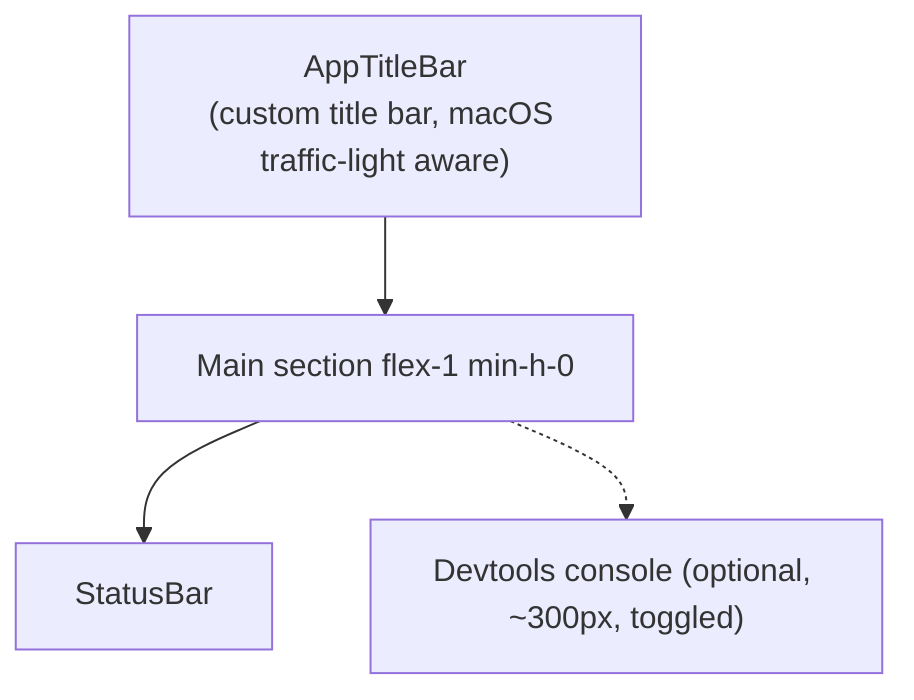
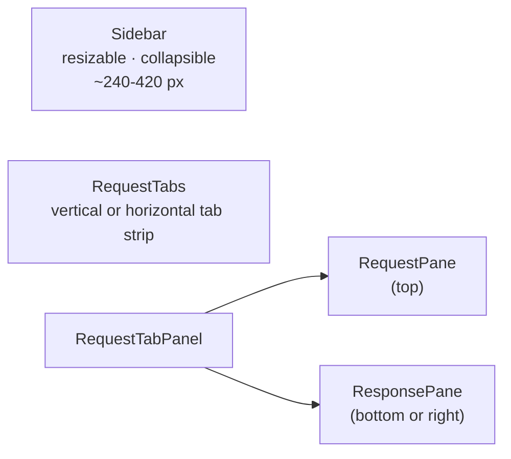
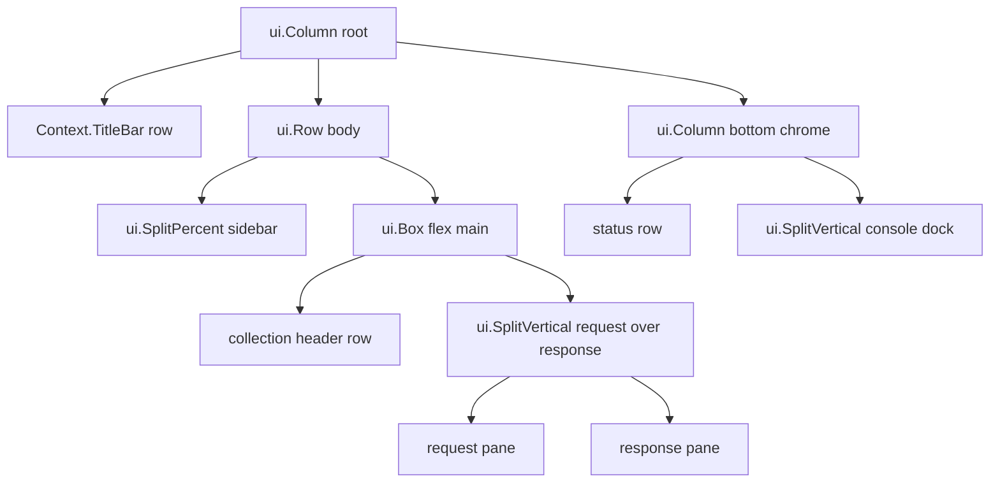

# Application Layout

Status: VERIFIED unless marked.

---

## 1. Window structure (top → bottom)



Source: `packages/bruno-app/src/pages/Bruno/index.js`
Relevant symbols: `Main`, `#main-container`, `isConsoleOpen`

The window height reservation is explicit:

```js
height: isConsoleOpen ? `calc(100vh - 60px - 300px)` : `calc(100vh - 60px)`;
```

so opening the console shrinks the app rather than overlaying it.

---

## 2. Three-column body



| Region                 | Component                    | Resizable                                        | Persisted                                      |
| ---------------------- | ---------------------------- | ------------------------------------------------ | ---------------------------------------------- |
| Sidebar                | `components/Sidebar`         | `useResizablePanel`, `useDragResize`             | Width in preferences                           |
| Tabs                   | `components/RequestTabs`     | Drag reorder (`DraggableTab`, `useMouseRowDrag`) | Order in tabs slice                            |
| Request/Response split | `components/RequestTabPanel` | Yes                                              | Orientation per tab (`changeLayout` hotkey ⌘J) |

Source: `components/RequestTabPanel`, `hooks/useResizablePanel`, `hooks/useDragResize`, `providers/Hotkeys/keyMappings.js`

---

## 3. Layout modes

| Mode                  | Description                                                        |
| --------------------- | ------------------------------------------------------------------ |
| **Stacked** (default) | Request pane above, response pane below                            |
| **Side-by-side**      | Response pane to the right; toggled by `changeLayout` (⌘/Ctrl + J) |
| Vertical tabs         | Tab strip on the left instead of above (`Sidebar`/`Tabs` variant)  |
| Sidebar collapsed     | ⌘/Ctrl + `\`                                                       |
| AI chat sidebar       | Optional right rail, can pop out (`AiChatSidebar/Popout`)          |
| Console dock          | Bottom dock with Devtools + terminal                               |

Layout state lives in Redux (`tabs[].requestPaneOrientation`) and preferences, so it survives restarts.

---

## 4. Title bar

`AppTitleBar` is a custom frame strip: app menu (Windows/Linux), active collection name, workspace selector trigger, update indicator, window controls. On macOS it respects the traffic-light inset.

---

## 5. Empty and special screens

| Screen                 | Trigger                         | Component                                        |
| ---------------------- | ------------------------------- | ------------------------------------------------ |
| Welcome / onboarding   | No collections open, first run  | `WelcomeModal`, `EmptyAppState`, `WorkspaceHome` |
| Manage workspace       | Workspace manager open          | `ManageWorkspace`                                |
| Transient request save | Unsaved scratch request closed  | `SaveTransientRequest`                           |
| Collection open splash | Opening a large collection      | loading state on `#main-container`               |
| Rosetta warning        | Apple Silicon running x64 build | banner in `pages/Bruno`                          |

---

## 6. Responsive behavior

The app assumes a desktop window ≥ ~900 px. Behavior under stress:

- `ResponsiveTabs` collapses overflow into a dropdown.
- Response pane action icons collapse into a `…` menu below `RIGHT_CONTENT_EXPANDED_WIDTH = 135` px (`ResponsePane/index.js`).
- `useTabPaneBoundaries` and `HeightBoundContainer` keep CodeMirror sized correctly when panes resize.

---

## 7. Go port guidance (PROPOSED)

- Treat the three regions as fixed collapsible splitters (sidebar / request / response). Persist split ratios.
- Support both orientations from day one — users switch frequently.
- Reserve a dock area for logs; do not overlay the editor.
- Preserve the 60 px title-bar + status-bar chrome budget so the content area feels the same.

---

## 8. Go-native layout mapping (PROPOSED — Go-only constraint)

Sections 1–7 describe Bruno's DOM/flex layout. With a Go-only stack (no HTML/CSS, no Electron, no Wails) the same visual structure is produced by native layout widgets. The chosen toolkit is **MyGo** (decision recorded in `architecture/system-overview.md` §8.5); the second column names the concrete MyGo construct, and the note column records the non-obvious caveats.

| Bruno CSS mechanism                              | Go-native equivalent                       | MyGo construct / note                                                                                                                                        |
| ------------------------------------------------ | ------------------------------------------ | ------------------------------------------------------------------------------------------------------------------------------------------------------------ |
| `flex-col h-screen`                              | Root vertical stack sized to the window    | `ui.Column` as the single root of `ui.View`; everything else nests inside it                                                                                 |
| `flex-1 min-h-0`                                 | Flexible child with a minimum-clamp rule   | `ui.Box` with `Weight`, plus an explicit minimum height on the parent; MyGo will not invent the clamp, the presenter must supply it                          |
| `calc(100vh - 60px - 300px)` console reservation | Explicit splitter with a fixed console     | Vertical `ui.Split` whose bottom panel is fixed-height and whose top panel takes the remainder — the same arithmetic, expressed structurally                 |
| Resizable panes (`useResizablePanel`)            | Splitter with drag handles and constraints | `ui.Split` (horizontal), `ui.SplitVertical` (vertical), or `ui.SplitPercent` for ratio-based splits; store the ratio in presentation state                   |
| Draggable tabs                                   | Reorderable tab strip with drop indicators | `ui.Tabs` / `ui.TabsBase`; reorder is presenter logic on the tab slice, not a widget feature                                                                 |
| Custom title bar (`AppTitleBar`)                 | Custom title row signed to the window      | `Context.TitleBar` content plus `Element.DragWindow` on the non-interactive region; keep the macOS traffic-light inset in the presenter's layout calculation |
| `ResponsiveTabs` overflow `…`                    | Overflow menu from measured label widths   | Presenter measures widths, then renders either inline tabs or a `ui.MenuButton`; there is no automatic overflow collapsing                                   |
| `Portal` modals/overlays                         | Overlay layer above all panes, focus trap  | `ui.Modal` / `ui.DialogBase` / `ui.Popover`; the toast surface is `Context.Toast` and needs no overlay of its own                                            |

### 8.2.1 Concrete tree for the default (stacked) layout



The side-by-side mode is the same tree with `ui.SplitVertical` replaced by `ui.Split` (request left, response right). Only that one constructor changes, mirroring how `changeLayout` only flips an orientation flag in Bruno.

### 8.2.2 What the layout layer must not own

MyGo gives the presenter a repaint-oriented `View` function. That makes it tempting to hold domain state in closures. Do not: the `View` function must be a pure function of an immutable snapshot handed to it by the `app` layer. Window creation (`mygo.NewWindow`), invalidation (`Context.Invalidate`), and any `Context` access stay inside `main`-thread code; the HTTP engine never sees a `Context`.

Source (Bruno side of the mapping): `packages/bruno-app/src/pages/Bruno/index.js`, `components/RequestTabPanel`, `components/RequestTabs`, `components/AppTitleBar`
Relevant symbols: `Main`, `RequestTabPanel`, `ResponsiveTabs`, `AppTitleBar`
Source (MyGo constructs): package `ui` of `github.com/egoist/mygo` — `Column`, `Row`, `Box`, `Split`, `SplitVertical`, `SplitPercent`, `TabsBase`, `MenuButton`, `Modal`, `DialogBase`, `Popover`, `Context.TitleBar`, `Element.DragWindow`, `Context.Toast`

### 8.1 Region budget (preserve)

```text
┌───────────────────────────────────────── window ─────────────────────────────────────────┐
│ Title bar / menu                                                       (≈28–32 px)       │
├───────────────┬──────────────────────────────────────────────────────────────────────────┤
│ Sidebar       │ Collection header (environment selector, runner)                         │
│ 220–600 px    ├──────────────────────────────────────────────────────────────────────────┤
│ (collapsible) │ Request pane  ── stacked ──┐  or  ── side-by-side ──┐                     │
│               │ Response pane ────────────┘                         │                     │
├───────────────┴──────────────────────────────────────────────────────────────────────────┤
│ Status bar                                                                  (≈24 px)     │
├──────────────────────────────────────────────────────────────────────────────────────────┤
│ Console dock (optional, ~300 px, shrinks content)                                        │
└──────────────────────────────────────────────────────────────────────────────────────────┘
```

### 8.3 Layout state ownership

Split ratios, sidebar width, orientation, and console visibility are **presentation state**, not domain state: they belong to the presenter and are persisted to a settings file. The core must never read them. This keeps the layout layer replaceable and testable headlessly.

### 8.4 Minimum and degraded modes

- Below ~900 px width: collapse the sidebar to icons, force stacked orientation, hide secondary status items.
- Below ~600 px: single pane with a Request/Response switcher (documented fallback; Bruno does not support this, so it is an addition, not parity work).
- Multi-monitor: persist window bounds and split ratios per display configuration (see `store/window-state.js` behaviour in Bruno).
