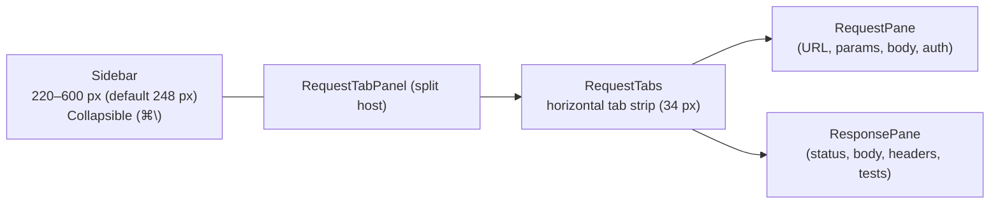

# Application Layout

Status: VERIFIED against `bruno/packages/bruno-app/src/` at commit `60d7517` and cross-referenced with `ui-map/screens/app-shell.md`.

---

## 1. Window structure (top → bottom)

```text
┌──────────────────────────────────────────────────────────────────────────┐
│ AppTitleBar (36 px, drag region)                                         │
│  [workspace ▾]                    brun  or  o   (center)   [icons][win]  │
├──────────────┬───────────────────────────────────────────────────────────┤
│              │ RequestTabs (height ~34 px)                               │
│  Sidebar     ├───────────────────────────────────────────────────────────┤
│  (220–600px) │ RequestPane                    │ ResponsePane             │
│  (§sidebar)  │  (§request-editor)             │  (§response-viewer)      │
│              │         ── drag bar 12 px ──                              │
├──────────────┴───────────────────────────────────────────────────────────┤
│ StatusBar (24 px / 1.5 rem)                                              │
└──────────────────────────────────────────────────────────────────────────┘
```

The app shell is structured as a vertical root:

1. `AppTitleBar`: 36 px fixed height (`AppTitleBar/StyledWrapper.js:4`).
2. Main body section: `flex-1 min-h-0` containing the 3-column workspace.
3. `StatusBar`: 24 px (`1.5rem`) bottom status strip (`StatusBar/StyledWrapper.js:7`).

Devtools/console dock (when toggled open) reserves 300 px from the window height rather than overlaying the body:
`height: isConsoleOpen ? calc(100vh - 60px - 300px) : calc(100vh - 60px)`.

---

## 2. AppTitleBar Specification

**Height:** `36px` (`components/AppTitleBar/StyledWrapper.js:4`).  
**Ground:** `sidebar.bg` (light `#f8f8f8`, dark `#222224`).  
**Drag region:** `-webkit-app-region: drag`; interactive child controls opt out via `no-drag` class (`StyledWrapper.js:6, 24-30`).

| Region              | Element                    | Visual Spec                                                                                                                                                               | Source / Action                                                                                                         |
| ------------------- | -------------------------- | ------------------------------------------------------------------------------------------------------------------------------------------------------------------------- | ----------------------------------------------------------------------------------------------------------------------- | --------- | ------------------- |
| **Left**            | Workspace dropdown trigger | Padding `5px 10px`, radius `6px`, gap `6px`, max-width `180px` with ellipsis. Text `13px/500` `sidebar.color`. Hover: `sidebar.collection.item.hoverBg`.                  | List workspaces, pin toggle, rename, create, import (`WorkspaceSidebar/*`). Untitled displays **"Untitled Workspace"**. |
| **Window Inset**    | macOS traffic lights       | Left padding `70px`; drops to `6px` in fullscreen mode.                                                                                                                   | `StyledWrapper.js:17, 21`.                                                                                              |
| **Center**          | Bruno wordmark             | Absolute-centered, `13px/600`, tracking `.5px`, color `text`, non-interactive.                                                                                            | `StyledWrapper.js:89-102`.                                                                                              |
| **Right Actions**   | Toolbar icons              | 16 px Tabler icons, `strokeWidth 1.5`, gap `2px`. Buttons: Home, pin/unpin, new workspace, import, settings, sidebar toggle, console toggle, response orientation toggle. | `index.js:36-44`.                                                                                                       |
| **Window Controls** | Win/Linux min/max/close    | `IconMinus`, `IconSquare`/`IconCopy`, `IconX`. Rendered only when `isWindows                                                                                              |                                                                                                                         | isLinux`. | `index.js:1-2, 36`. |

---

## 3. StatusBar Specification

**Height:** `1.5rem` = 24 px (`components/StatusBar/StyledWrapper.js:7`).  
**Ground:** `sidebar.bg`, **Top border:** `1px solid statusBar.border` (`#e9e9e9` L), **Text:** `statusBar.color` (`rgb(100,100,100)`), **Font:** `font.size.sm` (12 px), `user-select: none`.

Action buttons (ordered left to right):

| Control       | Icon              | Label / Tooltip (verbatim) | Behavior                                         |
| ------------- | ----------------- | -------------------------- | ------------------------------------------------ |
| Preferences   | `IconSettings`    | `Preferences`              | Opens preferences tab / modal (`index.js:29-36`) |
| Theme         | `IconPalette`     | `ThemeDropdown`            | Theme picker popover                             |
| Notifications | Bell              | `Notifications`            | Notifications popover list                       |
| GitHub        | `IconBrandGithub` | `GitHub Repository`        | External browser link to repo                    |
| Global Search | `IconSearch`      | `Search`                   | Triggers global search modal (⌘/Ctrl + K)        |
| Cookies       | `IconCookie`      | `Cookies`                  | Opens Cookies management modal                   |
| Dev Tools     | `IconTool`        | `Dev Tools`                | Toggles console dock; displays error count badge |
| Version       | —                 | `v{version}`               | Read-only version string                         |

**Error Badge:** When console errors exist, Dev Tools renders an inline badge `.error-count-inline` (`10px/500`, text `colors.text.danger`, background `colors.bg.danger` at 20 % alpha, padding `1px 4px`, radius `4px`).  
**Dividers:** `1px × 16px` hairline divider in `sidebar.dragbar`, opacity `.4`.

---

## 4. Three-Column Body Layout



### Layout regions and splitters

| Region          | Component                | Constraints & Dimensions                                     | Notes                                             |
| --------------- | ------------------------ | ------------------------------------------------------------ | ------------------------------------------------- |
| **Sidebar**     | `components/Sidebar`     | Min `220px`, max `600px`, default `248px`. 6 px drag handle. | Collapsible via ⌘/Ctrl + `\` or title bar toggle. |
| **RequestTabs** | `components/RequestTabs` | Height `~34px`. Drag reorder, dirty dots, close buttons.     | Collapses overflow into responsive `…` dropdown.  |
| **Panes Split** | `layout.RootView`        | 12 px drag bar divider.                                      | Resizable split; persists split ratio in state.   |

---

## 5. Layout Modes

| Mode                  | Description                                    | Trigger / Persistence                                                            |
| --------------------- | ---------------------------------------------- | -------------------------------------------------------------------------------- |
| **Stacked** (default) | Request pane on top, response pane below       | Default orientation                                                              |
| **Side-by-side**      | Request pane on left, response pane on right   | Toggled via global hotkey **⌘/Ctrl + J** (R-7, `providers/Hotkeys/index.js:386`) |
| **Sidebar collapsed** | Sidebar shrinks to 0 px; body takes full width | Toggled via **⌘/Ctrl + `\`** or title bar toggle                                 |
| **Console dock**      | Bottom dock (300 px) for logs and devtools     | Toggled via status bar button or **⌘/Ctrl + T**                                  |

Orientation is persisted per-tab in Redux (`tabs[].requestPaneOrientation`), allowing independent layout configurations across open requests.

---

## 6. Empty and Special States

| Screen                     | Trigger                            | Component Spec                                                     |
| -------------------------- | ---------------------------------- | ------------------------------------------------------------------ |
| **Workspace Overview**     | No collections open in workspace   | `WorkspaceOverview` (`ui-map/screens/welcome.md`), empty CTA cards |
| **Welcome / Onboarding**   | First app launch                   | `WelcomeModal` / `WorkspaceHome`                                   |
| **Manage Workspaces**      | Workspace switcher menu            | `ManageWorkspace` modal (`ui-map/screens/workspace-switcher.md`)   |
| **Transient Request Save** | Closing an unsaved scratch tab     | `SaveTransientRequest` confirmation modal                          |
| **Collection Loading**     | Large collection parsing / loading | Indeterminate spinner overlay on main container                    |

---

## 7. Go Implementation Mapping (MyGo + Lobe)

- **Root frame:** Built with MyGo `ui.Column` containing `AppTitleBar`, split body (`ui.Split`), and `StatusBar`.
- **Drag window:** Title bar handles OS window dragging via `c.DragWindow()`.
- **Traffic light margin:** Responsive left margin: 70 DIPs on macOS windowed mode, 6 DIPs on fullscreen or non-macOS.
- **Splitters:** Built using MyGo `SplitHorizontal` and `SplitVertical` with 12 px hit targets.
- **Orientation toggle:** Bound globally to `Cmd/Ctrl + J` (R-7) in the root keybinding router.
