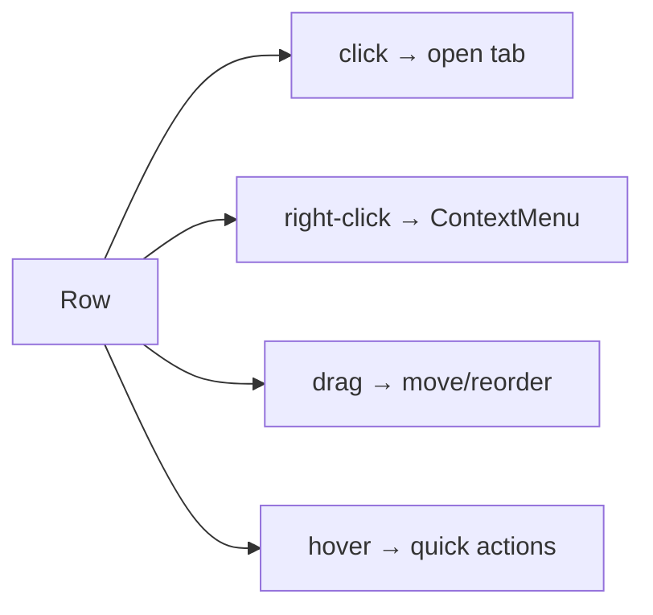

# Collections Sidebar

Status: VERIFIED unless marked.

Root: `packages/bruno-app/src/components/Sidebar/`

---

## 1. Structure

```text
Sidebar (width 220–600 px, resizable, persisted SIDEBAR_WIDTH_KEY)
├── Workspace selector (when workspaces enabled)
├── Search field (toggleable; ⌘/Ctrl+F)
├── Sections (accordion, persisted expanded state)
│   ├── Collections   (CollectionsSection)
│   ├── API Specs     (ApiSpecsSection)
│   └── Mock Servers  (MockServersSection — beta feature flag)
└── Footer actions: New Request / New Folder / Import / New Collection
```

Source: `Sidebar/index.js` (`MIN_LEFT_SIDEBAR_WIDTH = 220`, `MAX_LEFT_SIDEBAR_WIDTH = 600`, `sidebarSections` memo), `SidebarContent.js`, `SidebarAccordionContext.js`.

---

## 2. Tree node types

| Node | Rendering |
|---|---|
| Collection | Name + active-environment badge + git status dot |
| Folder | Chevron, name, count; recursive |
| Request | Method badge + name; dirty dot; protocol icon for GraphQL/gRPC/WS |
| Environment | Name + color + secret badge |
| Example | Under a request (expandable) |

The environment badge colors come from `environment.color` with 12 % alpha backgrounds (`getEnvBadgeStyle` in `EnvironmentSelector`, shared style logic).

---

## 3. Row anatomy and interactions



| Interaction | Behavior |
|---|---|
| Single click | Open item (or toggle folder) |
| Double click | Rename (inline) |
| Right-click | Context menu (below) |
| Drag | Reorder within folder; move into folder; cross-collection blocked |
| Keyboard | `Escape` clears selection; `useSidebarSelectionClick` handles selection semantics |
| Search | Filters tree; matched text highlighted |

### Context menu actions

- Rename, Clone, Delete, Copy path, Duplicate
- New request/folder inside
- Run (folder/collection), Run with tags
- Generate code
- Set as variable / Copy URL
- Reveal in file manager
- Share / export

Source: `Sidebar/Collections/Collection/CollectionItem/*` (context menu, `GenerateCodeItem`), `ui/ContextMenu`.

---

## 4. Drag and drop

- Custom implementation: `useMouseRowDrag`, `dragBlockedCursor.js`, `DndTargetErrorGuard`.
- Dropping in a valid target inserts at position; ordering persists via `renderer:resequence-items` which rewrites `seq` values.
- Cross-collection drag shows a blocked cursor instead of silently failing.

---

## 5. Large collections

| Technique | Where |
|---|---|
| Virtualized rows | `useChunkedReveal`, `useDeferredLoading` |
| Lazy expansion | Children rendered on expand (`useExpandedRows`) |
| Auto-reveal of active item | `useSidebarAutoReveal` |
| Debounced filtering | `useDebounce` + `fast-fuzzy` |

---

## 6. Empty and error states

| State | Component |
|---|---|
| No collections | `EmptyAppState`, `OpenCollection`, `WelcomeModal` |
| Collection parse error | Row shows warning; tooltip has message |
| Skipped paths (ignored/unreadable) | `SkippedPathsWarning` |
| Deprecated collection format | `DeprecationWarning`, `MigrateCollectionToYmlModal` |

---

## 7. Environments section

Rendered inside the collection header rather than as tree nodes on the left rail (the selector lives in `CollectionHeader`). Editing opens a **tab**, not a modal, for large env sets.

---

## 8. Go port guidance (PROPOSED)

- A virtualized tree is mandatory for 1000+ request collections; test with Bruno's own fixture collections.
- Preserve drag semantics including the "blocked" affordance.
- Persist expansion state keyed by stable UIDs, not paths.
