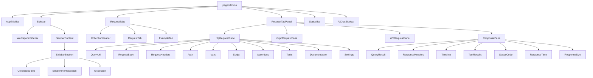

# Components

Status: VERIFIED unless marked. This is the component inventory with purpose, state, and dependencies. Individual deep dives are in sibling documents.

---

## 1. Hierarchy



---

## 2. Inventory by area

### 2.1 Shell

| Component | Purpose | State | Notes |
|---|---|---|---|
| `pages/Bruno` | App shell | Redux + local (Rosetta banner) | Renders transient-request modals |
| `AppTitleBar` | Window chrome, menus | `app` slice | Platform-aware |
| `StatusBar` | Bottom bar: connection/status, zoom | `app` | |
| `Devtools` | Console + terminal dock | `logs` slice | `@xterm/xterm`, `node-pty` |
| `Notifications` | In-app notification list | `notifications` | |
| `Toast` / react-hot-toast | Transient messages | — | |

### 2.2 Sidebar (`components/Sidebar`)

| Component | Purpose |
|---|---|
| `index.js`, `SidebarContent.js`, `SidebarSection` | Structure |
| `Collections/…` | Tree, `CollectionItem`, context menus, `GenerateCodeItem`, drag |
| `CreateCollection`, `NewFolder`, `NewRequest` | Creation modals (611 lines for `NewRequest` alone) |
| `ImportCollection`, `ImportCollectionLocation`, `BulkImportCollectionLocation` | Import wizard (980 lines for bulk) |
| `PostmanPackageReport` | Postman import summary |
| `CloneGitRespository`, `OpenCollection` | Git clone / open from disk |
| `Environments/…` | Environment list, editor, secrets, inheritance |
| `ApiSpecs`, `MockServer` sections | API spec and mock management |
| `GlobalSearchModal` | ⌘K search |
| `WorkspaceHome`, `ManageWorkspace`, `WorkspaceSidebar` | Multi-collection workspaces |

### 2.3 Request editor (`components/RequestPane`)

| Component | Purpose | Deep dive |
|---|---|---|
| `HttpRequestPane` | Sub-tab host + indicators | `request-editor.md` |
| `QueryUrl` + `HttpMethodSelector` + `SendButton` | Method, URL, Save, curl paste, codegen | `request-editor.md` |
| `QueryParams` | Query + path params table | |
| `RequestBody` (+ `RequestBodyMode`, `CodeEditor`, `MultipartFileChipsCell`, `ValidationConflictModal`) | Body modes | |
| `RequestHeaders` | Bulk editor + table | |
| `Auth` | Provider-specific forms | `logic/authentication.md` |
| `Vars` | Pre/post variable tables | |
| `Script` | Pre/post script editors | |
| `Assertions` | Assert table with expression autocomplete | |
| `Tests` | Plain JS test editor | |
| `Documentation` | Rich text (tiptap) | |
| `Settings` | Per-request settings (encode, redirects, timeout, tags) | |
| `AppCodeEditor` | Custom JS "apps" | |
| `PromptVariables` | Modal for `{{?Prompt}}` | |
| `GraphQLRequestPane`, `GrpcRequestPane`, `WSRequestPane` | Protocol variants | |

### 2.4 Response (`components/ResponsePane`)

| Component | Purpose |
|---|---|
| `index.js` | Tab host, status line, auto-format logic |
| `QueryResult` (+ `QueryResultTypeSelector`) | Body viewer with format switching |
| `ResponseHeaders` | Header table with copy |
| `Timeline` / `RunnerTimeline` | Network trace |
| `TestResults` / `TestResultsLabel` | Tests & assertions |
| `StatusCode`, `ResponseTime`, `ResponseSize`, `ResponseStopWatch` | Metrics |
| `ResponsePaneActions`, `ResponseCopy`, `ResponseDownload`, `ResponseClear`, `ResponseBookmark` | Actions |
| `ResponseErrorsCard`, `ResponseErrorsIcon`, `ResponseAlertsSection`, `UnresolvedVariablesInfo` | Diagnostics |
| `LargeResponseWarning` | Oversize bodies |
| `NetworkError`, `Placeholder`, `SkippedRequest`, `Overlay` | States |
| `GrpcResponsePane`, `WsResponsePane` | Protocol variants |

### 2.5 Cross-cutting

| Component | Purpose |
|---|---|
| `MultiLineEditor`, `SingleLineEditor`, `CodeEditor`, `CodeMirrorSearch` | Editors |
| `Modal`, `Portal`, `Dropdown`, `MenuDropdown`, `ContextMenu`, `Tabs`, `RadioButton`, `ToggleSwitch`, `Checkbox`, `Table`, `ReorderTable`, `EditableTable`, `SelectionList`, `SelectionFooter` | Forms & data |
| `VariableScopeIcon`, `VariableScopeList`, `VarValueCell`, `EnvironmentVariablesTable` | Variable UX |
| `SetAsVariableMenu`, `SetAsVariablePopover` | Capture values from response |
| `StatusDot`, `MethodBadge`, `TagList`, `TagPicker`, `ColorBadge`, `TruncatedText` | Presentation |
| `Settings*`, `Preferences/*`, `InheritableSettingsInput` | Settings |
| `RunnerResults`, `IncludeExcludeTags` | Collection runner |
| `Bruno` (component), `BrunoSupport`, `Help`, `WelcomeModal`, `ChangelogTab` | Help/onboarding |

---

## 3. Component state conventions

1. **Props are read-only projections of Redux.** Example: `QueryUrl` reads `item.draft ? draft.request.method : request.method`.
2. **Local state only for ephemeral UI** (open dropdowns, modals, text in progress).
3. **All edits dispatch reducers** named `*Changed`/`update*` that write to `item.draft`.
4. **No component performs I/O.** Saving triggers thunks that call IPC.
5. **Every component tolerates `item.draft === null`** and `request` being partial — newly created items have placeholder structures.

```js
const method = item.draft ? get(item, 'draft.request.method') : get(item, 'request.method');
```

This idiom repeats in nearly every request component (VERIFIED).

---

## 4. Event handling patterns

| Pattern | Example |
|---|---|
| Debounced dispatch | URL typing; bulk header editing |
| Immediate + save-on-blur | Single-line editors |
| Optimistic update | Tab rename, param add |
| Confirm-required | Delete item, close with unsaved changes, env secret change |
| Keyboard capture | Enter to send (modifier), Escape to close, Tab to move between cells |

---

## 5. Go port guidance (PROPOSED)

- Mirror the *component boundaries* (they map cleanly onto widget groups), not the JSX.
- Keep a single `AppState` with selectors; Go equivalents can be plain functions returning values.
- Reproduce the `draft` vs `saved` duality explicitly in the model — it is pervasive.
