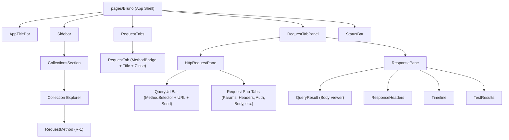

# Components

Status: VERIFIED against `bruno/packages/bruno-app/src/components/` and `src/ui/` at commit `60d7517`, cross-referenced with `ui-map/components/` and `ui-map/widgets.md`.

---

## 1. Component Hierarchy

---

## 2. Reusable UI Primitives (`src/ui`)

Concrete specifications for core reusable controls derived from `ui-map/components/*`:

### 2.1 Buttons (`ui-map/components/button.md`)

| Size | Height | Padding    | Font Size | Border Radius |
| ---- | ------ | ---------- | --------- | ------------- |
| `xs` | `20px` | `2px 6px`  | `11px`    | `4px`         |
| `sm` | `24px` | `4px 8px`  | `12px`    | `4px`         |
| `md` | `30px` | `6px 12px` | `13px`    | `6px`         |
| `lg` | `38px` | `8px 16px` | `14px`    | `6px`         |

**Variants:**

- `primary`: Background `primary.solid` (`#d37f17` L / `#e4ae49` D or `#4D8DFF` in Graphite), text white, hover `primary.strong`.
- `secondary`: Background `background.surface0`, border `border.border1`, text `text`.
- `danger`: Background `status.danger.background`, text `colors.text.danger`, border `status.danger.border`.
- `ghost`: Transparent background, hover `background.surface1`.

### 2.2 Text Inputs & Secret Masking (`ui-map/components/text-input.md`)

- **Standard height:** `32px` (`2rem`).
- **Typography:** `13px` Inter (UI fields) or monospace (variable / code values).
- **Surface:** `input.bg` (`#ffffff` L / `transparent` D), border `1px solid input.border` (`#cccccc` L / `#444444` D).
- **Focus ring:** Border `input.focusBorder` (`#8b8b8b` L / `rgba(228,174,73,.8)` D), no default browser outline.
- **Decision R-5 (Secret Masking):** Secret inputs render one asterisk `*` per character everywhere in the application.

### 2.3 Select and Dropdowns (`ui-map/components/select.md`)

- Built with custom trigger, chevron icon (`14px`), and floating popover menu.
- **Sizing:** Follows `INPUT_SIZES` (sm: 24 px, md: 30 px, lg: 38 px).
- **Options menu:** Background `dropdown.bg` (`#ffffff` L / `#222224` D), item hover `dropdown.hoverBg`, selected item text `dropdown.selectedColor` with right check icon.

### 2.4 Tabs (`ui-map/components/tabs.md`)

- **RequestTabs (Top Strip):**
  - Height: `34px`.
  - Background: `requestTabs.bg` (`#f6f6f6` L / `#26292b` D).
  - Active tab: Background matching main canvas (`background.base`), 1 px active top/side border.
  - Decision R-2: Request tabs have **no background hover tint**; only the close icon has a circular hover disc (`requestTabs.icon.hoverBg`).
  - Decision R-3: Preview / transient tabs are styled with **italic text only**; no special color token.
- **Sub-Tabs (Panes):**
  - Horizontal line tabs with active bottom border `2px solid primary.solid`.

### 2.5 Method Badges vs Sidebar Verbs (`ui-map/components/method-badge.md`)

| Component       | Where Used                    | Visual Characteristics                                                                                                                        | Spec Reference               |
| --------------- | ----------------------------- | --------------------------------------------------------------------------------------------------------------------------------------------- | ---------------------------- |
| `MethodBadge`   | RequestTabs, URL bar, Dialogs | Rounded badge (`radius 4px`), 12 px uppercase text, border + translucent background matching method token.                                    | `components/method-badge.md` |
| `RequestMethod` | Collections Sidebar rows      | Flat 11 px text, bold, right-aligned in fixed 34 px slot; verbs > 5 chars truncated to 3 letters (DEL, OPT); protocol labels (grpc, ws, gql). | Decision R-1                 |

### 2.6 Status Indicators & Activity (`ui-map/components/status-*.md`)

- **`StatusBadge`:** Rounded badge (`radius 4px`, padding `2px 6px`), 11 px font, 15 % alpha background with matching full-strength border and text.
- **`StatusDot`:** 6 px circular dot. Green (passed / unsaved clean), orange (modified / draft), red (failed / error).
- **`Spinner`:** 16 px SVG circle with 2 px stroke, indeterminate CSS/GPU rotation.

---

## 3. Composite Widgets (`ui-map/widgets.md`)

Ranked into MUST-HAVE vs NICE-TO-HAVE tiers for the Go port:

### 3.1 CodeEditor

- **MUST-HAVE:** Monospace font with tabular figures, syntax highlighting (JSON, XML, JS, YAML), line numbers in gutter, error line decoration, active line highlight, copy-to-clipboard button.
- **NICE-TO-HAVE:** Code folding, multi-cursor support, minification toggle, structural search/replace.

### 3.2 EditableTable (Key-Value Grid)

- **MUST-HAVE:** Checkbox for row enabled/disabled, key column, value column with secret toggle, description column, add row trigger, row delete action, drag-reorder handle.
- **NICE-TO-HAVE:** Bulk mode toggle (raw text paste), column resizing persistence.

### 3.3 Tree View (Collection Explorer)

- **MUST-HAVE:** Recursive folder nesting, expand/collapse state preservation, item selection, inline renaming, drag-and-drop within collection, dirty indicator dots, context menu routing.
- **NICE-TO-HAVE:** Virtualized row rendering for >5,000 requests, search filter with fuzzy highlighting.

---

## 4. Go Implementation Requirements (D-019 Control Wrappers)

> [!WARNING]
> Upstream Lobe MyGo controls (`field.Input`, `field.Select`, `action.Button`) render on a detached container element that leaves the painted surface with MyGo's default near-white tone in dark mode.

**Architectural Requirement (D-019):**  
All screens must route through the wrappers defined in `internal/ui/widgets/controls.go`:

- `widgets.FieldInput`: Token-painted outer element enclosing a borderless Lobe input.
- `widgets.FieldSelect`: Token-painted outer container enclosing a Lobe select trigger.
- `widgets.Button`: App-owned surface applying the active theme palette and elevation.
