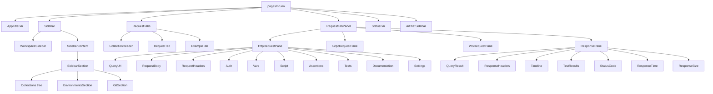

# Components

Status: VERIFIED unless marked. This is the component inventory with purpose, state, and dependencies. Individual deep dives are in sibling documents.

---

## 1. Hierarchy



---

## 2. Inventory by area

### 2.1 Shell

| Component                 | Purpose                             | State                          | Notes                            |
| ------------------------- | ----------------------------------- | ------------------------------ | -------------------------------- |
| `pages/Bruno`             | App shell                           | Redux + local (Rosetta banner) | Renders transient-request modals |
| `AppTitleBar`             | Window chrome, menus                | `app` slice                    | Platform-aware                   |
| `StatusBar`               | Bottom bar: connection/status, zoom | `app`                          |                                  |
| `Devtools`                | Console + terminal dock             | `logs` slice                   | `@xterm/xterm`, `node-pty`       |
| `Notifications`           | In-app notification list            | `notifications`                |                                  |
| `Toast` / react-hot-toast | Transient messages                  | —                              |                                  |

### 2.2 Sidebar (`components/Sidebar`)

| Component                                                                      | Purpose                                                         |
| ------------------------------------------------------------------------------ | --------------------------------------------------------------- |
| `index.js`, `SidebarContent.js`, `SidebarSection`                              | Structure                                                       |
| `Collections/…`                                                                | Tree, `CollectionItem`, context menus, `GenerateCodeItem`, drag |
| `CreateCollection`, `NewFolder`, `NewRequest`                                  | Creation modals (611 lines for `NewRequest` alone)              |
| `ImportCollection`, `ImportCollectionLocation`, `BulkImportCollectionLocation` | Import wizard (980 lines for bulk)                              |
| `PostmanPackageReport`                                                         | Postman import summary                                          |
| `CloneGitRespository`, `OpenCollection`                                        | Git clone / open from disk                                      |
| `Environments/…`                                                               | Environment list, editor, secrets, inheritance                  |
| `ApiSpecs`, `MockServer` sections                                              | API spec and mock management                                    |
| `GlobalSearchModal`                                                            | ⌘K search                                                       |
| `WorkspaceHome`, `ManageWorkspace`, `WorkspaceSidebar`                         | Multi-collection workspaces                                     |

### 2.3 Request editor (`components/RequestPane`)

| Component                                                                                              | Purpose                                                 | Deep dive                 |
| ------------------------------------------------------------------------------------------------------ | ------------------------------------------------------- | ------------------------- |
| `HttpRequestPane`                                                                                      | Sub-tab host + indicators                               | `request-editor.md`       |
| `QueryUrl` + `HttpMethodSelector` + `SendButton`                                                       | Method, URL, Save, curl paste, codegen                  | `request-editor.md`       |
| `QueryParams`                                                                                          | Query + path params table                               |                           |
| `RequestBody` (+ `RequestBodyMode`, `CodeEditor`, `MultipartFileChipsCell`, `ValidationConflictModal`) | Body modes                                              |                           |
| `RequestHeaders`                                                                                       | Bulk editor + table                                     |                           |
| `Auth`                                                                                                 | Provider-specific forms                                 | `logic/authentication.md` |
| `Vars`                                                                                                 | Pre/post variable tables                                |                           |
| `Script`                                                                                               | Pre/post script editors                                 |                           |
| `Assertions`                                                                                           | Assert table with expression autocomplete               |                           |
| `Tests`                                                                                                | Plain JS test editor                                    |                           |
| `Documentation`                                                                                        | Rich text (tiptap)                                      |                           |
| `Settings`                                                                                             | Per-request settings (encode, redirects, timeout, tags) |                           |
| `AppCodeEditor`                                                                                        | Custom JS "apps"                                        |                           |
| `PromptVariables`                                                                                      | Modal for `{{?Prompt}}`                                 |                           |
| `GraphQLRequestPane`, `GrpcRequestPane`, `WSRequestPane`                                               | Protocol variants                                       |                           |

### 2.4 Response (`components/ResponsePane`)

| Component                                                                                      | Purpose                                  |
| ---------------------------------------------------------------------------------------------- | ---------------------------------------- |
| `index.js`                                                                                     | Tab host, status line, auto-format logic |
| `QueryResult` (+ `QueryResultTypeSelector`)                                                    | Body viewer with format switching        |
| `ResponseHeaders`                                                                              | Header table with copy                   |
| `Timeline` / `RunnerTimeline`                                                                  | Network trace                            |
| `TestResults` / `TestResultsLabel`                                                             | Tests & assertions                       |
| `StatusCode`, `ResponseTime`, `ResponseSize`, `ResponseStopWatch`                              | Metrics                                  |
| `ResponsePaneActions`, `ResponseCopy`, `ResponseDownload`, `ResponseClear`, `ResponseBookmark` | Actions                                  |
| `ResponseErrorsCard`, `ResponseErrorsIcon`, `ResponseAlertsSection`, `UnresolvedVariablesInfo` | Diagnostics                              |
| `LargeResponseWarning`                                                                         | Oversize bodies                          |
| `NetworkError`, `Placeholder`, `SkippedRequest`, `Overlay`                                     | States                                   |
| `GrpcResponsePane`, `WsResponsePane`                                                           | Protocol variants                        |

### 2.5 Cross-cutting

| Component                                                                                                                                                                                     | Purpose                      |
| --------------------------------------------------------------------------------------------------------------------------------------------------------------------------------------------- | ---------------------------- |
| `MultiLineEditor`, `SingleLineEditor`, `CodeEditor`, `CodeMirrorSearch`                                                                                                                       | Editors                      |
| `Modal`, `Portal`, `Dropdown`, `MenuDropdown`, `ContextMenu`, `Tabs`, `RadioButton`, `ToggleSwitch`, `Checkbox`, `Table`, `ReorderTable`, `EditableTable`, `SelectionList`, `SelectionFooter` | Forms & data                 |
| `VariableScopeIcon`, `VariableScopeList`, `VarValueCell`, `EnvironmentVariablesTable`                                                                                                         | Variable UX                  |
| `SetAsVariableMenu`, `SetAsVariablePopover`                                                                                                                                                   | Capture values from response |
| `StatusDot`, `MethodBadge`, `TagList`, `TagPicker`, `ColorBadge`, `TruncatedText`                                                                                                             | Presentation                 |
| `Settings*`, `Preferences/*`, `InheritableSettingsInput`                                                                                                                                      | Settings                     |
| `RunnerResults`, `IncludeExcludeTags`                                                                                                                                                         | Collection runner            |
| `Bruno` (component), `BrunoSupport`, `Help`, `WelcomeModal`, `ChangelogTab`                                                                                                                   | Help/onboarding              |

---

## 3. Component state conventions

1. **Props are read-only projections of Redux.** Example: `QueryUrl` reads `item.draft ? draft.request.method : request.method`.
2. **Local state only for ephemeral UI** (open dropdowns, modals, text in progress).
3. **All edits dispatch reducers** named `*Changed`/`update*` that write to `item.draft`.
4. **No component performs I/O.** Saving triggers thunks that call IPC.
5. **Every component tolerates `item.draft === null`** and `request` being partial — newly created items have placeholder structures.

```js
const method = item.draft
  ? get(item, "draft.request.method")
  : get(item, "request.method");
```

This idiom repeats in nearly every request component (VERIFIED).

---

## 4. Event handling patterns

| Pattern                  | Example                                                              |
| ------------------------ | -------------------------------------------------------------------- |
| Debounced dispatch       | URL typing; bulk header editing                                      |
| Immediate + save-on-blur | Single-line editors                                                  |
| Optimistic update        | Tab rename, param add                                                |
| Confirm-required         | Delete item, close with unsaved changes, env secret change           |
| Keyboard capture         | Enter to send (modifier), Escape to close, Tab to move between cells |

---

## 5. Go port guidance (PROPOSED)

- Mirror the _component boundaries_ (they map cleanly onto widget groups), not the JSX.
- Keep a single `AppState` with selectors; Go equivalents can be plain functions returning values.
- Reproduce the `draft` vs `saved` duality explicitly in the model — it is pervasive.

---

## 6. Lobe MyGo component inventory (VERIFIED against the library)

`design-system.md` §7.2.1 establishes the layering: **Lobe MyGo is the component library**, MyGo `ui` is the toolkit underneath. This section is the concrete inventory of what Lobe actually provides, so no component is invented and no existing one is rebuilt.

Source: `github.com/lobehub/lobe-mygo` (`v0.0.0-…-5e5fea5`), package documentation for `pkg/{action,field,choice,display,feedback,overlay,nav,layout,code}` and the module README's package table.

### 6.1 What the library provides

| Package        | Components                                                                                                                                                                             | Package doc                      |
| -------------- | -------------------------------------------------------------------------------------------------------------------------------------------------------------------------------------- | -------------------------------- |
| `pkg/action`   | `Button`, `ActionIcon`, `ActionIconGroup`, `CopyButton`, `Segmented`, `StyleButton`, `StyleActionIcon`                                                                                 | ✓                                |
| `pkg/field`    | `Input`, `TextArea`, `InputNumber`, `InputPassword`, `InputOTP`, `Select`, `AutoComplete`, `SearchBar`, `HotkeyInput`, `EditableText`, `DatePicker`, `Calendar`, `Upload`, `PickFiles` | ✓                                |
| `pkg/choice`   | `Checkbox`, `RadioGroup`, `Switch`, `Slider`, `Rate`, `ToggleGroup`, `ColorSwatches`, `ColorPicker`, `ImageSelect`                                                                     | ✓                                |
| `pkg/display`  | `Text`, `Tag`, `Avatar`, `GroupAvatar`, `AgentAvatar`, `Icon`, `Hotkey`, `Image`, `ImageGroup`, `List`, `Accordion`, `Empty`, `Skeleton*`                                              | ✓                                |
| `pkg/feedback` | `Alert`, `Badge`, `Progress`, `Spin`, `Result`, `Modal`, `Drawer`, `ToastHost`/`ShowToast`, `FloatingPanel`, `FloatingSheet`                                                           | ✓                                |
| `pkg/overlay`  | `Tooltip`, `Popover`, `DropdownMenu`, `ContextMenu`                                                                                                                                    | ✓                                |
| `pkg/nav`      | `Tabs`, `Pagination`, `Breadcrumb`, `Steps`, `Burger`                                                                                                                                  | ✓                                |
| `pkg/layout`   | `Block`, `Grid`, `Divider`, `ScrollArea`, `DraggablePanel`, `Header`, `SideNav`, `DraggableSideNav`, `Layout`, `GuideCard`, `SortableList`                                             | ✓                                |
| `pkg/code`     | `Highlighter`, `Snippet`, `QRCode`, `Spans`, `Theme`, `LanguageName`                                                                                                                   | ✓                                |
| `pkg/markdown` | `Markdown` with streaming                                                                                                                                                              | ✓                                |
| `pkg/theme`    | `Apply`, `TokensOf`, `Config`, `Tokens`, `Size`, `Elevation`, `Mix`                                                                                                                    | ✓                                |
| `pkg/motion`   | Springs, easings, transitions                                                                                                                                                          | ✓                                |
| `pkg/lucide`   | Lucide icons as Go functions                                                                                                                                                           | symbol list not published (§6.4) |

### 6.2 Shared conventions across the library

These hold for nearly every component and are what keeps the app coherent:

| Convention       | Detail                                                                                                                                                                          |
| ---------------- | ------------------------------------------------------------------------------------------------------------------------------------------------------------------------------- |
| Signature        | `func Name(c *ui.Context, …) ui.Element`; value-bearing controls take a **pointer to the value** they edit (`value *string`, `value *int`, `selected *int`, `open *bool`)       |
| Read and write   | The pointer is both input and output: the component writes through it as the user acts, so the caller's state is the single source of truth                                     |
| Setters          | Some take an explicit setter instead: `layout.SortableList(c, items *[]T, key func(T) string, …)` writes a reordered slice, `config`-style props                                |
| Selection result | Components that open menus return the chosen key from the frame it was chosen, or `""`: `display.List`, `overlay.DropdownMenu`, `overlay.ContextMenu`, `action.ActionIconGroup` |
| Confirmation     | `feedback.Modal` returns `true` in the frame OK is pressed and **leaves `*open` to the caller** to close once the action succeeds                                               |
| Sizing           | `theme.Size` (`Small`/`Middle`/`Large` → 24/32/40 px controls) rather than raw pixels                                                                                           |
| Styling          | `Variant` enums per component (`InputOutlined`/`InputFilled`/`InputBorderless`, `ButtonVariant`, `TagVariant`, …)                                                               |
| Keyboard         | Every component documents its own key handling (arrows to move, Enter/Space to choose, Escape to close)                                                                         |
| Accessibility    | `Label`/`Title`/`Alt` props feed assistive technology; `Tooltip` describes its anchor                                                                                           |
| i18n             | Components speak English and Simplified Chinese via MyGo catalogs, keys under the `lobe.` namespace (`pkg/internal/l10n/messages/en.json`)                                      |

### 6.3 Composition and customisation

Lobe's composition style is **props plus builder closures**, not inheritance:

- Children are built by `func()` closures: `feedback.Modal(c, open, props, content func())`, `layout.ScrollArea(c, props, content func())`, `layout.Layout(c, props, content func())`, `display.Badge(c, props, content func())`.
- Slotted regions are named closures: `layout.HeaderProps{Logo, Nav, Actions func()}`, `layout.SideNavProps{Avatar, TopActions, BottomActions func()}`, `layout.DraggableSideNavProps{Header, Footer func(nav SideNavState)}`, `feedback.FloatingPanelProps{Title string, Actions, Footer func()}`.
- Per-row renderers: `nav.Tabs(c, selected *int, p, panel func(i int))`, `display.Accordion(c, open map[string]bool, p, panel func(key string))`, `layout.SortableList(c, items, key, p, row func(item T, handle func()))`.
- Restyling a trigger: `action.StyleButton` / `action.StyleActionIcon` give an arbitrary button the look of a Lobe Button/ActionIcon — this is how a menu trigger keeps menu keyboard semantics while looking like a button.

Extension patterns we adopt:

1. **Wrap, don't fork.** A wrapper function taking the same `*ui.Context` plus our own props, delegating to the Lobe component and adding app behaviour. Example in §6.6.
2. **`ActionIconGroupProps.Menu`** adds a `…` more-menu to a row of icons — the idiomatic way to add secondary actions without a custom toolbar.
3. **`display.ListItem.Actions`** builds per-row buttons shown on hover or focus; **`ListItem.Divider`** creates group separators.
4. **`SortableList`** provides drag-reorder with a caller-supplied handle and keyboard reordering for free.
5. **`theme.NewConfig`** rebrands the whole library once; do not restyle components individually.

### 6.4 Known gaps (VERIFIED absent from the published API)

| Gap                                                 | Evidence                                                                                                                  | Consequence                                                                             |
| --------------------------------------------------- | ------------------------------------------------------------------------------------------------------------------------- | --------------------------------------------------------------------------------------- |
| **No code editor**                                  | `pkg/code` exports `Highlighter`, `Snippet`, `QRCode`, `Spans`, `Theme`, `LanguageName` only — all read-only              | Editable body/script/tests use MyGo `ui/editor`, themed with `code.Theme(tk)`           |
| **No multi-select**                                 | `field.Select` takes `selected *string` and `SelectOption`-shaped options; no multiple flag                               | Header/method pickers are single-select (fine); anything needing multi-select is custom |
| **No free-text select / combobox**                  | `field.AutoComplete` has no “add new value” path                                                                          | Header-name autocomplete with custom values is a custom widget                          |
| **No tree component**                               | `display.List` is flat; `layout.SortableList` is a flat reorderable list; `display.Accordion` collapses sections          | Collection explorer tree is custom (see §6.5)                                           |
| **No tabs with close buttons or reordering**        | `nav.TabItem{Label, Icon, Disabled}`; `nav.TabsProps{Items, Variant, Size, Vertical}`                                     | Request tab strip needs a custom tab bar                                                |
| **No table with editable cells**                    | No table in the published packages; `display.List` is row navigation                                                      | Query/header/param grids are custom                                                     |
| **No split pane primitive**                         | `layout.DraggablePanel` resizes a panel at an **edge** of its container; there is no 50/50 request-over-response splitter | Use MyGo `ui.SplitVertical`/`ui.Split`/`ui.SplitPercent` for the request/response split |
| **No virtualised large list beyond `display.List`** | `List` renders `[]ListItem` wholesale                                                                                     | Very large collections need a custom virtualised tree                                   |
| **Lucide symbol list unpublished**                  | pkg.go.dev withholds docs for `pkg/lucide` (licence metadata)                                                             | Icon identifiers must be read from the library source/catalog, not guessed              |

Each of these gaps is a **deliberate choice by the library** (it is a design-language kit, not an IDE toolkit), so we plan for custom widgets rather than waiting for upstream.

### 6.5 Component mapping for this application

`★` = Lobe component used directly. `◆` = Lobe component composed/extended. `■` = must be implemented in this application.

| Application area                         | Implementation                                                                                                                                                        |
| ---------------------------------------- | --------------------------------------------------------------------------------------------------------------------------------------------------------------------- |
| App shell / side navigation              | ◆ `layout.DraggableSideNav` (width drag, collapse to rail, `SideNavState` for the collapse animation) + ◆ `display.List` inside it with `Collapse`/`RailWidth`        |
| Top bar / title bar                      | ◆ `layout.Header` (64 DIP, `Logo`/`Nav`/`Actions` slots) or MyGo `Context.TitleBar` for the window drag region                                                        |
| Collection explorer / folder tree        | ■ custom tree (virtualised, drag-and-drop, inline rename) built from `display.ListItem` row visuals; search via ★ `field.SearchBar`                                   |
| Request tabs                             | ■ custom tab bar (close/middle-click close, drag reorder, overflow menu); use ★ `action.ActionIcon` for the close and `overlay.DropdownMenu` for overflow             |
| Request sub-tabs (Params/Body/Headers/…) | ★ `nav.Tabs` (`TabsSquare` variant, `Vertical` when the pane is narrow) + ★ `feedback.Badge` for per-tab counts                                                       |
| HTTP method selector                     | ■ custom badge + ★ `overlay.DropdownMenu` (method list with hotkey hints); colours from our `Methods` token map                                                       |
| URL input                                | ★ `field.Input` with `Prefix` icon for the method, ★ `field.AutoComplete` for `{{var}}` suggestions, ★ `action.ActionIcon` as the Send/Cancel button                  |
| Query parameter editor                   | ■ custom key/value grid (enable checkbox, drag reorder) built from ★ `field.Input` cells and ★ `choice.Checkbox`                                                      |
| Headers editor                           | ■ same grid + ★ `overlay.DropdownMenu` for the common-header suggestions                                                                                              |
| Path params editor                       | ■ same grid                                                                                                                                                           |
| Authentication editor                    | ★ `field.Select` for the mode + per-mode forms from ★ `field.Input`/`InputPassword`/`TextArea`, ★ `action.Button` for “Get Token”, ★ `feedback.Alert` for auth errors |
| Body editor                              | ■ MyGo `ui/editor` (JSON/text/XML); ★ `action.Segmented` for the body mode (`none/json/text/xml/form-urlencoded/multipart/binary`)                                    |
| Multipart body                           | ■ rows with ★ `field.Upload`(`PickFiles`) for the file cell                                                                                                           |
| Form-urlencoded body                     | ■ key/value grid as above                                                                                                                                             |
| Scripts editor                           | ■ MyGo `ui/editor` (JS) + ★ `field.Select` for sandbox mode                                                                                                           |
| Assertions / Tests editor                | ■ MyGo `ui/editor` + ★ `action.ActionIconGroup` row actions                                                                                                           |
| Response status strip                    | ★ `display.Tag` for status class + ★ `display.Text` for duration/size + ★ `feedback.Progress` for an in-flight progress bar                                           |
| Response viewer                          | ★ `nav.Tabs` for Response/Headers/Timeline/Tests; ★ `code.Highlighter` for JSON/XML/HTML bodies when read-only                                                        |
| JSON pretty/raw toggle                   | ★ `action.Segmented`                                                                                                                                                  |
| Response headers table                   | ■ custom grid (read-only); `display.List` is not tabular                                                                                                              |
| Timeline view                            | ■ table (phase, duration, offset) from `display.Text` rows, or `code.Highlighter` of the JSON                                                                         |
| Test results                             | ★ `display.Tag` (pass/fail) + ★ `display.Accordion` to expand diffs + ★ `code.Highlighter` for the diff                                                               |
| Environment selector                     | ★ `field.Select` with `Icon` per option + ★ `overlay.Popover` for the quick editor                                                                                    |
| Environment editor                       | ■ variables grid with secret flag (★ `choice.Switch`) and ★ `field.InputPassword` for secret values                                                                   |
| Collections sidebar footer / actions     | ★ `action.ActionIconGroup` with `Menu` for the overflow actions                                                                                                       |
| Context menus everywhere                 | ★ `overlay.ContextMenu` (returns the chosen key)                                                                                                                      |
| Toolbars / per-row actions               | ★ `action.ActionIconGroup`                                                                                                                                            |
| Copy buttons                             | ★ `action.CopyButton` (copies and shows “Copied”)                                                                                                                     |
| Settings panes                           | ★ `display.List` for the section nav + ★ `field.*` and ★ `choice.*` for controls + ★ `field.HotkeyInput` for keybindings                                              |
| Dialogs / confirmations                  | ★ `feedback.Modal` (returns OK; caller closes)                                                                                                                        |
| Notifications                            | ★ `feedback.ToastHost` once per view + `feedback.ShowToast`                                                                                                           |
| Errors                                   | ★ `feedback.Alert` with `Selectable: true` for detailed errors                                                                                                        |
| Empty states                             | ★ `display.Empty` (`Page: true` for whole-pane states)                                                                                                                |
| Loading                                  | ★ `display.Skeleton`, ★ `feedback.Spin`                                                                                                                               |
| Docs tab                                 | ★ `pkg/markdown` viewer + ■ Markdown edit mode                                                                                                                        |
| Runner results                           | ★ `display.List`/custom table + ★ `display.Tag` + ★ `feedback.Progress`                                                                                               |
| Keybinding display                       | ★ `display.Hotkey`                                                                                                                                                    |
| Keyboard capture UI                      | ★ `field.HotkeyInput` with `Conflicts` wired to the live keymap                                                                                                       |

### 6.6 Custom-widget list (what we must build)

| #   | Widget                                               | Why Lobe cannot serve it                 | Built from                                                                                       |
| --- | ---------------------------------------------------- | ---------------------------------------- | ------------------------------------------------------------------------------------------------ |
| 1   | **Code editor with variable completion**             | No editable code component (§6.4)        | MyGo `ui/editor` + `code.Theme(tk)` + completion popup on `{{`                                   |
| 2   | **Request tab bar**                                  | `nav.Tabs` has no close/reorder/overflow | `action.ActionIcon`, `overlay.DropdownMenu`, MyGo `ui.Scroll`                                    |
| 3   | **Collection tree**                                  | No tree component                        | Virtualised rows from `display.ListItem`, `SortableList`-style drag, inline `field.EditableText` |
| 4   | **Key/value parameter grid**                         | No editable table                        | `field.Input` + `choice.Checkbox` + row drag handle                                              |
| 5   | **Method badge with per-verb colour**                | No HTTP vocabulary                       | `display.Tag`/painted chip + our `Methods` token map                                             |
| 6   | **Request/response splitter**                        | `DraggablePanel` is edge-anchored only   | MyGo `ui.SplitVertical`/`Split`/`SplitPercent`                                                   |
| 7   | **Virtualised long lists**                           | `display.List` renders all rows          | MyGo `ui/OutlineTable`/`ui.GridView` or a windowed list                                          |
| 8   | **Free-text combobox** (header names, env var names) | `AutoComplete` cannot add values         | `field.AutoComplete` + an “add” row in the popup                                                 |

Everything else in §6.5 is composition of existing Lobe components.

### 6.7 Worked example: a toolbar row

```go
import (
    "github.com/egoist/mygo/ui"
    "github.com/lobehub/lobe-mygo/pkg/action"
    "github.com/lobehub/lobe-mygo/pkg/overlay"
    "github.com/lobehub/lobe-mygo/pkg/theme"
)

func responseToolbar(c *ui.Context, onAction func(key string)) ui.Element {
    tk := theme.TokensOf(c)
    _ = tk // tokens available here for colours if the group needs them
    return action.ActionIconGroup(c, action.ActionIconGroupProps{
        Variant: action.GroupBorderless,
        Size:    theme.Small,
        Items: []action.ActionGroupItem{
            // lucide exposes every Lucide glyph as a Go function returning *ui.SVG.
            // The exact function names are taken from lobe-mygo/pkg/lucide (see §6.4:
            // pkg.go.dev does not publish that package's symbol list).
            {Key: "copy", Label: "Copy response", Icon: lucideIcon("copy")},
            {Key: "save", Label: "Save as example", Icon: lucideIcon("save")},
        },
        Menu: []overlay.MenuItem{
            {Key: "raw", Label: "Toggle raw view", Hotkey: "mod+alt+r"},
            {Divider: true},
            {Key: "clear", Label: "Clear response", Danger: true},
        },
    })
}

// lucideIcon is our thin lookup over pkg/lucide, so icon names stay data rather
// than appearing scattered through widget code.
func lucideIcon(name string) *ui.SVG { /* lookup in a map built from pkg/lucide */ }
```

Two things to note: the group **returns the clicked key** rather than taking callbacks per item, and `overlay.MenuItem.Hotkey` only _displays_ the shortcut — the docs state it "does not bind the keys", so binding stays in our keymap (`ui/interaction-patterns.md` §12).
