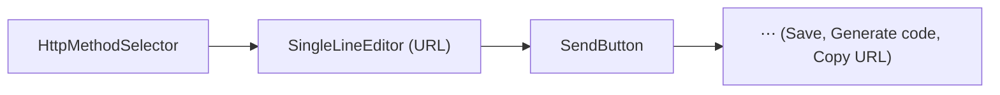

# Request Editor

Status: VERIFIED unless marked.

Root: `packages/bruno-app/src/components/RequestPane/`

---

## 1. Sub-tab structure

`HttpRequestPane` defines the tab set (VERIFIED, `index.js` lines 25–36):

```js
const TAB_CONFIG = [
  { key: 'params',  label: 'Params'  },
  { key: 'body',    label: 'Body'    },
  { key: 'headers', label: 'Headers' },
  { key: 'auth',    label: 'Auth'    },
  { key: 'vars',    label: 'Vars'    },
  { key: 'script',  label: 'Script'  },
  { key: 'assert',  label: 'Assert'  },
  { key: 'tests',   label: 'Tests'   },
  { key: 'docs',    label: 'Docs'    },
  { key: 'app',     label: 'App'     },
  { key: 'settings',label: 'Settings'}
];
```

### Tab indicators

| Tab | Indicator |
|---|---|
| Params | `sup` count of enabled params |
| Body | `StatusDot` when mode ≠ `none` |
| Headers | count of enabled headers |
| Auth | `StatusDot` when effective auth ≠ none/inherit-resolved-none |
| Vars | count of enabled pre + post vars |
| Script | dot; **error style** if `preRequestScriptErrorMessage`/`postResponseScriptErrorMessage` |
| Assert | count of enabled assertions |
| Tests | dot when non-empty; **error style** on `testScriptErrorMessage` |
| Docs | dot when docs exist |
| App | dot when `app.code` non-empty; tab hidden/forced to Params if apps disabled |
| Settings | dot when tags exist |

Source: `HttpRequestPane/index.js` `indicators` memo. This "silent configuration" affordance is why a request can look "empty" yet carry headers/scripts.

### Protocol variants

| Type | Component |
|---|---|
| `http-request` | `HttpRequestPane` |
| `graphql-request` | `GraphQLRequestPane` (query editor + variables + schema introspection) |
| `grpc-request` | `GrpcRequestPane` (message editor, metadata, 4 script hooks) |
| `ws-request` | `WSRequestPane` (message list, per-message/tab) |

---

## 2. Method + URL bar (`QueryUrl`)



| Element | Behavior |
|---|---|
| Method selector | Dropdown of `GET POST PUT DELETE PATCH OPTIONS HEAD TRACE CONNECT` + **custom method** entry (`httpcustom` block in `.bru`) |
| URL editor | Single-line CodeMirror with `{{var}}` autocomplete, syntax highlight; toggles `method-span` width for custom methods |
| Save | Explicit save (⌘/Ctrl + S), disabled when unchanged (`hasRequestChanges`) |
| Send | `Send` → `Cancel` while `requestState ∈ {queued, sending}` |
| Paste cURL | Pasting a `curl …` command into the URL or GraphQL editor converts it (`getRequestFromCurlCommand`, `utils/curl`) |
| Generate code | Opens code snippet modal (curl/js/python/go …) |

### URL ⇄ params synchronization (important algorithm)

When the URL changes, `requestUrlChanged` (reducer, `slices/collections/index.js` line 1165) rebuilds `params`:

1. Split on the **first** `?`; parse the query string into params.
2. Parse path params from the path portion (`parsePathParams`, e.g. `/users/:id`).
3. Re-attach existing UIDs where a name *or* value matches (best-effort for duplicate keys).
4. Keep previously disabled query params (so toggling one off doesn't lose it).
5. Keep path params whose `:name` still exists; drop those removed from the URL.
6. Final list order: `[urlQueryParams, newPathParams, disabledQueryParams, oldPathParams]`.

The comment in the source states the contract plainly: *"the query params are the source of truth, the url in the queryurl input gets constructed using these params"*, while the full URL (with query) is also stored in `url`.

> **Parity warning:** a Go port must reproduce this reducer, including UID preservation, or users will lose disabled rows on every keystroke. Two sources of truth (params array + URL string) must be reconciled deterministically.

---

## 3. Params tab (`QueryParams`)

Two stacks in one tab:

- **Query** — editable table (`EditableTable`) with columns: checkbox (enabled), name, value, description; drag to reorder; add-row; delete.
- **Path** — derived from `:name` segments in the URL; helper text: *"Path variables are automatically added whenever the …"*.

Column widths persist per tab (`updateTableColumnWidths` in `tabs` slice, keyed `request-params-…`). Scroll position persists per item (`usePersistedState key: request-params-scroll-<uid>`).

There is also a **visual Query Builder** (`RequestPane/QueryBuilder`, `FieldNode.js` 508 lines) for OData-style expressions, producing a query string via `components/RequestPane/QueryEditor`.

---

## 4. Body tab (`RequestBody`)

### Mode selector (`RequestBodyMode`)

| Group | Modes |
|---|---|
| Form | `multipartForm` ("Multipart Form"), `formUrlEncoded` ("Form URL Encoded") |
| Raw | `json`, `xml`, `text`, `sparql` |
| Other | `file` ("File / Binary"), `none` ("No Body") |

GraphQL requests use the GraphQL pane instead.

### Per-mode UI

| Mode | Editor | Extras |
|---|---|---|
| `json` | Multi-line CodeMirror, JSON mode + lint | Prettify button |
| `xml` | Multi-line, XML mode | Prettify (xml-formatter) |
| `text` | Plain multi-line | |
| `sparql` | Plain multi-line | |
| `formUrlEncoded` | Key/value table (enabled, name, value, description) | |
| `multipartForm` | Table with **type selector** (`text`/`file`), name, value, **file picker** (multi-file chips: `MultipartFileChipsCell`), **per-value content type**, description | File paths stored relative to the collection |
| `file` | File picker list with `selected` radio, per-file content type | Binary, streamed when large |
| `none` | Empty state | |

`RequestBodyMode` also offers **prettify** for json/xml and a shortcut hint.

---

## 5. Headers tab (`RequestHeaders`)

Two views toggled by `Bulk edit`:

**Table view** — columns: enabled, name, value, description; add/delete rows; drag reorder; duplicate detection; scroll tracking (`useTrackScroll`).

**Bulk editor** — raw text area, one `Name: Value` per line (`BulkEditor` component). Enables paste from docs/curl.

### "Omit headers"

Rows can also be *omitted* rather than disabled when `settings.omitHeaders` is in play: `updateOmitHeaders` writes to `request.settings.omitHeaders`, which the transport honors by preventing auto-added defaults (e.g. `User-Agent`, `Connection`). See `logic/http-engine.md`.

### Content-Type handling

An explicit `Content-Type` row disables the body-mode default (checked in `prepareRequest` via `contentTypeDefined`). Duplicate `content-type` rows are normalized to lowercase key `'content-type'` during merge.

---

## 6. Auth tab (`Auth`)

Mode dropdown listing: `Inherit`, `None`, `Basic`, `Bearer`, `API Key`, `Digest`, `NTLM`, `OAuth 1.0`, `OAuth 2.0`, `AWS Sig v4`, `WSSE`, `Akamai EdgeGrid`.

- `inherit` shows the effective inherited provider (read-only summary).
- OAuth2 shows grant-specific fields, PKCE toggle, credentials placement, token placement/prefix/query key, auto-fetch/auto-refresh, **additional parameters** tables (authorization/token/refresh × headers/query/body), and a "Get Token"/debug view fed by `main:credentials-update`.

See `logic/authentication.md`.

---

## 7. Vars tab (`Vars`)

Two sections:

- **Pre Request** — `vars:pre-request` (name/value/enabled/description, typed via `DataTypeSelector`).
- **Post Response** — `vars:post-response`, values are **JS expressions** (`res.status`, `res.body.id`).

---

## 8. Script tab (`Script`)

- **Pre Request** editor (`script:pre-request`)
- **Post Response** editor (`script:post-response`)

Both are multi-line CodeMirror (JS mode) with error line decorations from the last run. A "Docs / snippets" helper lists the `bru` API.

---

## 9. Assert tab (`Assertions`)

Table of `lhs expression : operator rhs`. LHS uses autocomplete over request/response/variables; RHS supports the operator prefix syntax (`eq 200`, `isJson`). Failed assertions render in the Tests tab.

Operator list: see `logic/assertions-and-tests.md`.

---

## 10. Tests tab (`Tests`)

Plain JS editor, runs `test('name', () => {…})` with chai `expect`/`assert`. Same error decorations.

---

## 11. Docs tab (`Documentation`)

Rich-text editor (`tiptap`) supporting Markdown import of API docs; stored in the `docs { }` block.

---

## 12. Settings tab (`Settings`)

| Setting | Values | Effect |
|---|---|---|
| `encodeUrl` | bool | Percent-encode the URL before sending |
| `followRedirects` | bool | Default true |
| `maxRedirects` | int | Default 5 (`DEFAULT_MAX_REDIRECTS`) |
| `timeout` | ms or `inherit` | `inherit` → global preference |
| `forwardAuthorizationHeader` | bool | Default true |
| `omitHeaders` | list | Suppress Node defaults |
| Tags | list | Runner selection (`bru run --tags`) |
| Description | text | |

`InheritableSettingsInput` renders "inherit" as an explicit option showing the effective parent value.

---

## 13. App tab (`AppCodeEditor`)

An opt-in JS code block (`app { code, enabled }`) that allows embedding a small custom UI/transform for the request. Gated by a setting; otherwise the tab is hidden and a restored `app` tab falls back to Params.

---

## 14. Go port guidance (PROPOSED)

1. Implement the params reducer algorithm exactly (it is the most surprising piece of UI logic).
2. Reproduce the indicator dots — they are the primary discoverability mechanism for hidden configuration.
3. Bulk header editing is heavily used; implement it early.
4. Keep per-tab sub-state (selected sub-tab, column widths, editor scroll) persisted.
