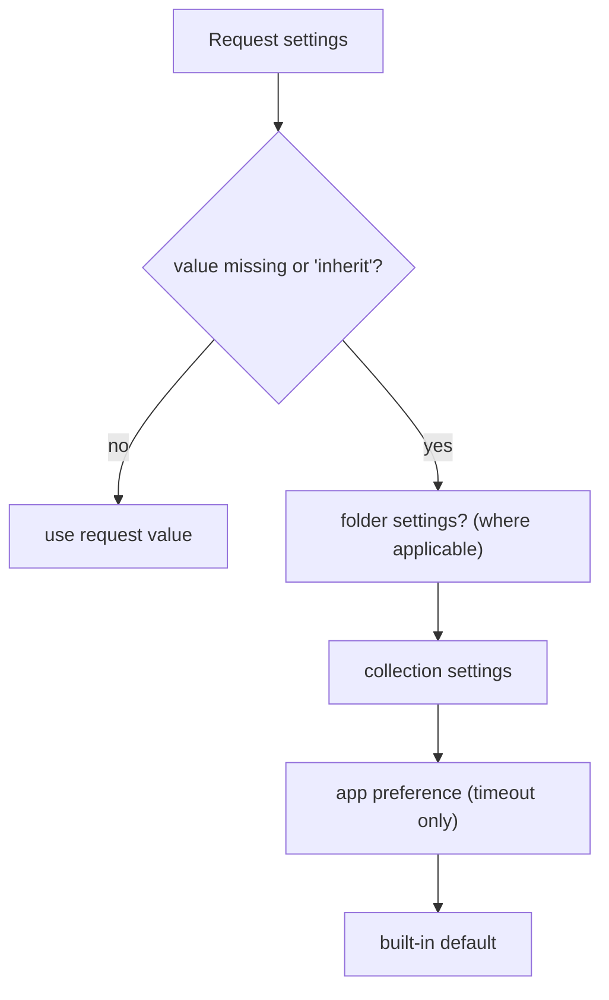

# Settings

Status: VERIFIED unless marked.

Three levels of settings exist. Confusing them is a common source of "why did my request behave differently".

| Level | Where | Scope |
|---|---|---|
| **App preferences** | Preferences modal (`⌘/Ctrl + ,`) | Whole app, persisted in `electron-store` |
| **Collection / folder settings** | Collection header → Settings; folder settings | Subtree |
| **Request settings** | Request pane → Settings tab | Single request |

---

## 1. Preferences tabs (VERIFIED)

From `components/Preferences/index.js`:

| Tab | Content |
|---|---|
| **General** | SSL/TLS certificate verification; custom CA certificate (choose + remove + keep defaults); store cookies automatically; send cookies automatically; use system browser for OAuth2 authorization; enable auto save; auto-save delay (ms); request timeout (ms); default location |
| **Themes** | Light/dark + ~20 named themes |
| **Display** | Font size, zoom, theme-adjacent display options |
| **Proxy** | Mode (`off` / `on` / `system` / `pac`), protocol, hostname, port, auth (disabled/username/password), bypass proxy, PAC source |
| **Client Certificates** | List of client certs: domain, type (`cert` \| `pfx`), cert/key/pfx file paths, passphrase, disabled |
| **Keybindings** | View/override bindings (`getKeyBindingsForActionAllOS`), enable toggle |
| **AI** | Provider keys, autocomplete, security pane (out of scope for the port) |
| **Cache** | Clear cache |
| **Support** | Version info, links |
| **Beta** | Feature flags (`BETA_FEATURES`, e.g. mock server) |

---

## 2. Preference keys that affect the engine (VERIFIED)

| Key | Effect | Source |
|---|---|---|
| `request.timeout` | Global default / `inherit` target | `resolveInheritedSettings` |
| `request.storeCookies` | Persist `Set-Cookie` | `preferencesUtil.shouldStoreCookies()` |
| `request.sendCookies` | Send jar cookies | `preferencesUtil.shouldSendCookies()` |
| `request.sslVerification` (verify TLS) | `rejectUnauthorized` | `store/preferences.js` `shouldVerifyTls` (line 407) |
| custom CA settings | `ca` array on agents | `cert-utils.js` |
| proxy mode/config | Agent selection | `getCertsAndProxyConfig` |
| `useSystemBrowser` for OAuth2 | Auth UI path | `authorize-user-in-system-browser.js` |
| auto save | Debounced writes | `autosaveMiddleware` |
| `keybindingsEnabled` | Shortcut activation | `HotkeysProvider` |

---

## 3. Collection / folder settings

| Setting | Source |
|---|---|
| Name, description | `meta` block in `collection.bru` / `folder.bru` |
| Shared headers/query/auth/vars/scripts | `headers`, `query`, `auth`, `vars:*`, `script:*` blocks |
| Proxy config | `bruno.json → proxy` |
| Script module whitelist + context roots + flow | `bruno.json → scripts` |
| Client certificates | `bruno.json → clientCertificates` |
| Presets | `bruno.json → presets` |
| Folder auth mode `inherit` | `folder.bru` `auth { mode: inherit }` |

UI: `CollectionSettings`, `FolderSettings`, `InheritableSettingsInput`.

---

## 4. Request settings

See `ui/request-editor.md §12`. Values of `inherit` are resolved at execution time (`resolveInheritedSettings`), and **only `timeout`** actually has a global fallback. Other settings default to built-in values:

| Setting | Default when missing |
|---|---|
| `followRedirects` | `true` |
| `forwardAuthorizationHeader` | `true` |
| `maxRedirects` | `DEFAULT_MAX_REDIRECTS` (5) |
| `encodeUrl` | `false` |
| `timeout` | global preference |

Source: `prepare-request.js`/`configureRequest` and `utils/collection.js` `resolveInheritedSettings`.

---

## 5. Proxy settings detail

New format (VERIFIED, `proxy-util.ts`):

```ts
{ inherit: boolean, disabled?: boolean,
  config: { protocol, hostname, port, auth: { disabled?, username, password }, bypassProxy } }
```

Old format (`{ enabled: true|false|'global', … }`) is auto-migrated by `transformProxyConfig`. Modes:

| Mode | Meaning |
|---|---|
| `off` | Direct connection |
| `on` | Use explicit proxy config |
| `system` | Use OS/system proxy (from `system-proxy` store) |
| `pac` | Resolve via PAC script at `pac.source` |

---

## 6. Settings precedence diagram



In practice only `timeout` walks the full chain; other settings do not inherit from folders.

---

## 7. Go port guidance (PROPOSED)

1. Represent preferences as a versioned struct with explicit defaults and a migration function (Bruno already migrates proxy config).
2. Keep the three levels distinct in the UI; users are often confused about why `maxRedirects: 0` on a request beats the global.
3. Store preferences as plain JSON in the config dir; encrypt only secrets (API keys, client cert passphrases).
